# Prototype ② — 플레이어블 (Phase 8 · 9단계)

> 작성 2026-11-04 · 상태: **v0.3 — 9단계 반복 2: 캠페인 모드(마을·로스터·사당·지역 1~3), 플레이테스트 대기** (v0.3 변경은 [§10](#10-v03--9단계-반복-2-캠페인-모드), v0.2 는 [§9](#9-v02--9단계-반복-1-카드-정비))
> 근거: [핵심 규칙 v0.4](02-core-rules.md) · [영웅](03-heroes.md) · [탐험 규칙](05-exploration.md) · [첫 지역](05-region1.md) · [본진](06-base.md) §9~§10 · [Prototype ①](07-prototype.md) §11~§12(현재 규칙)
> 코드: `web/` (Vite + TypeScript + Preact) · 엔진은 `src/core/` 를 그대로 번들에 싣는다 · 자동 진행 봇은 `src/sim/bot.ts`
> 결과물: **`web/dist/artifact.html`** — 데이터·JS·CSS 를 모두 품은 HTML 한 장(v0.3 약 650KB, 외부 요청은 Google Fonts 뿐)

## 0. 한눈에

- 브라우저에서 첫 지역 「건너지 못한 나루」를 **신당(의뢰·파티·진형·보급품) → 저승길 지도 → 전투·기물·이벤트·덫·길굿 → 보스 → 결과**까지 끝까지 플레이한다.
- 전투는 Prototype ①의 헤드리스 엔진을 **한 줄도 바꾸지 않고** 그대로 돌린다(같은 규칙·같은 수치·같은 결정성). 엔진에서 바꾼 것은 데이터 읽기 방식 하나다(§6).
- 탐험(넋등·정찰·기습·그늘·덫·기물·이벤트·길굿·오방기·가호)은 이번에 처음 실행되는 규칙이다. 시뮬레이터에 없던 층이라 **플레이테스트로 맞출 값**이 많다(§7).
- **자동 진행**을 켜면 봇이 전투·지도·보상·길굿을 대신 둔다. 테스트와 접근성을 위한 장치다.
- 보스 길 56회 헤드리스 자동 진행(조합 56개를 한 번씩): **클리어 70% · 해원율 43% · 사망 0.75/원정 · 전투 8.7/원정 · 방 78% 방문**, 전멸 17회는 모두 보스 굴. **v0.2(카드 v0.3 + 길굿 강화)**: 클리어 68% · 해원율 44% · 사망 0.59/원정 · 전투 8.6/원정 · 방 78%, 전멸 18회 모두 보스 굴. (Prototype ① v0.2.1 원정 시뮬 중앙 65%와 비슷하다. 봇은 한 수 앞만 보고, 보스 굴은 방 60%를 밝힌 뒤 들어간다.)

## 1. 실행

저장소 루트에서:

```bash
npm install                 # 한 번 (vite · vite-plugin-singlefile · preact 는 devDependencies)
npm run web:dev             # 개발 서버 (http://localhost:5173)
npm run web:build           # 타입 검사(web/tsconfig.json) + web/dist/index.html (단일 파일)
npm run web:artifact        # build + web/dist/artifact.html (Artifact 페이지 계약 검사 포함)
npm run web:e2e             # web:artifact 후 artifact.html 을 Chromium 으로 띄워 원정 5판 + 스크린숏
npm run web:headless -- --runs 56 --commission boss   # 화면 없이 자동 진행만 (균형 점검용)
```

- `web:e2e` 옵션: `npm run web:e2e -- --only N`(N번째 판만, 0부터) · `-- --no-shots`(스크린숏 생략). Playwright·Chromium 은 미리 깔린 것을 쓴다(`require('playwright')`, 없으면 전역 경로).
- Google Fonts 는 e2e 가 `curl` 로 받아 캐시(임시 폴더)에서 내준다. 받지 못하면 대체 글꼴로 돈다(콘솔 오류 없음).
- `web/dist/` 는 빌드 결과라 git 에서 뺐다(`.gitignore`).

### Artifact 페이지 계약 (`web/scripts/artifact.mjs` 가 검사)

| 항목 | 처리 |
|---|---|
| 문서 뼈대 | `<!doctype>`·`<html>`·`<head>`·`<body>` 없음. 첫 줄 `<title>저승굿</title>`, 둘째 줄 `<meta name="claude:viewport-fit-sides" content="cover">`, 그다음 Google Fonts `<link>` 3개 · `<style>` · `<script type="module">` |
| 외부 자원 | Google Fonts 스타일시트만(나눔 브러시 · 고운 돋움, 대체 글꼴 스택 포함). 데이터 JSON 은 번들에 들어 있어 실행 중 요청이 없다 |
| 여백 | 바깥 틀 `padding-left/right: max(16px, env(safe-area-inset-*, 0px))`, 위아래는 `padding-block`. 화면 가장자리에 붙는 알림·창은 그 가장자리 `env(safe-area-inset-*)` 를 더한다. `vh` 대신 `height: 100%`·px 상한 |
| 테마 | 일부러 어두운 단일 테마. `:root` 에 색 토큰 + `color-scheme: dark`, `body` 배경은 토큰 |
| 금지 API | `alert/confirm/prompt`·`window.print`·다운로드·iframe 없음. 확인은 화면 안의 확인 줄로 |
| 폰 폭 | 390px 에서 가로 페이지 스크롤 없음(e2e 가 화면마다 검사). 손패만 자기 `overflow-x: auto` 안에서 넘긴다 |
| 저장 | `localStorage` 접근은 모두 try/catch. 저장소가 없어도 게임은 돈다(이어하기만 사라진다) |

## 2. 화면

### 2.1 표지 · 신당

| 390×844 | 1280×800 |
|---|---|
| 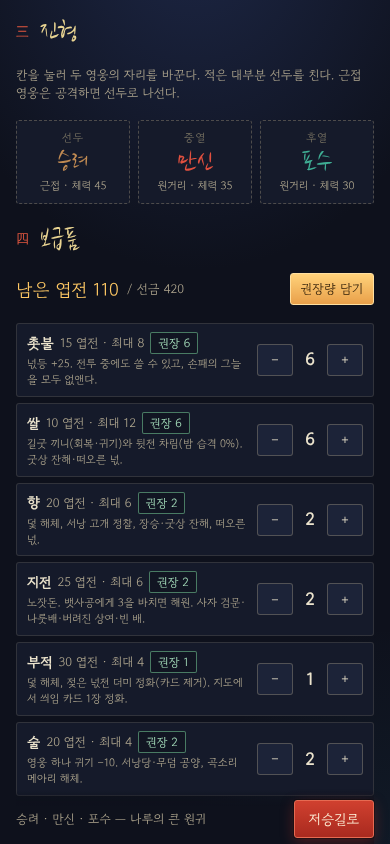 | 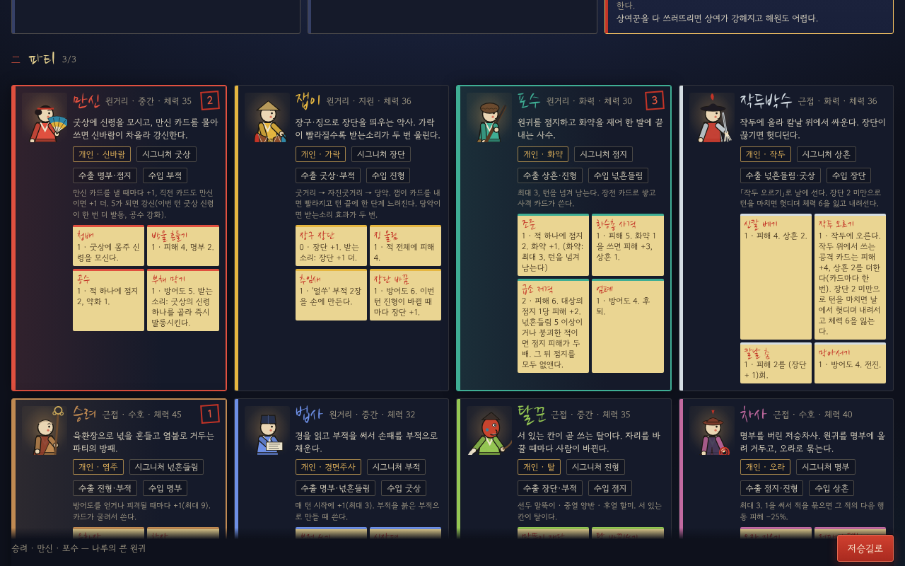 |

- **표지**: 「저승굿」, 새 원정 / 이어하기(저장된 원정이 있을 때) / 용어 도움말, 창작물 고지.
- **一 의뢰**: 짧음(떠내려간 아이 · 길 밝히기) · 보통(서낭 고개의 원귀 · 원귀 소탕) · **보스 길**(나루의 큰 원귀 · 보스 굴 위치와 정체를 미리 공개). 의뢰마다 방 수·수호 방·길굿 수·굿비 선금이 붙는다. 보스는 시드로 정해져 고를 때 보인다(뱃사공이면 "지전 3을 아껴라").
- **二 파티**: 8 원형 카드 — 거리·역할·체력, 개인 자원(설명), 시그니처·수출·수입(`heroes.json` + `synergy.json` 의 선택), 시작 카드 4장(작은 부적 모양). 3명을 누른 순서가 번호로 붙는다.
- **三 진형**: 선두·중열·후열 칸을 두 번 눌러 맞바꾼다. 기본은 엔진의 `defaultFormation`(수호 > 근접 > 체력).
- **四 보급품**: 6종 −/+ (값·묶음 한도), 의뢰별 **권장량**(탐험 §6 표) 표시와 「권장량 담기」, 남은 엽전. 시드 입력(같은 시드 = 같은 저승길).

### 2.2 저승길 (지도)

| 390×844 | 1280×800 |
|---|---|
| 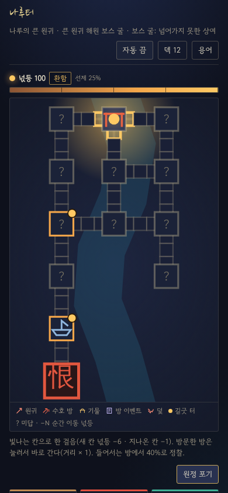 | 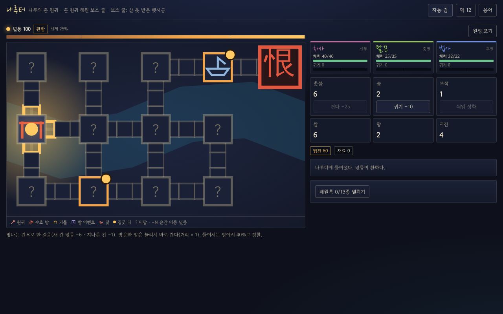 |

- 격자 위 방(사각)과 **길목 3칸**(작은 칸)의 지도. 신장 트리 + 고리 통로, 입구(홍살문 표시), 수호 방, 길굿 터(노란 점), 보스 길은 맨 끝 열에 **보스 굴(붉은 「恨」 인장)** 과 그 앞 **나루(나룻배 · 길굿 터 · 뱃사공의 나룻배 이벤트 고정)**. 강을 따라 길게 늘어진 사슬형(오른쪽으로 갈수록 방이 생길 확률이 높다). 폰에서는 지도를 세로로 돌려 그린다.
- 한 걸음: **빛나는 칸**을 누른다. 새 칸 넋등 −6, 지나온 칸 −1. 방문한 방은 눌러서 **바로 이동**(지나온 길목만, 넋등 = 칸 수 × 1, 확인 줄). 보스 굴은 들어가기 전에 확인한다.
- **넋등**: 막대 + 5구간 이름 + 지금 구간의 효과(선제/기습 확률, 그늘 장수, 적 피해, 엽전, 4택). 등불 빛(지도 위 둥근 빛)이 넋등만큼 넓다.
- **정찰**: 처음 들어서는 방에서 25% + 구간 보정으로 이웃 방·길목 내용 공개. 모르는 곳은 「?」.
- 옆 칸: 목표 진척(상단), 파티(체력·귀기·중상·회복 중), 보급품(촛불 켜기, 술로 귀기 −10, 부적으로 씌임 정화), 엽전·재료·치성, 가호, **다음 전투에 걸린 효과**, 기록, 해원록. 「길굿을 연다」(길굿 터에서) · 「목표 달성 — 귀환」 · 「원정 포기」(확인 줄) · 「다시 살펴본다」(손대지 않은 기물로 돌아왔을 때).

### 2.3 전투

| 390×844 | 1280×800 |
|---|---|
| 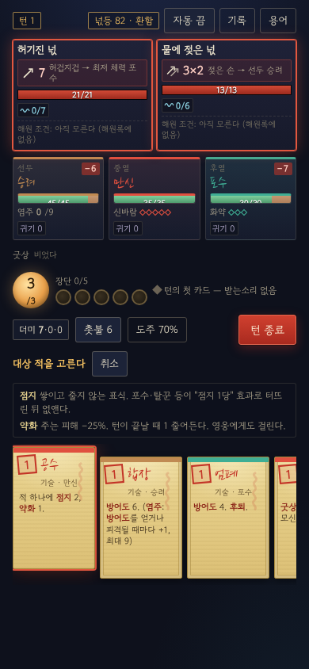 | 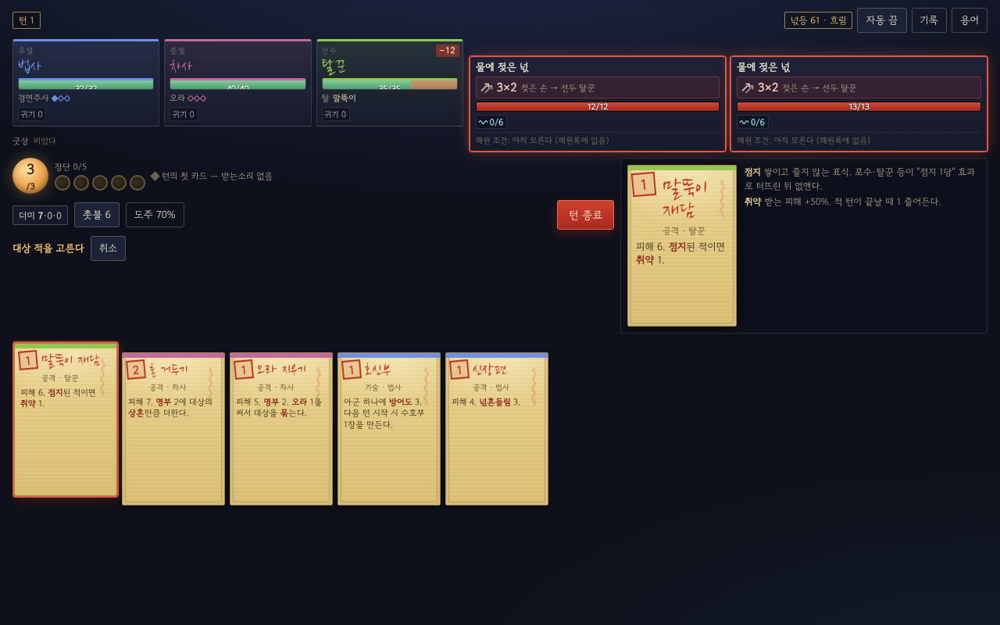 |

- **적**(앞 → 뒤: `region1.json` 의 position): 체력 막대(명부만큼 빗금 = 처형선), 방어도, 점지·상흔·명부·넋흔들림/버팀·붕괴·취약·약화·묶임·누적 공격 표식(그림 + 숫자), **의도 = 행동 그림 + 피해(타당×타수, 약화·묶기·넋등 배율 반영) + 대상 칸과 그 칸에 선 영웅 이름**. 붕괴면 「행동 취소」. 해원 조건(해원록에 있으면 문장, 지금 성립하면 ◆). 쓰러지면 **「해원」(빛) / 「처치」(어둠) / 「달아남」** 이 그 자리에 남고, 위에 알림이 뜬다(해원 → 서 있는 영웅 체력 +3).
- **영웅 3칸**(폰: 선두 → 후열, 데스크톱: 적을 향해 후열 → 선두): 칸 이름, 체력 막대(**보이는 의도로 예상한 피해**를 붉게 깜박이고 −N 배지), 방어도, 개인 자원(신바람 ◇5 · 가락 단계 이름 · 화약 · 작두 위/아래 · 염주 · 경면주사 · 탈 이름 · 오라), 약화·홀림·회복 중·중상·엄호·귀기. 쓰러지면 **넋 부르기 r/N 과 맞으면 버틸 확률**, 그 턴이면 「이번 턴 보호」.
- **굿상** 줄(설치물·남은 횟수), 낸 능력 이름.
- **에너지**(등불 원), **장단 북 5개** — 차오를수록 북이 빨리 뛴다(1장 1.1초 → 5장 0.32초), **받는소리 표시**(직전 카드 주인 색 + 이름, 턴 첫 카드면 "받는소리 없음"). 손패에서 **지금 내면 받는소리가 되는 카드에 붉은 「받」 인장**.
- **손패 = 부적**: 괴황지 바탕, 경면주사 붉은 획, 비용 인장, 붓글씨 이름, 위 띠 = 주인 영웅 색(합기는 두 색), 희귀도 테두리. 저주(씌임)는 잿빛 보라, 상태(그늘·상처·잡음)는 잿빛, 넋 부르기·곡은 흰 종이. 낼 수 없으면 어둡게.
- 카드를 누르면 **풀이(카드 문장 속 낱말 → 용어 도움말)** 와 대상 안내. 적 하나·아군 하나(엄호·교대·방어도/회복 대상)·쓰러진 아군·두 영웅(교대) 순서로 고른다. **대상이 하나뿐이면 묻지 않는다**. "다른 적 하나" 는 봇과 같이 체력이 가장 높은 다른 적.
- 더미(뽑을 · 버린 · 소멸, 뽑을 더미는 이름순), 촛불(넋등 +25, 손패 그늘 소멸), 도주(70% + 시도마다 5%, 보스 불가, 확인 줄), 턴 종료, 기록(엔진 로그 + 적 차례 요약 "적 · 나루 물귀신: 발목 잡기 → 선두 승려" + 피해).
- 전투 시작 알림: **선제**(첫 턴 +2장) / **기습당함**(−2장), 그늘 장수.

### 2.4 보상 · 오방기 · 가호

| 390×844 | 1280×800 |
|---|---|
| 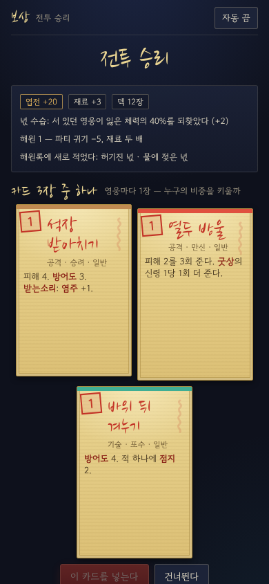 | 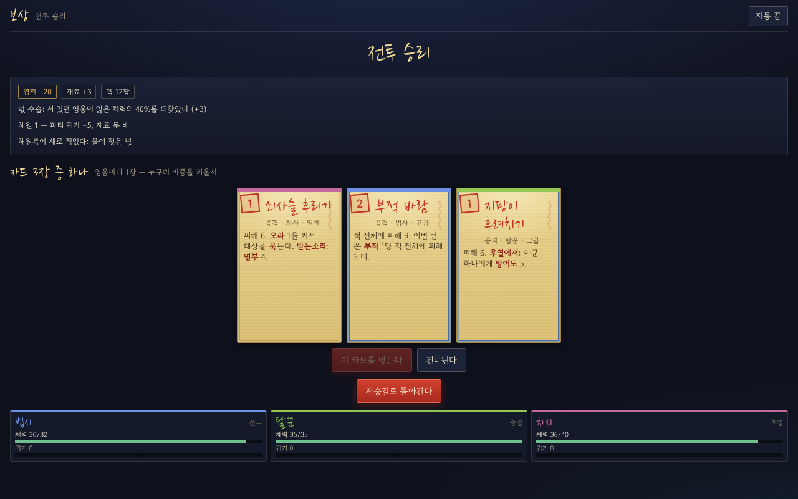 |

- 엽전(원귀 드롭 × 넋등 배율 × 걸립), 재료(해원 2배), 넋 수습(+N), 해원 수, 치성.
- **카드 3장 중 하나(영웅마다 1장)**, 어둠 이하 4택, 칠흑이면 희귀 1장 보장. 건너뛰기 가능. 희귀 보정(−5%에서 시작, 희귀가 아니면 +1%)은 원정 내내 이어진다.
- **수호 방**: 오방기 뒤집힌 깃발 3개(빨강 재수 · 흰색 명복 · 노랑 조상 → 가호 3택 · 파랑 우환 → 희귀 카드 3택 + 씌임, 검정은 칠흑일 때만). 「오방 깃발」 가호가 있으면 하나를 미리 본다.
- **보스**: 희귀 카드 3택 + 보스 가호 3택 → 「원정을 마친다」.

### 2.5 길굿

| 390×844 | 1280×800 |
|---|---|
| 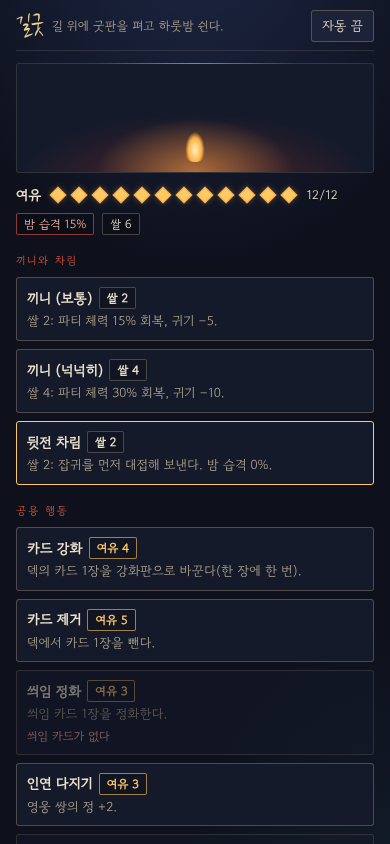 | 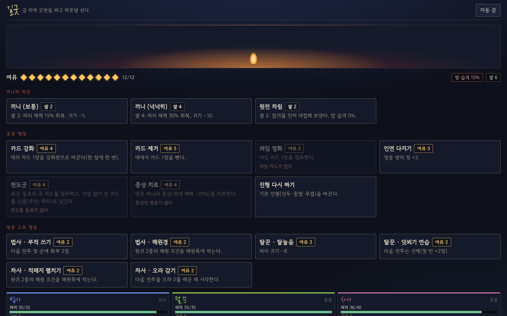 |

- **여유 12점**(마름모 12개). 끼니 보통(쌀 2: 체력 15%·귀기 −5) / 넉넉히(쌀 4: 30%·−10), 뒷전 차림(쌀 2: 밤 습격 0%).
- 공용: **카드 강화 4**(덱의 카드 1장 → 강화판, v0.2) · 카드 제거 5 · 씌임 정화 3 · 인연 다지기 3(쌍 선택) · 천도굿 4 · 중상 치료 4 · 진형 다시 짜기(0).
- **카드 강화**: 고르기 창에 덱의 강화할 수 있는 카드가 **강화판 모습**으로 놓인다(금박 테두리 · 「강」 인장 · 이름 뒤 +). 카드 아래 한 줄이 바뀌는 점을 보여 준다(비용 1→0 · +선천 · 숫자 5→7, 문장이 바뀌면 "효과 강화"). 한 장에 한 번, 저주·상태·곡·넋 부르기는 고를 수 없다. 「삼지창 사슬」 가호가 있으면 막힌다(까닭 표시). 강화한 카드는 손패·더미·덱 보기·보상 어디서나 강화판으로 보인다.

| 강화 고르기 390×844 | 1280×800 |
|---|---|
| 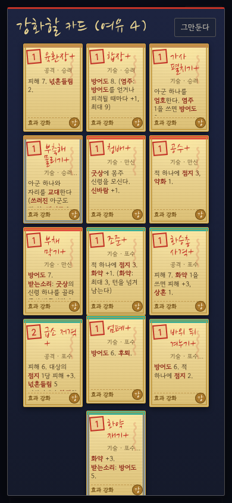 | 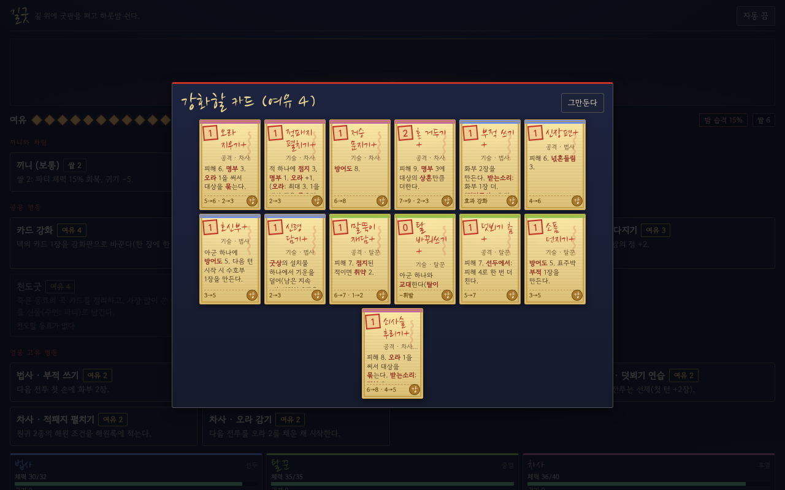 |

- 영웅 고유 2개씩(파티에 있는 영웅만, 길굿마다 한 번). 문서 예시 3개(가락 맞추기·밤 염불·망보기) 외에는 이번에 정한 가정값이다:

| 영웅 | 행동 1 | 행동 2 |
|---|---|---|
| 만신 | 공수 받기(2): 미답 방 2곳 정찰 | 몸주 모시기(3): 다음 전투를 굿상에 몸주 신령을 모시고 시작 |
| 잽이 | 가락 맞추기(2): 다음 전투 첫 턴 장단 +2 | 흥 돋우기(3): 파티 귀기 −8 |
| 포수 | 망보기(2): 밤 습격 0% | 화약 재기(2): 다음 전투 화약 2 |
| 작두박수 | 날 세우기(2): 다음 전투를 작두 위에서 시작 | 신칼 닦기(3): 자기 귀기 −15, 체력 +5 |
| 승려 | 밤 염불(3): 파티 귀기 −10 | 약손(3): 가장 다친 아군 체력 +8 |
| 법사 | 부적 쓰기(2): 다음 전투 첫 손에 화부 2장 | 해원경(2): 해원 조건 2종 공개 |
| 탈꾼 | 탈놀음(3): 파티 귀기 −8 | 덧뵈기 연습(2): 다음 전투 선제 |
| 차사 | 적패지 펼치기(2): 해원 조건 2종 공개 | 오라 감기(2): 다음 전투 오라 2 |

- 「길굿을 마친다」에서 **밤 습격**(기본 15%, 표시) 판정 → 습격이면 어려움 풀 전투(첫 전투로 친다, 카드 보상 있음).

### 2.6 결과

| 390×844 | 1280×800 |
|---|---|
| 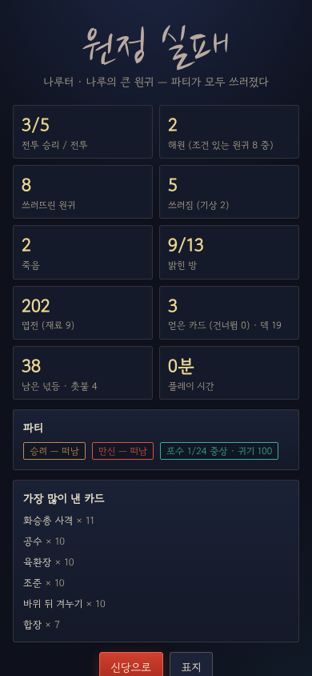 | 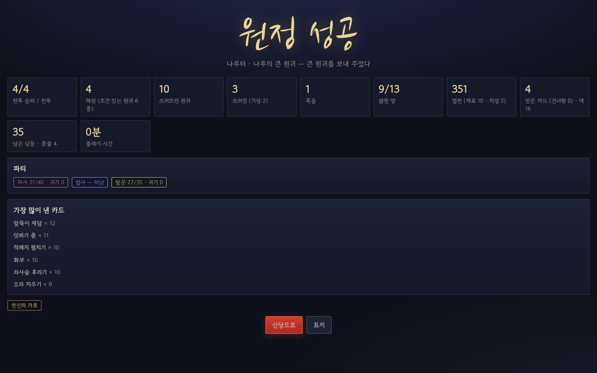 |

- 원정 성공/실패와 까닭, 전투 승리/전투, **해원 수(조건 있는 원귀 중)**, 쓰러뜨린 원귀, 쓰러짐(기상), 죽음, 밝힌 방, 엽전·재료·치성, 얻은/건너뛴 카드와 덱 크기, 남은 넋등·촛불, 플레이 시간, 파티의 마지막 상태, **가장 많이 낸 카드 6장** → 「신당으로」.

### 2.7 창 · 도움말

- **기물**: 세 갈래(맨손 / 맞는 보급품 / 영웅 고유)와 「손대지 않는다」. 막힌 갈래는 까닭(보급품이 없다 · 파티에 ○○이 없다 · 강화할 카드가 없다)을 붉게 보여 준다. 결과 문장 → 이어지는 동작(전투·카드 3택·카드 제거·카드 변환·**카드 강화**·진형). 서낭당 돌무더기에 「술」을 올리면 아무 카드 1장, 망자의 봇짐을 작두박수가 풀면 작두박수 카드 1장을 강화한다(v0.2).
- **방 이벤트**: 선택지마다 비용·필요 영웅·결과. **덫**: 미리 본 덫이면 해체(향·부적·술) 또는 조심해서 지나가기(50%), 모르고 밟으면 바로 결과.
- **용어 도움말**(표지·신당·지도·전투 어디서나): 핵심 규칙 §10·§13·§14 와 탐험 용어 66개(v0.2: 「강화」), 갈래별, 찾기. 카드 문장 속 같은 낱말은 붉은 굵은 글씨(마우스를 올리면 풀이), 카드를 누르면 그 카드의 낱말 풀이가 아래에 모인다.
- **덱 보기**(지도), 더미 보기(전투), 전투 기록.

## 3. 구현 · 간소화 · 제외

### 3.1 그대로 구현

| 영역 | 내용 |
|---|---|
| 전투 규칙 | Prototype ① 엔진 전부(v0.4: 넋 수습 40%·해원 회복 +3·쓰러진 턴 보호·신바람 v0.2·상여 125 등). 카드 291장 + 부적·설치물, special 14장, 적 15종, 조합 15개 |
| 던전 생성 | 탐험 §2 표 그대로: 방 수(짧음 8~9 · 보통/보스 길 12~13 + 보스 굴), 수호 방 0~1/1~2, 고리 통로 1/3, 길목 3칸, 방 내용 전투 45 · 기물 28 · 이벤트 10 · 빈 방 17%, 칸 내용 전투 14 · 기물 17 · 덫 8 · 빈 칸 61% (`dungeon_sim.py` 와 같은 표) |
| 이동 | 새 칸 −6 · 지나온 칸 −1 · 방문한 방 순간 이동(거리 × 1) · 정찰 25% + 구간 보정 · 어두운(≤25) 지나온 칸 재출현(8%, 카드 보상 없음) |
| 넋등 5구간 | 정찰 보정, 선제/기습 확률(문간 금줄 −15%p), 그늘 1/2/3장(전투 1회 새 상태 카드 상한 4 — 엔진의 `statusAdded` 에 미리 더한다), **적 피해 배율은 엔진 `RuleVariant.enemyDmgMult`**, 엽전 배율, 4택, 희귀 확률↑, 칠흑 희귀 보장, 칠흑에서만 검정기 |
| 전투 순서 | 원정 첫 2전투 쉬움 → 이후 어려움(6종을 다 쓴 뒤에만 반복, 연속 금지), 수호 방은 엘리트 3종을 모두 만나야 반복 |
| 보급품 | 촛불(지도·전투), 쌀(끼니·뒷전·기물), 향(덫·정찰·기물), 지전(뱃사공 노잣돈 = 엔진 `jijeon`, 사자 검문·나룻배·상여·빈 배), 부적(덫·정화·넋전), 술(귀기 −10·공양·메아리) |
| 보상 | 엽전·재료·치성, 카드 3/4택(영웅마다 1장), 희귀 보정, 오방기 5색, 가호 3택, 보스 희귀 카드 + 보스 가호 |
| 기물 8 · 이벤트 6 · 덫 3 | `region1.json` 의 모든 갈래(아래 간소화 제외) |
| 길굿 | 여유 12점, 끼니 2종, 뒷전 차림, 제거·정화·인연·천도굿·중상 치료, 영웅 고유 16개, 밤 습격 |
| 의뢰 목표 | 길 밝히기(방 75%) · 원귀 소탕(방 전투 전부, 수호 방 포함) · 큰 원귀 해원(보스). 달성하면 어디서든 귀환. 포기(귀기 +20, 보수 없음) |
| 쓰러짐·죽음 | 엔진 그대로(넋 부르기·사망 판정·쓰러진 턴 보호). 이긴 전투에서 쓰러져 있던 영웅은 체력 1·중상, 넋 수습에서 빠진다. 죽은 영웅의 카드는 곡으로, 전멸이면 영웅마다 50% 사망 판정 |
| 귀기·씌임 | 전투 안은 엔진(50·100 → 그 영웅의 씌임 카드). 탐험 귀기도 같은 임계로 씌임 카드를 넣는다. 해원 1회 = 파티 귀기 −5 |
| 해원록 | 원귀를 한 번 만나면 해원 조건이 기록된다(브라우저에 저장, 원정을 넘어 남는다). 그 전에는 「아직 모른다」. 물가 무덤(차사)·빈 배/나룻배(지전)·해원경·적패지로 미리 공개 |
| 저장 | 지도·전투(엔진 상태 통째, 통계 Map 포함)·보상·길굿·창 상태를 행동마다 `localStorage` 에. 새로고침 → 「이어하기」 로 같은 턴에서 이어진다(e2e 로 확인) |
| 자동 진행 | 전투 = `bot.ts` 의 `evaluate`/`enumerateActions` 로 `playTurn` 과 같은 한 걸음을 카드 한 장씩, 보상 = `draft.ts` 의 `pickReward`·`rewardScore`, 지도 = 가까운 미답 방(보스 길은 방 60%를 밝히면 나루 길굿 → 보스 굴), 넋등 26 미만이면 촛불, 기물은 영웅 고유 > 보급품 > 맨손. 빠르기 보통 / 빠름 / 즉시 |

### 3.2 가호 17종

| 상태 | 가호 |
|---|---|
| 그대로 (13) | 터주(첫 턴 선두 방어도 5) · 걸립(엽전 +20%) · 조왕(끼니 두 배) · 성주(최대 체력 +4) · 문간 금줄(기습 −15%p) · 업항아리(해원 재료 +1) · 산신(장단 첫 5 → 1장, 턴마다) · 서낭(덫을 항상 미리 봄) · 대감(승리마다 엽전 +10, 2전투마다 쌀 1 공물, 없으면 씌임 「대문 흔들기」) · 오방 깃발(깃발 하나 미리 보기) · 제석(받는소리 3연속 → 에너지 +1, 턴당 1회) · 천신(에너지 +1, 그늘 1장) · 삼지창 사슬(에너지 +1, 길굿 강화 불가) |
| 근사 (2) | 명도 한 닢: 개인 자원 +1 — 작두박수(작두에 오르게 됨)·탈꾼(자원 없음)은 건너뛴다 · 대신방울: 에너지 +1, 손패 8장 — 턴 시작 드로우 뒤 8장을 넘는 카드를 버린다(턴 중 드로우는 엔진 상한 10까지) |
| ~~효과 없음 (2)~~ | **v0.3: 모두 구현** — 용왕(엔진 `familyDmg`: 수귀에게 주는 피해 ×1.25) · 칠성(`deathSave` +0.15) · 명도 한 닢(작두박수는 작두에 오른 채 첫 턴 헛디딤 없이, 탈꾼은 한 칸 앞으로 나서며 탈이 바뀐 채) · 대신방울(엔진 손패 상한 8) |

### 3.3 간소화

| 무엇 | 문서 | 이번 구현 |
|---|---|---|
| 사자 검문 「버틴다」 | 사자 셋과 놀이 싸움, 피해가 체력 대신 귀기로 | ~~잡귀 셋, 끝나면 체력을 되돌림~~ → **v0.3: 놀이 사자 셋**(군졸 차림, 원귀 아님). 엔진 `play` 규칙: 영웅이 받는 피해는 **전투 안에서 바로 귀기로** 들어가고 쓰러지지 않는다(50·100 문턱의 씌임도 그대로). 5턴 안에 이기면 엽전 20, 못 이기면 귀기 +15, 어느 쪽이든 통과 |
| 잘못 끌려온 사람 「데려다준다」 | 그 사람(체력 20)을 지키며 잡귀 무리를 3턴 버틴다 | ~~그 사람은 맞지 않는다~~ → **v0.3: 산 사람(체력 20)**이 파티 뒤를 따른다(엔진 `ward`). 선두를 노린 공격은 **선두에 방어도가 없으면 그 사람이 맞는다**. 세 턴을 버티거나 잡귀를 모두 쓰러뜨리면 치성 +1, 그 사람이 쓰러지면 호위 실패(귀기 +10) |
| 헛굿 판 「씌임 임계치 +N」 | 임계치 자체를 올림 | 엔진 임계(50·100)가 상수라 **전투에 들어갈 때 귀기를 N만큼 낮춰 넘기고 끝나면 되돌린다**(귀기가 N보다 낮을 때는 오차). 탐험 귀기는 50+N 으로 판정 |
| 넋등 귀기 배율 | 어두울수록 귀기 +10~40% | 탐험 귀기에는 바로, **전투 중 귀기는 끝난 뒤 차이만큼 더한다**(임계를 넘으면 그때 씌임) |
| 재출현 전투 | 낮은 확률 | 넋등 25 이하에서 지나온 칸을 걸을 때 8%. 순간 이동에는 없다 |
| 천도굿 · 신물 | 가장 많이 쓴 카드의 기념판, 주인 '파티' | 그 영웅 카드 중 **피해·상태를 거는 카드** 가운데 가장 많이 쓴 것(주인 없는 카드의 '방어도'·'개인 자원' 효과는 엔진에서 대상이 없어 빈 효과라서) |
| 길굿 영웅 행동 | 원형마다 2개(예시 3개) | 나머지 13개는 이번에 정한 가정값(§2.5 표) |
| 물가 무덤 「술」 | 같은 영웅의 다른 카드로 변환 | 그 영웅 보상 풀에서 무작위 |
| 장승 「향」 | 숨은 고리 통로 + 인접 방 정찰 | 지금 방과 격자로 이웃한 방 사이에 길목(빈 칸 3)을 새로 낸다 |
| 기본 진형 | — | 신당에서 정하고 길굿·장승(탈꾼)에서 바꾼다. **v0.3: 전투가 끝난 자리 그대로 다음 전투를 시작한다**(진형 유지) |
| 엽전 | 보급품·치료·장비 | 원정 안에서는 쓸 곳이 없다(본진 메타 제외). 선금에서 남긴 엽전 + 전리품이 결과에 남는다 |
| 보급품 값·굿비 | 문서에 없음 | 촛불 15 · 쌀 10 · 향 20 · 지전 25 · 부적 30 · 술 20, 선금 짧음 200 · 보통 350 · 보스 길 420 (권장량을 사고 조금 남는 정도). 보스 길 권장량: 촛불 6 · 쌀 6 · 향 2 · 지전 4(뱃사공)/2(상여) · 부적 1 · 술 2 |

### 3.4 제외 (이번 범위 밖)

- 본진 메타(시설·제작·익힌 카드·로드아웃·승급·피로·묘역), 인연으로 여는 **합기 카드**(정은 쌓이지만 보상에 합기가 나오지 않는다), 재료·치성의 쓰임.
- 칠흑의 「저승 그림자 출현」(적 데이터 없음), 보스 길 이외 지역, '김' 길이 의뢰.
- 원정 중 천도굿을 치르지 못한 넋이 씌임의 원인이 되는 규칙.

## 4. 검증

| 검사 | 결과 |
|---|---|
| `npm run typecheck` | 통과 (루트 tsconfig 에 `resolveJsonModule` 추가) |
| `npm test` | 38/38 (v0.2: 강화판 6 · 데이터 수정 6 추가) |
| `npm run sim:combat` · `npm run sim:expedition -- --runs 200` | **결과 동일** — 커밋된 `data/sim/combat.json`·`expedition.json` 과 비교해 `meta.generated`·`runtimeSec` 두 줄만 다르다(중앙 65% · 최소 43 · 최대 86). 비교 뒤 파일은 되돌렸다 |
| `npm run web:build` | 타입 검사(web/tsconfig.json) + 단일 HTML |
| `npm run web:artifact` | 계약 검사 통과, `web/dist/artifact.html` 약 470KB |
| `npm run web:e2e` | 5판 모두 결과 화면까지, 콘솔 오류 0, 폰 폭 가로 스크롤 0. v0.2: 스크린숏 판(A·B)의 첫 길굿에서 「카드 강화」 → 고르기 창에 강화판(「강」 인장) → 그만두기 → 여유 12 그대로를 확인 |

### e2e (보스 길, 자동 진행)

| 판 | 파티 | 시드 · 보스 | 화면 | 결과 | 걸린 시간 |
|---|---|---|---|---|---|
| A | 승려 · 만신 · 포수 | 101 · 상여 | 390×844, 스크린숏(빠름) | 실패 — 보스에서 전멸 (전투 4/5, 해원 3/8) | 약 25초 |
| B | 차사 · 법사 · 탈꾼 | 202 · 뱃사공 | 1280×800, 스크린숏(빠름) | **성공** (전투 4/4, 해원 4/6, 사망 1) | 약 34초 |
| C | 잽이 · 작두박수 · 차사 | 303 · 상여 | 390×844 (즉시) | **성공** (전투 8/8, 해원 6/16) | 약 2초 |
| D | 승려 · 잽이 · 법사 | 404 · 뱃사공 | 1280×800 (즉시) | 실패 — 보스에서 전멸 (전투 7/8) | 약 2초 |
| E | 탈꾼 · 포수 · 승려 | 505 · 상여 | 390×844, **손으로**: 지도 걷기 → 첫 전투에서 카드·대상 고르기 → 턴 종료 → 새로고침 → 이어하기(같은 턴) → 용어·더미·기록 창 → 자동 진행으로 끝까지 | **성공** (전투 11/11, 해원 10/23) | 약 3초 |

## 5. 엔진에서 바꾼 것 (브라우저에서 돌리기 위해서만)

| 파일 | 변경 |
|---|---|
| `src/core/raw-data.ts` (새) | `data/cards/*.json`·`data/design/{heroes,region1,synergy}.json` 을 **정적 JSON import**(`with { type: 'json' }`)로 묶는다. Node(tsx)와 Vite 가 같은 방식으로 읽는다 |
| `src/core/data.ts` | `readFileSync` 대신 `RAW_JSON[경로]`. `node:fs`·`node:path`·`node:url` 의존이 사라졌다 |
| `src/sim/root.ts` (새) | 저장소 루트 경로 `ROOT` 를 `data.ts` 에서 옮겼다(시뮬레이터가 결과 파일을 쓸 때만 쓴다). `combat-sim.ts`·`expedition-sim.ts`·`report.ts` 의 import 한 줄씩 |
| `tsconfig.json` | `resolveJsonModule: true` |

규칙·수치·봇은 바꾸지 않았다. 웹 쪽은 엔진의 공개 함수(`createCombat`·`playCard`·`endPlayerTurn`·`enemyTurn`·`startPlayerTurn`·`finishCombat`·`addPersonal`·`addJangdan`·`gainBlock`·`drawCards`)와 상태 필드(`formation`·`summons`·`energy`·`nextEnergy`·`statusAdded`)만 만진다.

```
web/
  index.html  vite.config.ts  tsconfig.json
  src/main.tsx  app.tsx  styles.css
  src/game/   content(지역·영웅·보급품·의뢰·넋등) · dungeon(생성·경로) · run(이동·정찰·귀기·해원록·결과) · combat(전투 세션·가호·의도 보기·봇 한 걸음)
              rewards(카드·오방기·가호) · encounters(기물·이벤트·덫) · camp(길굿) · actions · autoplay · save · store · glossary · types
  src/ui/     shrine(표지·신당) · map · combat · screens(보상·길굿·결과·창·도움말) · common(부적 카드·표식·넋등·장단 북) · auto
  scripts/    artifact.mjs(계약 검사) · e2e.mjs(Playwright) · headless.ts(균형 점검)
```

## 6. 시각 방향

- 바탕은 순흑이 아니라 **먹·쪽빛 밤**(#0e111c 위에 위쪽 남색 안개, 아래 청록 물빛). 지도에는 지역 이름처럼 **흐르는 강**을 깔았다.
- **카드 = 부적**: 노란 괴황지(종이결 줄무늬), **경면주사 붉은 획**(오른쪽 세로 획, 붓글씨 카드 이름, 비용 인장), 위 띠에 주인 색. 저주는 잿빛 보라, 상태는 잿빛.
- **오방색**이 강조 체계: 적(경면주사 — 위험·대상·주요 단추), 황(넋등·여유·가호), 청(방어도·물), 백(해원의 빛), 흑(바탕). 영웅 8색: 만신 주홍 · 잽이 황 · 포수 청록 · 작두박수 백(날) · 승려 괴색 · 법사 쪽빛 · 탈꾼 연두 · 차사 자주.
- 글꼴: 붓글씨 **나눔 브러시**(제목·카드 이름·영웅 이름·화면 머리, 아껴 씀) + 읽기 쉬운 **고운 돋움**(본문). 대체 글꼴 스택 포함.
- 표식은 이모지 없이 작은 SVG(점지 = 과녁, 상흔 = 칼금, 명부 = 문서, 넋흔들림 = 물결, 붕괴 = 갈라짐, 묶임 = 오라 고리 …). `prefers-reduced-motion` 이면 북·깜박임·뒤집기 움직임을 끈다.
- 재현 윤리(영웅 §8): 피·상처 묘사 없음, 씌임은 "귀신이 붙었다", 검은 갓 저승사자 이미지 없음(사자 검문은 문장만), 보스 굴은 「恨」 인장 하나.

## 7. 알려진 문제

1. ~~해원 조건이 처음엔 보이지 않는다~~ → v0.3: 지도의 해원록이 **그 지역 원귀 전체**를 보여 주고(아는 것 · 「아직 모른다」 · 해원 횟수), 전투 보상에 「해원록에 새로 적었다: …」를 알린다. 캠페인에서는 해원록이 캠페인 전체에 이어진다. (원래 문장:) **해원 조건이 처음엔 보이지 않는다**(설계대로: 해원록). 첫 원정의 첫 만남마다 「아직 모른다」라서 해원을 쫓기 어렵다. 해원록은 브라우저에 남으니 두 번째 원정부터 보인다. 플레이테스트에서 너무 답답하면 "첫 만남부터 공개" 로 바꾸기 쉽다(`haewonView`).
2. ~~용왕·칠성의 가호는 효과가 없다~~ → v0.3 에서 모두 구현(§3.2).
3. ~~카드 강화는 어디서도 할 수 없다~~ → v0.2 에서 열었다(§2.5). 자동 진행 봇은 길굿에서 영웅 고유 행동을 먼저 하고, 남은 여유로 **가치가 가장 많이 오르는 카드**를 강화한 뒤 제거를 한다.
4. 전투 중 넋등 귀기 배율은 전투가 끝난 뒤 더한다. 헛굿의 씌임 임계치는 귀기를 낮춰 넘기는 근사.
5. 자동 진행 봇은 보스 길에서 **방 60%를 밝히면 보스로 간다**(전투 평균 8.7회). 사람은 더 넓게 돌 것이라 덱이 더 크고 넋등은 더 모자랄 수 있다. 봇 클리어 70%는 한 수 앞 봇 기준이다.
6. 원귀 소탕의 진척 「n/N」 은 아직 들어가 보지 않은 방의 원귀 수까지 센다(의뢰서에 원귀 수가 적혀 있다고 본다).
7. 전투 기록은 엔진 로그(카드·쓰러짐·해원·처형·붕괴·강신)와 적 차례 요약이다. 적 한 마리씩의 피해 숫자는 따로 보이지 않는다(피격 영웅의 체력 감소 합만).
8. 이어하기 뒤에는 그 전투의 앞 기록이 비어 있다(저장 크기 때문에 엔진 로그를 저장하지 않는다).
9. ~~진형은 전투 사이에 이어지지 않는다~~ → v0.3: 진형 유지.
10. Google Fonts 를 못 받으면 붓글씨가 궁서·바탕 계열로 대체된다.
11. 데스크톱 전투 화면은 위아래 여백이 남는다(손패가 아래로 붙지 않음). 1280×800 에서 한 화면에 들어오는 것만 맞췄다.

## 8. 플레이테스트 체크리스트 (디자이너가 플레이하며 답할 것)

**전투 감각**
- [ ] 장단 북(빨라지는 박자)과 「받」 인장만 보고 받는소리를 이어 낼 수 있었나? 받는소리를 일부러 노린 턴이 있었나?
- [ ] 의도의 **대상 칸 + 영웅 이름 + 피해**만으로 "누구를 마지막에 공격시킬까(돌격)" 를 계획할 수 있었나? 영웅 칸의 −N 예상 피해를 봤나?
- [ ] 쓰러진 턴 보호(「이번 턴 보호」)를 알아챘나? 넋 부르기 r/N 과 버틸 확률을 보고 "구할까, 공격할까" 를 고민했나?
- [ ] 해원 ◆(지금 성립) 표시를 보고 막타 순서를 바꾼 적이 있나? 해원 조건이 처음에 숨겨진 것이 답답했나, 발견하는 재미였나?
- [ ] 한 판 전투가 몇 분 걸렸나? 카드를 고르는 두 번 누르기(풀이 → 내기)가 번거로웠나?
- [ ] 개인 자원(신바람·가락·화약·작두·염주·경면주사·탈·오라)이 영웅 칸에서 읽혔나? 강신·당악·헛디딤을 경험했나?

**원정 감각**
- [ ] **넋 수습(잃은 체력 40%)** 이 너무 후한가? 길굿 끼니를 쓸 일이 있었나?
- [ ] 넋등이 시계처럼 느껴졌나? 촛불 6개가 남았나 모자랐나? 어스름·어둠의 보상(4택·엽전)을 노려 일부러 어둡게 간 적이 있나?
- [ ] 선제·기습·그늘이 체감됐나? 다음 전투 확률 표시를 봤나?
- [ ] 보스 길 한 판이 **45~60분** 안에 들어왔나? 보스 전에 방을 몇 개나 밝혔나? 지도가 너무 크거나 작은가?
- [ ] 순간 이동(방문한 방 누르기)이 되돌아가기의 지루함을 없앴나?
- [ ] 기물의 세 갈래가 선택처럼 느껴졌나(보급품을 아낄까, 맨손으로 운을 볼까)? 영웅 고유 갈래가 "이 영웅을 데려오길 잘했다" 를 만들었나?
- [ ] 덫을 정찰로 미리 보고 피한 적이 있나? 덫이 의미 있는 손해였나?
- [ ] 길굿 여유 12점이 모자랐나 남았나? 어떤 행동을 골랐나? **카드 강화(4)와 카드 제거(5) 중 무엇을 더 자주 골랐나?**
- [ ] 강화판(금박·「강」 인장·이름 뒤 +)이 손패에서 한눈에 구별됐나? 고르기 창의 바뀌는 점 한 줄(5→7, 비용 1→0, +보존)로 어떤 카드를 강화할지 판단할 수 있었나?
- [ ] 카드 보상 "영웅마다 1장" 이 누구의 비중을 키울지 고민하게 했나? 건너뛴 적이 있나?
- [ ] 수호 방 오방기가 기대감을 줬나?

**보스 · 경제**
- [ ] 뱃사공: 지전 3을 아껴 노잣돈을 바쳤나? 보급품 준비 단계에서 그 계획을 세웠나?
- [ ] 상여: 상여꾼을 살려 두고 상여를 노리는 해원의 딜레마가 읽혔나?
- [ ] 권장량·보급품 값·선금이 적당했나? 남는 엽전이 쓸 곳이 없어 아쉬웠나?

**화면 · 접근성**
- [ ] 폰(390px)에서 손패 넘기기·대상 누르기·지도 칸 누르기가 편했나? 오조작이 있었나?
- [ ] 용어 도움말과 카드 낱말 풀이로 처음 보는 낱말을 이해했나? 빠진 용어는?
- [ ] 자동 진행이 테스트·관전에 도움이 됐나? 빠르기가 적당했나?
- [ ] 톤: 씌임 표현, 상여·저승 연출이 처연함 쪽에 있었나(공포·고어로 기울지 않았나)?

## 9. v0.2 — 9단계 반복 1: 카드 정비

> 2026-11-04 · 근거: [카드 v0.3](04-cards.md) §2.1·§3.1 · [Prototype ① §13](07-prototype.md#13-v03--반복-1)

| 무엇 | 전 | 후 |
|---|---|---|
| 길굿 카드 강화 | 막아 둠 | **여유 4**: 덱의 카드 1장 → 강화판(§2.5). 「삼지창 사슬」이면 막힘 |
| 서낭당 돌무더기 「술」 | 막아 둠 | 공양 → 아무 카드 1장 강화 |
| 망자의 봇짐 (작두박수) | 재료 1 (강화 생략) | 재료 1 + 작두박수 카드 1장 강화(강화할 카드가 없으면 재료만) |
| 강화판 표시 | — | 금박 테두리 · 「강」 인장 · 이름 뒤 + (손패·더미·덱 보기·고르기 창). 고르기 창은 바뀌는 점 한 줄 |
| 결과 화면 | 얻은 카드 · 건너뜀 | + 강화 수 |
| 자동 진행 | 길굿: 끼니 → 영웅 행동 → 제거 | 끼니 → 영웅 행동 → **강화(가치가 가장 많이 오르는 카드)** → 제거 |
| 용어 도움말 | 65 | 66 (「강화」) |
| 저장 | `run.v` 1 | **2** — 강화판 정의와 새 설치물(제석 신령+ 등)로 정의 번호가 바뀌어 v1 저장은 「이어하기」에서 빠진다 |
| 카드 데이터 | v0.2.1 | 카드 v0.3: 강화판 280장, 가치 모델 교정(S10)에 따른 수치 조정 62장 + 부적 2, 07 §9 데이터 불일치 수정 — [07 §13](07-prototype.md#13-v03--반복-1) |

- 엔진 쪽: 강화판은 `loadData()` 가 기본판·부적 뒤에 **별도 정의(id+)** 로 붙인다(기본판 번호는 그대로). 강화된 카드 인스턴스는 `d` 가 강화판 정의를 가리키고(`CardDef.upgraded`), `upgradeInst`·`isUpgraded`·`canUpgrade`(`src/core/data.ts`)로 다룬다. 엔진·봇은 정의만 읽으므로 강화판의 효과·비용·키워드(선천·보존 포함)가 그대로 적용된다. 쓰러짐(넋 부르기)·죽음(곡)·기상 뒤에도 강화판으로 돌아온다(테스트).
- 시뮬레이터(`sim:expedition`)의 길굿은 v0.2 와 같다(끼니 또는 시작 카드 제거, 강화 없음) — 7단계 기준선과 비교하기 위해서다. 강화가 원정 난이도에 주는 몫은 플레이테스트·헤드리스 자동 진행으로 본다.


## 10. v0.3 — 9단계 반복 2: 캠페인 모드

> 2026-11-04 · 근거: [캠페인 루프 v1](09-campaign-spec.md) · [지역 2](05-region2.md) §9 · [지역 3](05-region3.md) §9 · [반복 2 결과](09-iteration.md#4-반복-2-결과-2026-11-04)

### 10.1 흐름

```
표지 ─ 새 캠페인(시드 · 균열 카운트다운 켬/끔) ─▶ 마을 ⇄ [의뢰판 → 출정] ─▶ 저승길(지역 1~3) ─▶ 결과 ─▶ 귀환 결산 ─▶ 마을 … ─▶ 결말
     ─ 단판 원정 (v0.2 그대로: 지역 1 보스 길 한 판)
     ─ 캠페인 가져오기 (코드 붙여 넣기)
```

### 10.2 화면

| 화면 | 내용 | 스크린숏 |
|---|---|---|
| **마을** | 절기(「1년 소만」)·원정 수 · 엽전·치성 · **저승문 균열** 12칸(4·8칸 표시, 카운트다운) · 명절 · **풍경**(시설마다 건물, 단계가 오르면 지붕색·금줄·솟대) · 지난 귀환의 마을 이벤트 · 시설 8종(단계·효과·다음 비용·부지 조건, 짓기/올리기) · 재료·창고 · 기록 | `village-*.png` · 지역 2가 열린 뒤 `village-r2-*.png` |
| **의뢰판** | 의뢰 3장(지역·길이·재가집 사연·주로 나오는 원귀 계열 → 재료·굿비/선금, 균열 봉합·최종 원정은 붉은 표지) → 세 사람(같은 원형은 한 명, 쉬거나 치료 중이면 못 고름, 피로·귀기·중상 표시, 쌍마다 정과 합기 여부) → 보급품(권장량 담기, 창고·명절 값) → 출정 | — |
| **로스터** | 개체 목록 → **개체 시트**: 이름·별호·원형·성장의 길 · 출신(한 줄) · 좋은/나쁜 기질과 효과 · 레벨·경험·최대 체력(피로)·귀기·연속 출전·원정/해원·구한 동료 · 휴식(주막)·치료(약방)·기질 다스리기·내림굿(전수청, 길 A/B)·은퇴 · **로드아웃 4장**(바꾸기·추천대로, 각인 표시) · 익힌 카드 · 무구/노리개 · 정 · 마지막으로 많이 낸 카드 | `roster-*.png` |
| **사당** | 천도를 기다리는 넋(기한·떠도는 넋, **천도굿** 단추) · **위패**(조상신 이름·별호·원형·원정 수·떠난 절기·**신물 카드**·신딸) · **계보도**(신어머니 → 신딸) · 신물 휴대 수 | `sadang-*.png` |
| **객주·장터** | 영입 후보(출신·기질·레벨, **신어머니로 이을 조상신** 고르기) · 교환소(재료 ↔ 엽전, 손실 40%) · 균열 카운트다운 설정 | — |
| **무구방** | 사람 → 로드아웃 카드 → 재료 계열(→ 상태 +1 생산) 각인, 지우면 재료 반환 | — |
| **귀환 결산** | 굿비·전리품·치성·재료 · 레벨 오름 · **익힌 카드**(카드 그림) · 떠난 사람(원정 길굿에서 천도굿을 받았는지, 아니면 **천도굿** 단추와 기한) · 슬픔/결의 · 보스·부지·균열 · 마을 이벤트 | — |
| **결말** | 좋은(배웅) / 보통(부서진 빗장) / 실패(닫히지 않은 문) · 걸린 절기 · 원정 수 · 떠난 사람·조상신 · 가장 오래 함께한 사람 · **해원록 완성도** · 사당의 계보도·위패 · 코드 내보내기 | `ending-*.png` |
| 원정(지역 2·3) | 지도 제목이 지역 이름, 보스 굴 확인에 공물 보급품(「허주 벗기기: 부적 2 필요(지금 n)」), 원정 상태 칩(서운한 손님·대문 봉인·까마귀·업경대 구간·통행 무료…), 행기못 단추 · 전투: **손님 패널**(대접 게이지·턴·규칙) · **빗장 n/N**(풀리면 「풀림」) · **매듭 8칸**(풀린 것 밝게, n/4) · 산 사람 체력 · 신열 카드(주인 색) | 지도·전투 스크린숏은 v0.2 판(지역 1) |

모든 스크린숏은 `npm run web:e2e` 가 찍는다(390×844 · 1280×800, deviceScaleFactor 1).

| 마을 (폰) | 로스터 (데스크톱) | 사당 (데스크톱) | 결말 (폰) |
|---|---|---|---|
| 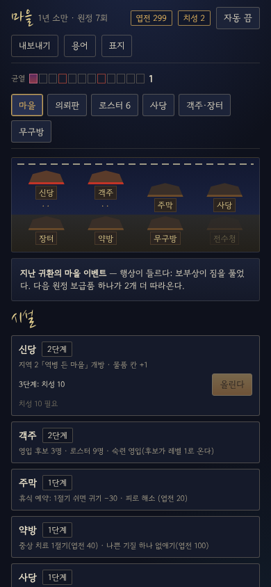 | 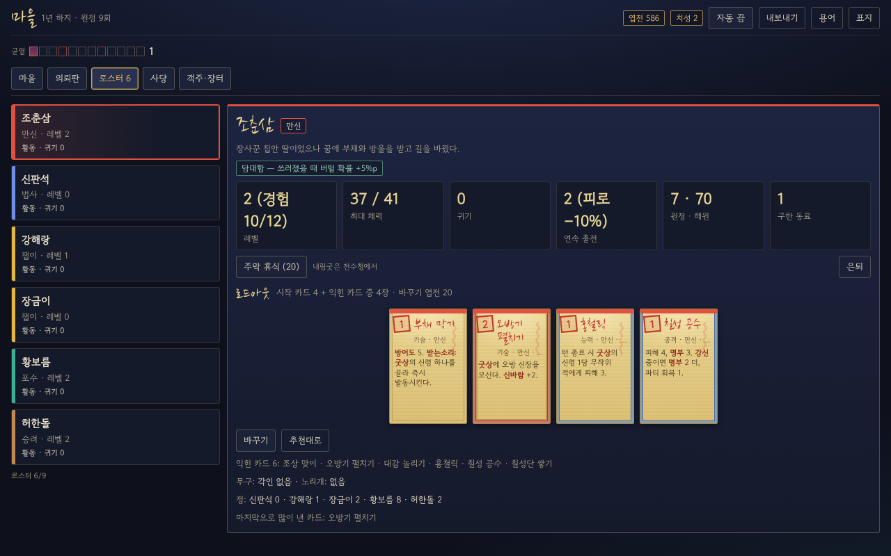 | 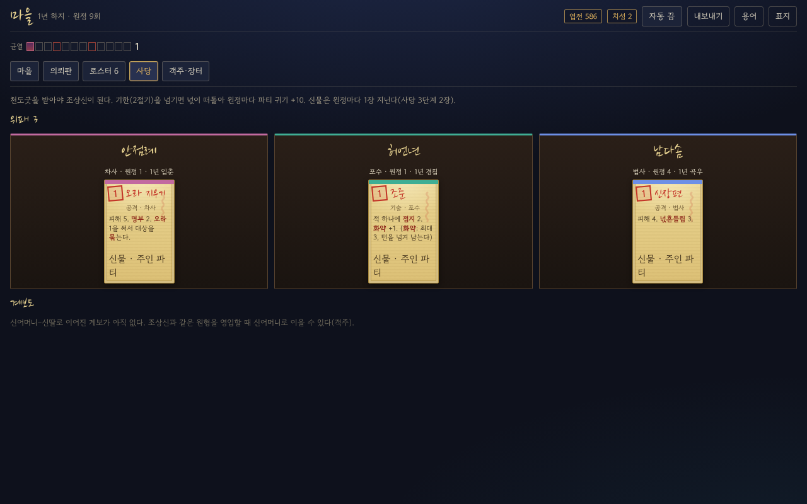 | 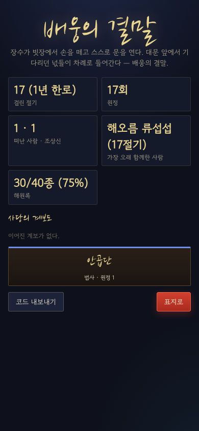 |

나머지: `village-1280x800` · `village-390x844`(첫 절기) · `village-r2-1280x800` · `roster-390x844` · `sadang-390x844` · `ending-1280x800`.

### 10.3 구현

| 무엇 | 어떻게 |
|---|---|
| 캠페인 규칙 | `src/meta/`(순수 TS, 테스트 10개)를 그대로 쓴다. 웹은 `web/src/game/campaign.ts` 가 출정 계획(`planExpedition`) → 원정(`newRun`: 개체 체력·귀기·중상, 로드아웃·합기·신물·각인 덱, 보급품, 균열 체력 배율, 결의 장단) → 귀환 보고(`reportFromRun`: 성공·후퇴·전멸, 영웅별 낸 카드, 기상, 계열별 해원/처치, 엽전·치성, 길굿 천도굿·인연, 만난 원귀, 남은 보급품) → `settle` 로 잇는다 |
| 지역 2·3 원정 | `content.ts` 가 세 지역을 함께 읽고(원귀·기물·이벤트·덫·가호 id 는 지역마다 다르다), 던전은 지역의 고리 통로 보정(+2/−2)·덫 비율(11%)·고정 방(2지역 손님 마당 + 서낭 앞 고사 자리, 3지역 혼 부르는 등 / 최종이면 업경대 비추기)을 쓴다. 기물 16·이벤트 12·덫 6은 데이터 문장 그대로 손으로 옮겼다(`encounters.ts`). 가호는 엔진 훅(`relicMods`) 또는 원정 계층(끼니·넋등·통행·업경대 거울 등) |
| 손님 배웅 | 손님 마당 → 특수 전투(수비 둘 + 손님 패널). 좋게 보내면 엽전 45·치성 1·「손님의 배웅」, 서운하면 이번 원정 전투마다 신열 1장. 쫓아내면 수비 셋과 전투(엽전 20을 고를 때 준다 — 간소화) |
| 업경대 | 최종 원정의 보스 굴 앞 고정 방. 이번 원정 해원 수(만신 +2, 향 한 단계 위) → 매듭 미리 풀기·체력·드로우·귀기 (`src/core/regions.ts` 를 시뮬과 같이 쓴다) |
| 저장 | v3: 캠페인과 진행 중 원정을 한 키에 저장(마을·결산 화면 포함). 「이어하기」가 마을이나 원정으로 돌아간다. v2(반복 1) 저장은 이어하지 않는다 |
| 내보내기/가져오기 | 마을·결말의 「내보내기」 → `JSG1:` + base64(JSON) 텍스트(기록은 최근 것만, 약 25~40KB). 「복사」는 클립보드를 쓰고, 막혀 있으면 글자 상자를 직접 선택해 복사한다(파일 내려받기 없음). 표지의 「캠페인 가져오기」에 붙여 넣는다. 원정 중 상태는 담지 않는다 |
| 자동 진행 | 마을에서는 `src/meta/bot.ts`(천도굿 → 신당 → 시설 → 영입 → 치료·휴식 → 내림굿 → 로드아웃·각인 → 의뢰·파티·보급품), 원정은 v0.2 자동 진행 그대로. 즉시 모드도 결산·마을은 한 번 그린다 |
| 시험용 훅 | `globalThis.__JSG_APP`·`__JSG_SETTINGS`(읽기), `__JSG_STOP`(e2e 가 두는 멈춤 조건) |

### 10.4 간소화 · 남은 것

- 지역 3의 **대문 방 통행**(지전 1 · 문답 · 문지기 전투)은 던전 방으로 두지 않았다. 문사재 문답 이벤트와 「통행 무료」 효과, 문신의 가호(지전 −1)만 있다.
- 노리개 칸은 화면에 「없음」으로만 있다(v1 명세 범위 밖의 수치 장비).
- 플레이어블 캠페인 원정은 지도 던전이라 시뮬레이터 원정(정해진 전투 순서)과 전투 수가 다르다. 헤드리스로 캠페인을 끝까지 돌리면(`node --import tsx web/scripts/headless.ts --campaign --runs 4 --max 25`) 결말까지 17~18회 원정이 걸렸다(4번 중 2번이 25회 안에 결말).
- 손님 배웅 「쫓아낸다」의 엽전 20은 전투 결과와 관계없이 고를 때 준다.

### 10.5 플레이테스트 체크리스트 (캠페인)

- [ ] 마을 한 바퀴(의뢰 → 파티 → 보급품 → 출정)가 몇 번 누르기로 끝났나? 권장량 담기를 썼나?
- [ ] 개체 시트의 출신·기질·익힌 카드가 "이 사람"을 기억하게 했나? 누가 죽었을 때 아까웠나(기둥 P4)?
- [ ] 천도굿 기한(2절기)과 떠도는 넋(+10 귀기)이 압박으로 느껴졌나? 신어머니로 잇는 결정을 해 봤나?
- [ ] 균열 게이지 때문에 보스 길을 서둘렀나? 카운트다운을 본 적이 있나?
- [ ] 각인·로드아웃 바꾸기·내림굿 중 무엇을 가장 자주 썼나? 엽전·재료·치성이 남았나 모자랐나?
- [ ] 지역 2의 신열(땀 내기 vs 옮김), 손님 배웅, 지역 3의 빗장·매듭이 화면에서 읽혔나?
- [ ] 캠페인 한 판(결말까지)이 얼마나 걸렸나? 원정 25~40회가 적당한가?
