# 표현 설계 v0.1 (Phase 10 · 결정 D8)

> 작성 2026-11-04 · 상태: **제안 — D8(표현 방식) 결정 대기. D9(최종 엔진)는 11단계 착수 전에 정한다**
> 근거: [표현 조사](research/presentation-reference.md) · [핵심 규칙](02-core-rules.md) · [영웅](03-heroes.md) · [탐험 규칙](05-exploration.md) · [지역 1](05-region1.md)·[2](05-region2.md)·[3](05-region3.md) · [본진](06-base.md) · [플레이어블](08-playable.md) · [무속 지식 정리](research/lore/shamanism-primer.md) §6~§8 · [매체 조사](research/lore/media-references.md) §5
> 목업: `docs/design/presentation/option-*.html` (코드로 그린 SVG·CSS, 외부 자원은 Google Fonts 뿐) → PNG `docs/design/presentation/png/` · 생성 `node tools/presentation/build.mjs && node tools/presentation/render.mjs`
> 수치(작업일·인일)는 모두 **추정**이다. 러프 단계에서 실제 속도를 재고 고친다.

## 0. 한눈에

**추천: 안 A — 2D 측면 종이 무대.**
영웅은 **꼭두**(상여를 장식하는 채색 목인)처럼, 원귀는 **넋전**(한지로 오린 망자의 몸)처럼 그린다. 무대는 한지를 겹친 측면 무대다. 전투·길목·마을이 **같은 측면 무대** 하나를 쓴다.

```
[전투]  후열 ─ 중열 ─ 선두 ─ 굿상 │ 원귀(앞 → 뒤)      머리 위 의도 배지 → 대상 영웅까지 점선
[길목]  같은 무대를 파티가 걷는다(패럴랙스). 넋등 빛 반경 = 앞쪽 어둠. 방에 들어서면 그 자리가 전투 무대
[마을]  한 장의 파노라마. 시설이 서면 건물·사람·금줄·솟대가 는다
[손패]  지금 그대로 부적 카드
```

| 안 | 한 줄 | 판정 |
|---|---|---|
| **A 2D 측면 종이 무대** | 꼭두 영웅 × 넋전 원귀, 측면 무대, DD식 측면 길목 | ✅ **추천** — 가독성·D7 탐험·비용·테마·폰을 함께 만족 |
| B 2.5D 굿판 디오라마 | 차일 친 굿청을 비스듬히 내려다보는 3D 카메라, 떠 있는 방 지도 | 분위기는 가장 강하다. 본 제작 비용 약 2배, 폰에서 원귀가 작아진다, 엔진 이전 필요 |
| C 위에서 본 굿상 | 돗자리 위에 영웅 원판·넋전 종이를 놓는 보드게임식 | 가장 싸고 가장 잘 읽힌다. 몸이 사라져 애착(P4)과 길목 긴장(D7)이 약해진다 |

## 1. 우리 게임이 화면에 요구하는 것

| # | 요구 | 화면에서 반드시 읽혀야 하는 것 | 근거 |
|---|---|---|---|
| R1 | **진형 3칸 대 원귀 줄** | 선두·중열·후열에 누가 섰는지, 원귀 앞·뒤 순서(최대 4) | 핵심 규칙 §1·§3·§13 |
| R2 | **의도** | 행동 종류 + 수치(타당 × 타수) + **대상 칸과 그 칸의 영웅**. 전체·최저 체력·쓰러진 영웅·굿상 대상 포함 | §3·§13 |
| R3 | **굿상 설치물** | 진형 앞 최대 3개, 이름·남은 횟수·발동 시점. 원귀가 굿상을 노릴 때 | §1, 허기진 넋·허주 |
| R4 | **공용 상태** | 점지·상흔·명부(체력 막대의 처형선)·넋흔들림/버팀·붕괴 + 취약·약화·묶임·누적 공격·빗장·홀림·신열 | §5·§13, 2·3막 |
| R5 | **장단과 받는소리** | 장단 0~5, 직전 카드의 주인, 지금 내면 받는소리가 되는 카드 | §4 |
| R6 | **개인 자원 8종** | 신바람·가락·화약·작두·염주·경면주사·탈·오라 | 영웅 §3 |
| R7 | **쓰러짐 → 구조 → 사망 판정** | 쓰러진 영웅, 넋 부르기 r/N, 맞으면 버틸 확률, "이번 턴 보호" | §6 |
| R8 | **해원 대 처치** | 해원 조건과 진척, 쓰러뜨린 순간 해원인지 처치인지(감정의 정점) | §13, 탐험 §14 |
| R9 | **넋등 5구간** | 환함~칠흑과 그 효과(그늘·적 피해·보상) | 탐험 §4 |
| R10 | **DD식 방·길목** | 방 지도, 길목 3칸, 기물·덫·길굿 터·보스 굴, 정찰 여부 | 탐험 §2~§9, D7 |
| R11 | **자라는 마을** | 시설 11종 × 3단계·짓는 중·봉인·잠긴 부지, 균열 12칸, 절기 | 본진 §1~§4, P6 |
| R12 | **영구 죽음과 유산** | 사당의 위패·신물, 계보도(신어머니–신딸), 천도굿, 조상신 | §6, 본진 §8, P4 |
| R13 | **개체** | 같은 원형의 다른 사람(얼굴·머리·소품 변형) | 영웅 §0, P4 |
| R14 | **플랫폼** | PC 1280×800 우선(D1). 웹 플레이어블은 **390px 폰에서도** 끝까지 플레이 | D1·D4, 플레이어블 §1 |
| R15 | **재현 윤리** | 실존 신령은 적이 아니다, 고어·조롱 금지, 피할 매체 외형 | 표현 조사 §5 |

## 2. 선택지

### 2.1 비교표

| 항목 | **A 2D 측면 종이 무대** | **B 2.5D 굿판 디오라마** | **C 위에서 본 굿상** |
|---|---|---|---|
| 차원·카메라 | 2D, 측면 고정(패럴랙스 겹) | 3D 공간에 세운 종이 인형(빌보드) 또는 3D 모델, 비스듬히 내려다보는 고정 카메라 | 2D, 위에서 내려다본 탁자 |
| 전투 | 왼쪽 후열 → 선두 → 굿상, 오른쪽 원귀. 머리 위 의도 배지 + 대상까지 점선 | 대각선 진형(카메라 쪽 후열 → 안쪽 선두), 원귀는 안쪽. 의도 = 깃대, 대상 = **바닥에 그은 빛줄** | 길베(흰 무명길) 위 영웅 **원판**, 원귀 **넋전 종이**. 의도 = 꽂은 깃발 + 색실 |
| 탐험 | **측면 길목**을 걷는다 + 작은 방 지도 | 어둠 속에 **떠 있는 방**(섬)과 길베 다리, 카메라가 파티를 따라간다 | **펼친 한지 지도** 위의 파티 패. 촛불 빛만큼 드러난다 |
| 마을 | 한 장의 **파노라마**(DD 햄릿·DD2 제단) | 미니어처 마을 디오라마 | 위에서 본 마을 지도(병풍 지도) |
| 애니메이션 | 러프: CSS 변형 / 본: 그린 부품 + **Spine 컷아웃** | 러프: CSS 3D·Three.js / 본: 3D 리그 또는 빌보드 + 3D 카메라·조명 | 러프·본 모두 트윈(패 미끄러짐·도장 찍기·뒤집기) |
| 화풍 | 한지 결·먹선·평면 채색, 볼 붉은 점(무신도), 오방색은 강조만 | 같은 재료를 조명 아래 입체로. 차일·지화 병풍·돗자리 | 탁자·돗자리·종이·도장·실 — 물건의 질감 |
| 가독성(P5) | 높음. 의도·대상·예상 피해가 한 줄에 읽힌다. 폰은 상세를 무대 밑 목록으로 | 중간. 원근 때문에 먼 원귀가 작다. 겹침이 생긴다. 폰에서 낮음 | **가장 높음.** 겹침이 없고 모든 정보가 평면에 놓인다 |
| 테마 | 꼭두 행렬(배웅하는 일행), 넋전(풀려나는 넋), 굿판을 옆에서 보는 구경꾼 시점 | **굿판 그 자체**. 의례 공간의 공기가 가장 잘 산다 | 굿상·상차림. 의례보다 "판"이 앞선다 |
| 애착(P3·P4) | 몸·자세·쓰러짐이 보인다 | 몸이 보이고 입체감이 크다 | 얼굴 원판뿐 — 약하다 |
| D7 탐험 긴장 | DD와 같은 측면 길목 → 빛·어둠이 화면 전체에 | 공간감은 좋지만 길목이 "다리"로 축약된다 | 지도 한 장 — 긴장이 가장 약하다 |
| 러프 비용 | 8~11 작업일 | 14~20 작업일 | 6~8 작업일 |
| 본 제작 비용 | 기준 1.0 (약 580~800 인일, §5.4) | 약 1.8~2.2배 + 엔진 이전 | 약 0.45~0.55배 |
| 엔진(D9) | **웹 유지 가능**(Preact UI + PixiJS + Spine 런타임 → Electron/Tauri). Godot·Unity도 가능 | Godot 또는 Unity가 사실상 필요 → 규칙 엔진(TypeScript) 이식 | 웹 유지 |
| 위험 | "DD 따라 하기"로 보일 수 있다. 컷아웃이 뻣뻣하면 "플래시 같다"(AtO 평) | 비용·인원(DD2: 5 → 14명), 엔진 이전, 폰 가독성, 3D 한국 민속 재료의 어색함 | 보드게임처럼 보여 애착·공포·처연함이 약하다. 해원이 "패 뒤집기"가 된다 |

> 제외한 안 — **D 1인칭(Inscryption식 탁자 맞은편)**: 분위기는 강하지만 파티가 몸으로 서지 않고 진형이 보이지 않는다(R1·R7 실패).

### 2.2 안 A — 2D 측면 종이 무대 (추천)

| 1280×800 | 390×844 |
|---|---|
| 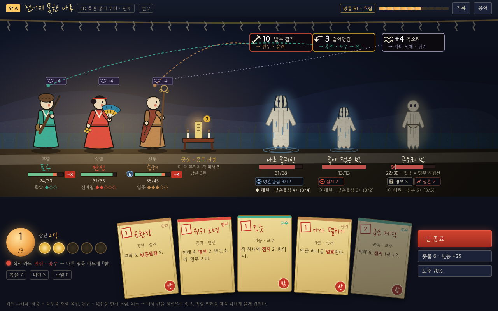 | 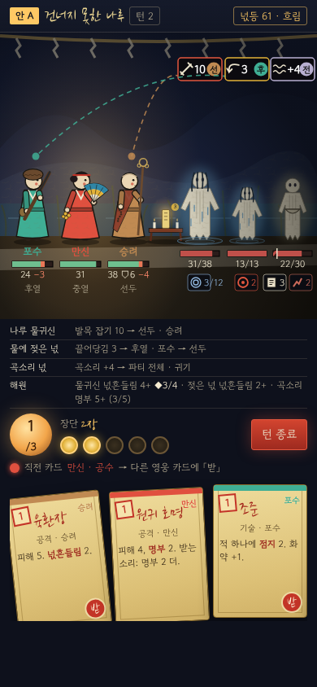 |
| 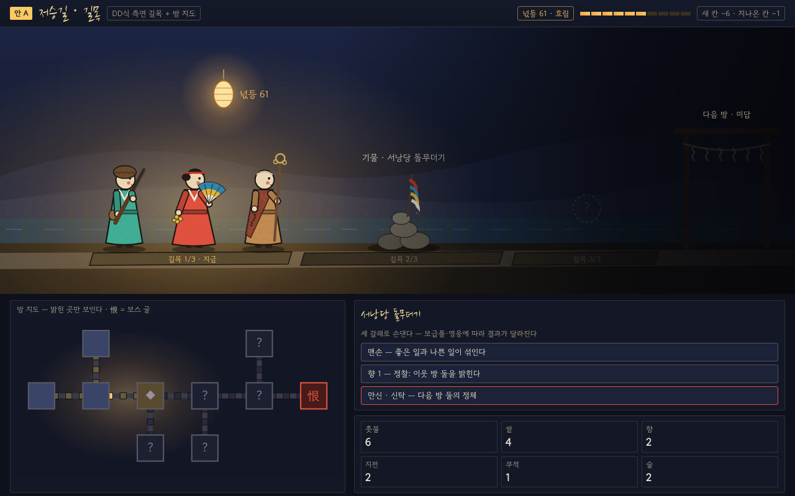 | 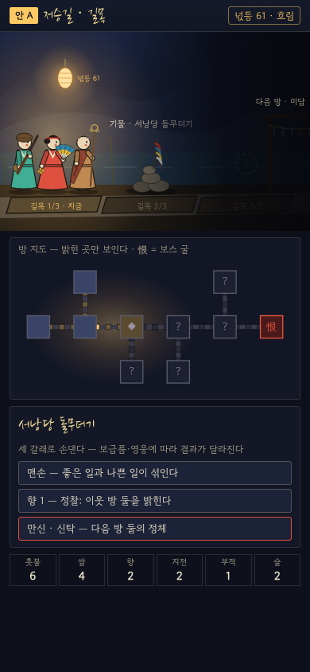 |
| 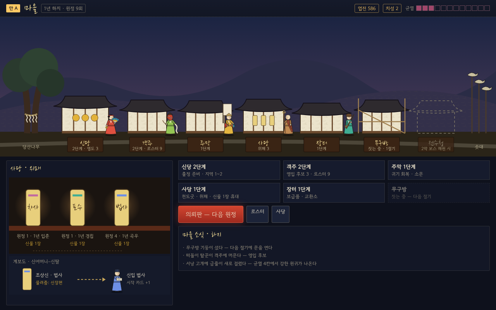 | 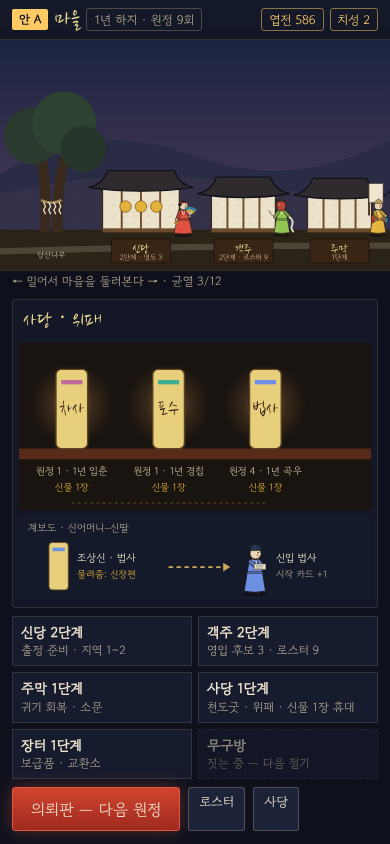 |
| 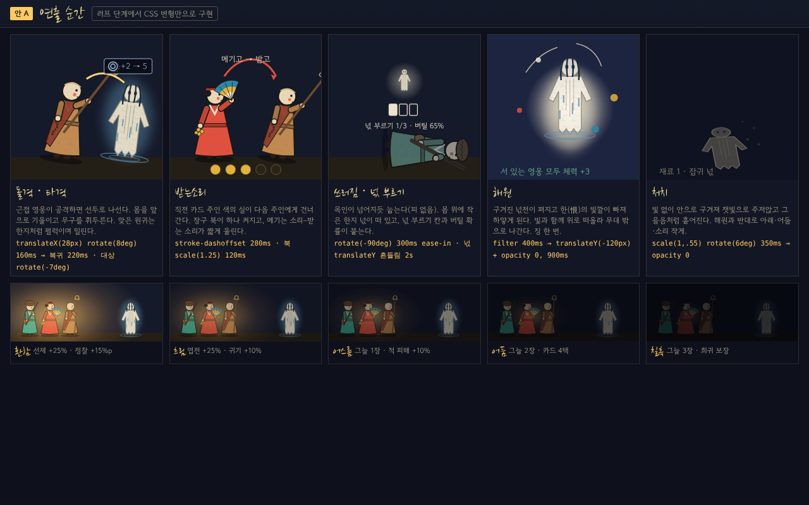 | 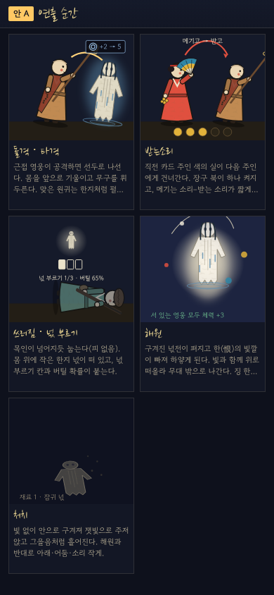 |

- **전투**
  - 위쪽 **금줄**(종이 술)이 무대를 의례 공간으로 묶는다.
  - 왼쪽부터 후열 포수 · 중열 만신 · 선두 승려 · 굿상(몸주 신령, 남은 3턴), 오른쪽에 원귀 앞 → 뒤.
  - 원귀 머리 위 **의도 배지** = 그림 + 수치 + "→ 선두 · 승려". 대상 영웅의 머리까지 그 영웅 색의 점선을 잇는다. 전체 대상(곡소리)은 영웅마다 "귀기 +4" 꼬리표를 단다.
  - 영웅 발밑: 칸 · 이름(붓글씨) · 체력 막대(예상 피해를 붉게 겹치고 −N 배지) · 방어도 방패 · 개인 자원 알.
  - 원귀 발밑: 이름 · 체력(명부만큼 **빗금 = 처형선**) · 상태 칩 · 해원 조건과 진척(◆ 가까움).
  - 아래: 에너지 등불 · 장단 북 5개 · **직전 카드 주인** · 손패(부적, 받는소리면 「받」 도장) · 턴 종료.
- **폰(390)**: 같은 무대를 0.6배로 줄이고 이름·수치만 남긴다. 의도 배지는 그림 + 수치 + 대상 칸 글자(선·중·후·전) 원. 행동 이름·해원 조건은 무대 밑 **목록**으로 내린다. 손패는 자기 영역 안에서 가로로 민다.
- **길목**
  - 파티가 길목 1/3 칸 위를 걷는다. 넋등이 머리 위에 떠 있다. 넋등의 빛 반경 바깥, 앞쪽(기물 · ? 칸 · 다음 방 문)은 어둠이 짙다.
  - 아래 방 지도는 지금 플레이어블 지도를 줄인 것이다. 기물은 세 갈래 선택지를 그대로 둔다.
- **마을**: 당산나무 → 신당(명도 3) → 객주 → 주막 → 사당(위패 3) → 장터 → 무구방(짓는 중, 비계) → 전수청(잠긴 부지, 점선) → 솟대. 쉬는 영웅들이 건물 앞에 선다. 아래 사당 위패 · 계보도 · 시설 · 마을 소식.
- **연출 순간**: 돌격·타격 / 받는소리 / 쓰러짐·넋 부르기 / **해원** / 처치, 그리고 넋등 5구간에 따라 같은 무대가 어두워지는 띠(§4.6).

### 2.3 안 B — 2.5D 굿판 디오라마

| 1280×800 | 390×844 |
|---|---|
| 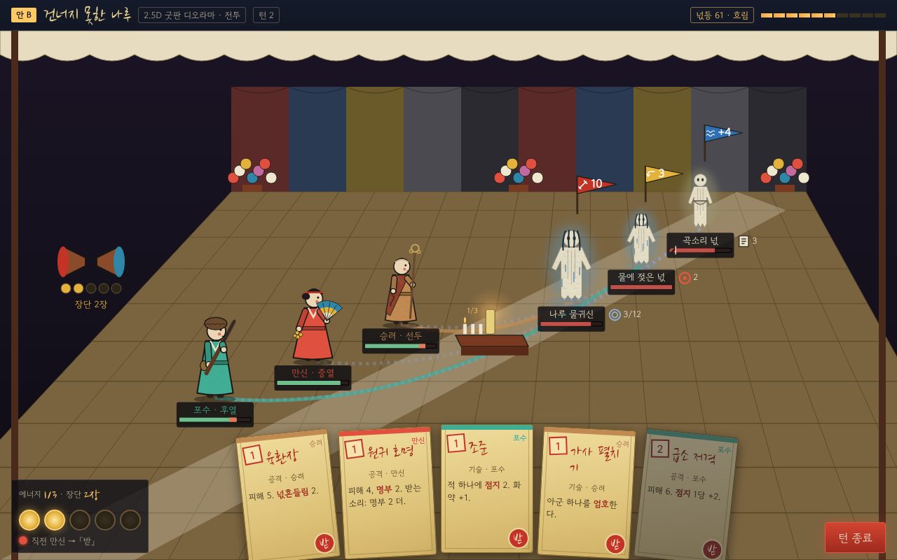 | 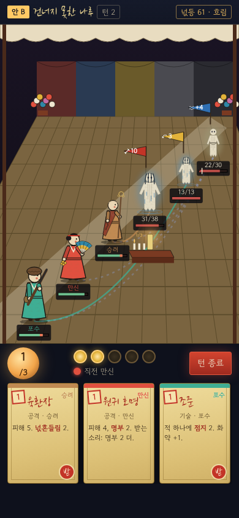 |
| 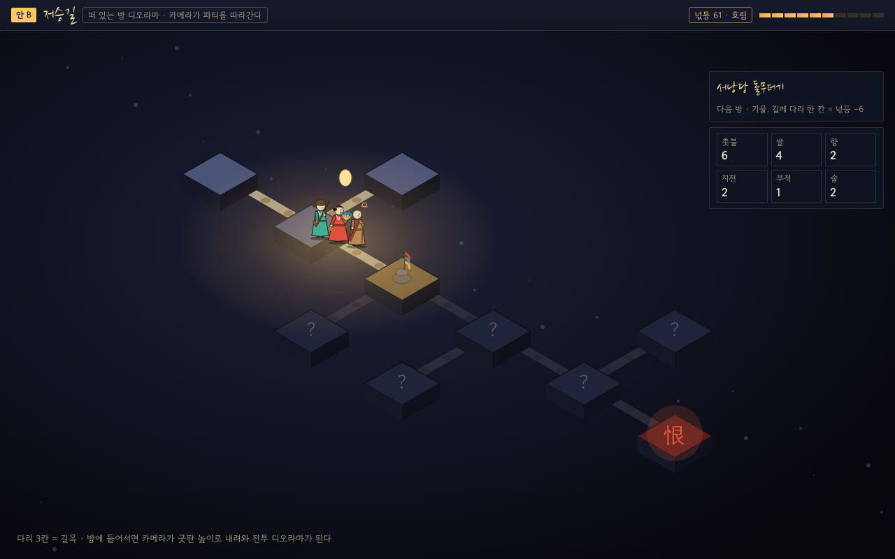 | 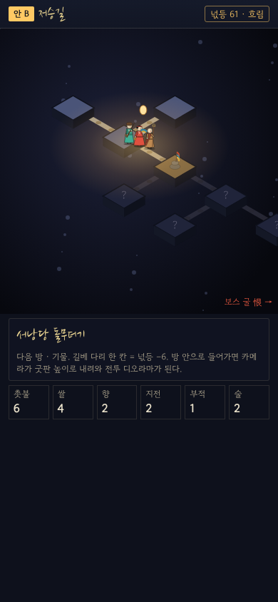 |

- **전투**
  - 차일을 친 굿청. 뒷벽에 오방 휘장과 지화 다발이 있고, 돗자리 바닥에 흰 길베가 대각선으로 지나간다.
  - 진형은 카메라 쪽(후열)에서 안쪽(선두)으로 서고, 원귀는 더 안쪽에 선다.
  - 의도는 원귀 위의 **깃발**(공격 적 · 이동 황 · 귀기 청), 대상은 **바닥에 그은 빛줄**이다.
  - 에너지는 굿상 위 **촛불**, 장단은 왼쪽 **장구**의 고리 — 정보가 장면 속 물건(디제틱 UI)이 된다.
- **탐험**: 어둠 속에 떠 있는 방(섬)과 길베 다리(3칸). 등불 빛이 닿는 섬만 밝다. 방에 들어서면 카메라가 굿판 높이로 내려와 전투가 된다.
- **본 제작**: 3D 카메라 이동(공격 시 다가가기), 실시간 조명(넋등 = 실제 광원), 그림자. 인물은 ① 3D 모델 + 툰 셰이딩 또는 ② 2D 그림을 3D 공간에 세운 빌보드(DD2식 하이브리드).
- **목업에서 보이는 약점**: 원근 때문에 먼 원귀일수록 작다(1280에서 영웅의 약 0.7~0.9배). 폰에서는 이름표·깃발이 겹치기 직전이고, 손패가 가까운 바닥을 덮는다.

### 2.4 안 C — 위에서 본 굿상

| 1280×800 | 390×844 |
|---|---|
| 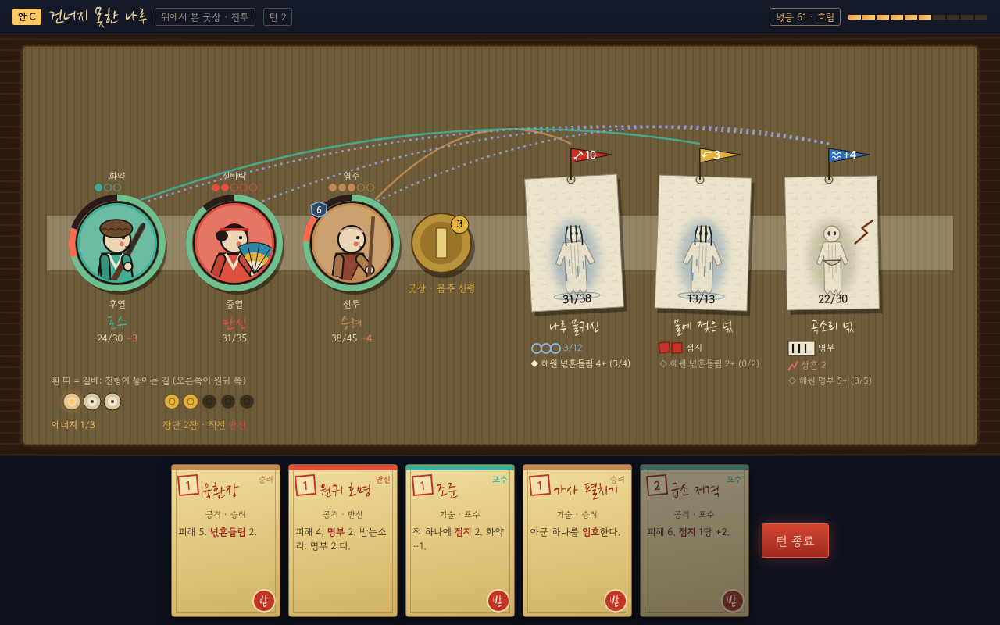 | 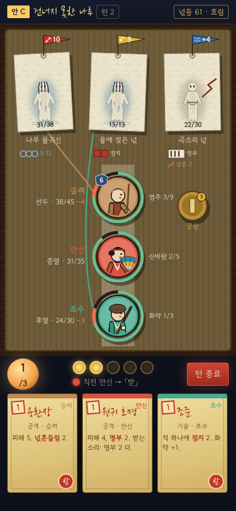 |
| 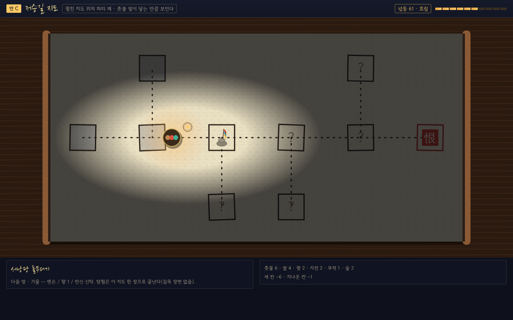 | 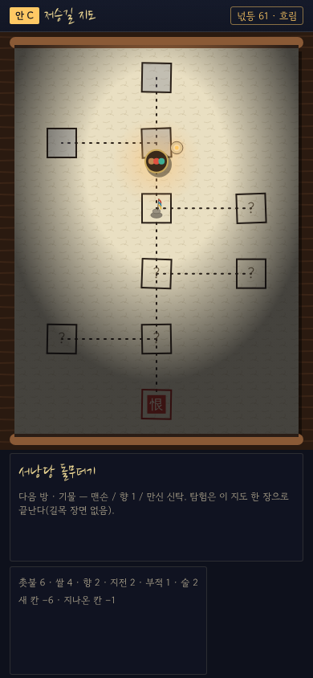 |

- **전투**
  - 탁자 위 돗자리. 영웅은 얼굴이 그려진 **원판**이고, 테두리 고리가 체력이다(예상 피해는 붉은 호).
  - 원귀는 한지 **넋전 종이**를 놓은 모습이고, 상태는 물건으로 표시한다. 점지 = 붉은 도장 · 명부 = 먹 획 · 넋흔들림 = 파란 실 고리 · 상흔 = 종이의 금.
  - 의도는 종이 위에 꽂은 **깃발**이고, 대상까지 색실을 잇는다. 에너지 = 촛불 3, 장단 = 작은 북 5.
  - 폰에서는 원귀를 위에 한 줄로 놓고, 길베를 세로로 세워 선두가 원귀 쪽에 오게 한다.
- **탐험**: 탁자에 한지 지도를 펼치고 파티 패를 움직인다. 촛불 빛이 닿는 곳만 보인다. **길목 장면이 없다.**
- **목업에서 보이는 강점·약점**: 1280·390 모두 겹침이 없고 정보가 가장 잘 읽힌다. 대신 영웅이 얼굴 원판뿐이라 쓰러짐·해원·애착이 패 위의 표시로 줄어든다.

## 3. 추천 — 안 A

| 이유 | 설명 | 근거 |
|---|---|---|
| ① 진형이 곧 화면 | 선두·중열·후열이 가로 순서로 읽히고 의도의 대상 칸을 선으로 바로 잇는다. 장르 주류라 학습 비용이 없다 | 조사 V1·V2 |
| ② D7과 한 무대 | DD1은 전환과 에셋을 줄이려고 전투·탐험을 같은 측면 시점으로 두었다. 우리도 같은 인형·같은 배경 겹을 길목·방·전투·길굿에 함께 쓴다 | 조사 F2·V3 |
| ③ 싼 애니메이션 | 2D 컷아웃(Spine류)은 DD1·AtO·Roguebook이 쓴 업계 표준이다. **꼭두는 원래 목인**이라 관절이 딱딱해도 어색하지 않다 | 조사 F3·V5, §4.4 |
| ④ 테마 | 꼭두(배웅하는 목인 행렬: 호위·돌봄·연희) = 우리 파티, 넋전(망자의 종이 몸) = 원귀. **해원은 종이가 펴져 떠오르고, 처치는 구겨져 주저앉는다** — 재료의 성질만으로 감정이 갈린다(R8). 무신도·꼭두·넋전은 평면 정면·측면 도상이라 측면 무대가 원전의 시각 문법과 맞는다 | 조사 §4.3·§4.4, Pentiment |
| ⑤ 폰 | 390px에서 무대를 줄이고 상세를 목록으로 내리면 읽힌다(목업 확인). B는 원근 때문에 폰에서 가장 약하다 | 목업 PNG |
| ⑥ 비용·엔진 | 본 제작이 B의 절반 수준이다. 지금 TypeScript 규칙 엔진·시뮬·Preact UI를 그대로 두고 무대만 PixiJS + Spine 런타임으로 바꿀 수 있다(D4 유지) | 조사 F4·§6 |

**B·C에서 빌릴 것**
- **C에서**: 상태를 "물건"처럼 보이는 아이콘(도장·먹 획·실 고리·금)으로 그린다. 폰에서 무대 밑 정보 목록을 둔다.
- **B에서**: 굿청 틀(위 금줄, 양옆 지화 다발)을 무대 테두리로 쓴다. 배경을 3~4겹으로 나눠 **패럴랙스 깊이**를 낸다(3D 없이 2.5D 느낌). 의도 깃발의 오방 색 규칙을 쓴다.

**A의 위험과 대응**

| 위험 | 대응 |
|---|---|
| "DD 따라 하기"로 보인다 | 화풍 축을 DD의 고딕 판화(검정·붉은 피)와 반대로 둔다: **한지·밝은 채색 목인·흰 넋**, 공포보다 처연함. 의도 표시·장단 실·해원처럼 DD에 없는 정보가 화면의 주인공이다 |
| 컷아웃이 뻣뻣하다(AtO "플래시 같다") | 목인답게 **자세 끊기**(포즈 투 포즈)를 기본으로 하고, 한지 넋의 펄럭임(메시 변형)과 무구의 흔들림(방울·술·오라)에만 2차 움직임을 준다 |
| 무대가 좁다(원귀 4 + 굿상 3) | 원귀는 등급별 크기(일반 1 · 졸개 0.8 · 엘리트 1.25 · 보스 1.6), 무리는 겹쳐 세운다. 굿상은 작은 상 하나에 신령 3까지 쌓는다 |
| 넋전·꼭두 사용의 민감성 | 실물을 본뜨지 않고 재료와 역할만 빌린다. 넋은 훼손하지 않는다(처치도 주저앉음까지). 11단계 착수 전 감수 |

## 4. 러프 그래픽 계획 (안 A) — 지금 플레이어블에 입힌다

D8이 A로 정해지면 진행한다. **이 문서 단계에서는 `web/`을 고치지 않는다.**

### 4.1 원칙
- 모든 그림은 **코드로 그린 SVG·CSS**다. 외부 이미지·폰트(Google Fonts 제외)·저작권 자산은 쓰지 않는다. 단일 HTML 아티팩트 계약(플레이어블 §1)을 지킨다.
- 출발점은 목업의 원시 도형 `tools/presentation/figures.mjs`(영웅 8 · 원귀 계열 8 · 아이콘)다. Preact 컴포넌트로 옮긴다.
- 엔진·규칙은 건드리지 않는다. 화면이 엔진 상태를 읽어 그릴 뿐이다.
- `prefers-reduced-motion` 이면 모든 연출을 즉시 결과로 바꾼다(정보는 그대로).
- **색만으로 구분하는 정보를 두지 않는다**: 대상 칸 글자(선·중·후·전), 해원 ◆/◇, 상태 그림 + 숫자.

### 4.2 컴포넌트

| 컴포넌트 | 역할 | 플레이어블에서 바뀌는 곳 |
|---|---|---|
| `Stage` | 측면 무대 틀: 배경 겹 + 금줄 + 넋등 비네트 + 칸 좌표(데스크톱·폰 두 배치) | 전투·길목·길굿 |
| `Backdrop` | 지역별 배경 3~4겹(하늘·먼 산·물/골목/회랑·바닥과 길베) | 지역 1~3 |
| `HeroFigure` | 꼭두풍 영웅. `id · pose · mask(탈꾼) · dim` | 전투·길목·마을·로스터·신당 |
| `SpiritFigure` | 넋전풍 원귀. `family · tier · boss · state` | 전투 |
| `GutsangTable` | 굿상과 그 위 신령(최대 3)·남은 횟수 | 전투 |
| `IntentBadge` + `TargetThread` | 의도 배지와 대상 영웅까지 점선. 전체 대상이면 영웅마다 꼬리표 | 전투 |
| `HpBar` | 체력 + 예상 피해(붉게) + 명부 빗금 처형선 + 방어 방패 | 전투(지금 막대를 대체) |
| `StatusChips` | 상태 그림 + 숫자. 데스크톱은 이름까지, 폰은 그림 + 숫자 | 전투 |
| `SoulOver` | 쓰러진 영웅 위의 작은 넋 + 넋 부르기 칸 + 버틸 % | 전투 |
| `JangdanDrums` · `BatThread` | 장단 북 5, 직전 주인 색 실 | 전투(지금 북을 대체) |
| `LightVignette` | 넋등 5구간별 비네트·앞쪽 어둠 | 전투·길목·지도 |
| `CorridorScene` | 길목 3칸을 걷는 측면 장면 + 기물·덫·문 | 지도 화면 위쪽(새로) |
| `VillagePanorama` · `Hanok` | 마을 파노라마, 시설 상태별 건물(빈 부지·짓는 중·1~3단계·봉인) | 마을 |
| `SadangTablets` · `Lineage` | 위패·신물, 계보도 | 사당 |

### 4.3 영웅 원시 도형 (목업에 구현된 것)

공통: 사다리꼴 도포 + 한지 결 무늬 + 먹선 2px, 둥근 머리, 볼의 붉은 점(무신도), 팔 두 개(소품을 쥔다), 발 그림자. 색은 플레이어블 `HERO_COLOR` 그대로.

| 원형 | 머리 | 소품 | 실루엣 열쇠 | 자세 변형 |
|---|---|---|---|---|
| 만신 | 쪽진 머리 + 붉은 띠 | 오방 부채, 방울 다발 | 넓은 소매, 펼친 부채 | 공격·시전 = 부채를 들어 올림. 강신 = 무복 색 반전(본 제작: 무복 갈아입기) |
| 잽이 | 패랭이 | 허리의 장구(붉은·푸른 북면), 채 | 가로로 놓인 장구 | 가락 3단계 = 채 높이(굿거리·자진굿거리·당악) |
| 포수 | 털모자 | 화승총, 화약통 | 비스듬한 긴 총 | 공격 = 겨누기 + 총구 불빛, 화약 = 허리 통 |
| 작두박수 | 전립 + 붉은 상모 | 흰 술 신칼, 붉은 전복 | 흰 도포 + 붉은 조끼 | 작두 위 = 발밑에 쌍날(본 제작) |
| 승려 | 민머리 | 육환장, 가사, 염주 | 긴 지팡이 끝 고리 | 공격 = 지팡이 휘두르기, 엄호 = 앞으로 막아섬 |
| 법사 | 유건 | 경문 두루마리, 부적 | 앞에 든 경문 | 시전 = 부적이 떠오름 |
| 탈꾼 | **탈**(칸마다: 선두 말뚝이 붉은 탈 · 중열 양반 흰 탈 · 후열 할미 검은 탈) | 한삼, 채찍 | 큰 탈 얼굴 | 칸이 바뀌면 탈만 바꿔 끼운다 |
| 차사 | **적갈색 벙거지** + 붉은 술(검은 갓 금지) | 오라(붉은 밧줄), 적패지 | 군졸 조끼 | 공격 = 오라를 던져 묶음 |

### 4.4 원귀 원시 도형

공통 실루엣: 한지 사람 오림(팔 날개, 아래 단 톱니 오림, 세로 칼집선, 빈 눈 두 개) + 뒤쪽 **한의 빛깔** 흐림. 등급 크기: 일반 1 · 졸개 0.8 · 엘리트 1.25 · 보스 1.6.

| 계열 | 한의 빛깔 | 덧붙임 | 해당 원귀(예) |
|---|---|---|---|
| 수귀 | 물빛 `#5f8fb0` | 얼굴을 덮은 젖은 머리칼, 물 흐른 선, 발밑 물결 | 물에 젖은 넋 · 나루 물귀신 · 물밑 그림자 · 뱃사공 |
| 객귀 | 흙길 `#a08a6a` | 봇짐, 지팡이 | 길 잃은 객귀 · 봇짐 진 객귀 · 혼백이 갈린 원귀 |
| 굶주린 넋 | 빈 그릇 회황 `#9c9a78` | 마른 몸(0.8폭), 빈 그릇 | 허기진 넋 · 곡소리 넋 · 줄 선 넋 |
| 잡귀잡신 | 잿보라 `#8e7aa6` | 작고 찢긴 종이 조각, 무리로 겹침 | 잡귀 · 굿판 훼방꾼 · 돌림 잡귀 · 허주 |
| 억울귀 | 타다 남은 소지 `#b0564a` | 그을린 가장자리, 장부 | 누명 쓴 아전 원귀 · 상여 · 빗장 지키는 넋 |
| 역귀 | 열기 `#c9873a` | 머리 위 아지랑이, 붉은 열점(피 아님) | 열 오른 넋 · 문간 역귀 · 돌림병이 된 넋 |
| 무장 원귀 | 녹슨 쇠 `#7a8288` | 투구, 창·방패 | 군졸 넋들 · 깃발 든 기수 · 빗장을 놓지 못한 장수 |
| 몽달·손각시 | 댕기 `#c27a9a` | 붉은 댕기 | 혼처 잃은 몽달귀 |

- **보스는 개별 소품**을 하나씩 더한다: 뱃사공(삿갓·노·배), 상여(꼭두 장식 상여 + 상여꾼), 돌림병이 된 넋(열기 장막), 허주(가면 — 손님 모습은 쓰지 않는다), 혼백이 갈린 원귀(혼·백 두 몸), 맨 앞에 선 굶은 넋(줄), 장수(빗장·성문).
- **손님**(2막 신령)은 원귀 실루엣을 쓰지 않는다: 무대 뒤쪽 높은 곳에 가마·차일과 함께 **공격 대상 표시 없이** 둔다.

### 4.5 팔레트 토큰

플레이어블 `web/src/styles.css`의 토큰(먹 `--ink-*`, 괴황지 `--paper*`, 경면주사 `--cinnabar*`, 넋등 `--lamp*`, 오방 `--o-*`, `--haewon`)을 그대로 쓰고 아래만 더한다.

| 토큰 | 값 | 쓰임 |
|---|---|---|
| `--hanji` / `--hanji-shade` | `#ebe3cb` / `#c9bf9f` | 원귀 종이·넋·길베·금줄 술 |
| `--meok` | `#1a1712` | 인형 먹선 |
| `--kkokdu-wood` | `#8a5a36` | 목인 받침·마을 목재 |
| `--han-*` (8) | 위 표의 한의 빛깔 | 원귀 뒤 흐림, 계열 구분 |
| `--intent-attack` / `-move` / `-stress` | 오방 적 `#c33427` · 황 `#e2b23a` · 청 `#2f6fb3` | 의도 테두리·깃발 |
| `--status-jeomji` / `-sangheun` / `-myeongbu` / `-neok` | `#e2573f` · `#c96a5a` · `#ebe3cc`(먹 빗금) · `#8fb5dc` | 상태 칩 |

### 4.6 애니메이션 (CSS 변형만)

| 순간 | 변형 | 길이 | 비고 |
|---|---|---|---|
| 돌격·근접 공격 | 공격자 `translateX(+28px) rotate(8deg)` → 복귀, 대상 `rotate(-7deg)` + 한지 펄럭(skewX ±4°) | 160ms + 220ms | 돌격으로 칸이 바뀌면 나머지가 한 칸씩 미끄러진다(`transition: transform 300ms`) |
| 원거리·기술 | 무구 들어 올림 + 대상에 짧은 빛(radial 투명도) | 240ms | 포수 총구 불빛, 법사 부적 떠오름 |
| 피격 | 대상 `translateX(-8px) rotate(-10deg)` + 붉은 사선 3개 | 180ms | 방어도로 다 막으면 방패만 흔들림 |
| 받는소리 | 직전 주인 색 실이 다음 주인에게 건너간다(`stroke-dashoffset`), 북 하나 `scale(1.25)` | 280ms | 장단 북은 장단 수에 따라 맥박 속도 1.1 → 0.32초(지금 플레이어블과 같다) |
| 굿상 소환 | 신령이 상 위로 `translateY(-20px)`, 촛불 켜짐 | 300ms | |
| 해원 | 원귀 `filter: saturate(0) brightness(1.4)`(한의 빛깔이 빠짐) → `translateY(-120px)` + 투명, 빛 원 커짐, 꽃잎 4점 | 400ms + 900ms | 서 있는 영웅 머리 위 "+3" |
| 처치 | 원귀 `scale(1, .55) rotate(6deg)` + 잿빛 → 투명, 그을음 점 | 350ms + 300ms | 해원과 반대: 아래·어둠·짧음 |
| 쓰러짐 | 영웅 `rotate(90deg)`(목인이 넘어진다), 채도↓, 넋이 떠오름 | 300ms | 피 없음 |
| 넋 부르기 · 기상 | 넋 칸 하나 채움 / 넋이 몸으로 내려앉고 `rotate(0)` | 200ms / 400ms | |
| 넋등 구간 변화 | 비네트 투명도·빛 반경 전환 | 600ms | 칠흑에서는 무대 가장자리가 거의 검다 |
| 강신(만신) | 무복 색 반전 + 바라 번쩍 | 400ms | |

### 4.7 바뀌는 화면과 추정

| 화면 | 바뀌는 것 | 추정 |
|---|---|---|
| 공용 | `figures` 원시 도형을 Preact로 이식, 팔레트 토큰, 움직임 줄이기 | 1.5일 |
| **전투** | `Stage`·인형·의도 실·상태 칩·예상 피해·굿상·쓰러짐·해원/처치 연출. 폰 배치(무대 + 목록) | 3~4일 |
| **저승길(지도)** | 위쪽에 `CorridorScene`(길목 걷기·기물·문·넋등 어둠), 아래에 지금 지도를 줄여 둔다 | 1.5~2일 |
| **마을** | `VillagePanorama`(시설 상태별 건물, 쉬는 영웅) | 1~1.5일 |
| 사당·로스터·신당 | 위패·계보도 그림, 로스터·파티 고르기에 인형 상반신 | 0.5~1일 |
| 길굿·결과 | 길굿 터에 둘러앉은 파티, 결과 화면의 행렬 | 0.5일 |
| 검증 | e2e 스크린숏 갱신, 390 가로 스크롤 0, 콘솔 오류 0, 움직임 줄이기 | 0.5일 |
| **합계** | | **8.5~11.5 작업일** |

### 4.8 러프 단계에서 시험할 질문

| # | 질문 | 방법 |
|---|---|---|
| Q1 | 처음 보는 사람이 **5초 안에** "다음에 누가 몇 피해를 맞는가 · 어느 원귀가 해원에 가까운가"를 말하는가(1280·390) | 스크린숏 5명 |
| Q2 | 글자를 가린 연출만 보고 **해원과 처치를 구분**하는가 | 녹화 10개 |
| Q3 | 측면 길목이 지도 클릭보다 **넋등 긴장**을 더 느끼게 하는가 | 같은 원정을 두 화면으로 |
| Q4 | 받는소리 실·「받」 도장이 **주인을 번갈아 내는 순서**를 늘리는가 | 플레이 기록의 장단 평균 |
| Q5 | 마을 파노라마에서 원정 10회 뒤 **성장이 보이는가**(P6) | 첫 화면과 10회 뒤 비교 |

## 5. 11단계 본 제작 계획 (안 A 기준)

### 5.1 에셋 목록

| 묶음 | 수량 | 내용 |
|---|---:|---|
| **영웅** | 8 원형 | 부품 일러스트(머리·몸통·팔·소품·소매) + 뼈대. 애니 10종: 숨쉬기, 걷기, 공격 2(근접 돌격·원거리/기술), 시전, 피격, 쓰러짐, 쓰러진 채 숨, 기상, 해원 반응 |
| 영웅 특수 상태 | 약 15 | 만신 강신(무복 갈아입기) 2, 작두박수 작두 위(숨·공격·헛디딤) 3, 탈꾼 탈 3(얼굴 부품 교체), 잽이 가락 3단계 2, 포수 장전 1, 법사 부적 쓰기 1, 차사 오라 묶기 1, 승려 엄호 1, 합기 공동 자세 템플릿 1 |
| 개체 변형 키트 | 8 원형 × (얼굴 6 · 머리 4 · 무구 색 3) | Spine 스킨. 같은 원형의 다른 사람(R13) |
| **원귀** | 47 항목 | 일반 24 · 졸개 7 · 엘리트 9 · 보스 7(최종 포함). 계열 템플릿 8을 먼저 만들고 덧붙임으로 변형한다 |
| 원귀 애니 | 일반 6 · 졸개 5 · 엘리트 7~8 · 보스 10~14 | 숨, 공격, 특수 행동(끌어당김·소환·홀림…), 피격, **해원**, **처치**. 보스는 2단계 전환 포함 |
| 특수 인물 | 3 | 손님(공격 대상 아님), 놀이 사자(1막 사자 검문), 산 사람(호위) |
| 굿상 신령·부적 | 신령 약 8 · 부적 약 12 | 몸주 신령·장구 신령·날 선 장군·경문 신장 등(가상), 화부·얼쑤·수호부·신령부·축귀부 등 |
| **배경** | 지역 3 × 약 8 | 길목 패럴랙스 2세트(4겹), 방 3(빈 방·기물 방·수호 방), 길굿 터, 보스 굴 + 보스별 전경 소품 |
| 기물·덫·이벤트 | 기물 24 · 덫 9 · 방 이벤트 18 | 기물은 무대 소품 1장씩, 덫은 바닥 표식, 이벤트는 장면 그림(재사용 많음) |
| **마을** | 3단계 파노라마 + 시설 11 × 5상태 | 빈 부지·짓는 중·1~3단계·봉인, 장식(금줄·솟대·단청), 절기 색조 4(색 보정) |
| 사당·신당·결말 | 약 8 | 사당 내부·위패 템플릿·계보도 틀·신당 내부·결말 장면 2~3 |
| **VFX** | 약 40 | 상태 부여·터짐 7(점지·상흔·명부·명부 집행·넋흔들림·붕괴·빗장), 장단 1~5·받는소리, 해원·처치·쓰러짐·기상, 홀림·신열·그늘, 굿상 소환, 부적, 넋등 |
| **UI** | 약 90 아이콘 + 화면 정리 | 카드 틀(영웅 8색·합기·저주·상태·강화), 원형 도장 8, 의도·상태·자원 아이콘 |
| 카드 그림 | **291장 — 그리지 않는 것을 추천** | 카드는 부적(글씨·도장)으로 둔다. 원형 도장 + 타입 문양만 더한다(결정 D8-1) |

### 5.2 파이프라인

```
콘셉트(원형·계열 실루엣 시트) → 무속 감수 ① → 부품 일러스트(포토샵·크리타, 한지 결 브러시)
 → Spine 리깅·애니(포즈 투 포즈 + 넋 펄럭임 메시) → 런타임 통합(무대 좌표·이벤트 훅)
 → 가독성 시험(Q1·Q2, 1280·390) → 감수 ② → 확정
```

- **원칙 4가지**
  - 실루엣이 먼저다. 검게 칠해도 원형·계열이 구분돼야 한다.
  - 부품 이름은 러프 `figures.mjs`와 같게 둔다(머리·도포·앞팔·소품). 그래야 러프에서 본 제작으로 갈아 끼운다.
  - 엔진 이벤트(공격·피격·해원·처치·쓰러짐·기상·이동)는 지금 엔진 로그에서 바로 뽑는다.
  - 오디오와 같은 타임라인을 쓴다(§6).

### 5.3 버티컬 슬라이스 품질 기준

**범위**
- 1막 「건너지 못한 나루」 보스 길 1회 전체를 본 아트·본 사운드로 만든다.
- 영웅 3(승려·만신·포수) + 교체 확인용 1(차사).
- 1막 원귀 15 항목 전부(보스는 뱃사공 우선).
- 나루 길목·방·길굿·보스 굴 배경, 마을 1단계 파노라마 + 사당.

| 기준 | 합격선 |
|---|---|
| 가독성 Q1 | 처음 보는 5명 중 4명이 스크린숏 한 장에서 5초 안에 답한다(1280·390 모두) |
| 해원/처치 Q2 | 글자를 가린 연출 10개를 10개 모두 구분한다 |
| 성능 | 1280×800, 내장 그래픽 노트북에서 전투 프레임 시간 16.7ms 이하가 95% 이상. 폰 웹 30fps 이상 |
| 용량 | 1막 에셋(웹) 60MB 이하, 첫 화면 3초 안 |
| 접근성 | 움직임 줄이기에서 정보 손실 0, 색만으로 구분하는 표시 0 |
| 사운드 | 장단이 오르고 내릴 때 박 경계에서 끊김 없이 바뀐다. 받는소리 반응 지연 50ms 이하 |
| 감수 | 무속 감수 1회 통과(지적 사항 반영) |
| 일관성 | 영웅·원귀·배경·UI가 같은 재료감(한지·먹·채색 목인)으로 보인다 — 외부 아트 리뷰 1회 |

### 5.4 비용 추정 (인일, ⚠️ 추정)

| 묶음 | A | 근거 |
|---|---:|---|
| 영웅 8 (콘셉트·부품·리깅·애니 10 + 특수 상태 + 변형 키트) | 130~185 | 원형당 16~23 |
| 원귀 47 + 특수 3 (계열 템플릿 8 포함) | 280~390 | 일반·졸개 3.5~5, 엘리트 6~8, 보스 12~18 |
| 배경(지역 3) + 마을·사당·결말 | 95~120 | 지역당 17~20, 마을 40~55 |
| VFX | 40~55 | |
| UI(아이콘·카드 틀·화면 정리) | 35~50 | |
| **합계** | **580~800 인일**(약 26~36 인월) | 일러스트·애니메이터·VFX/UI 3인이면 약 9~12개월 |
| B (같은 범위) | 약 1.8~2.2배 + 엔진 이전 2~4 인월 | 3D 모델·리그·환경 세트·카메라·조명 |
| C (같은 범위) | 약 0.45~0.55배 | 원판·종이·물건 아이콘, 애니 최소 |

## 6. 사운드 방향

### 6.1 악기와 지역 색

굿 음악의 기본은 **장구와 제금(바라)**이고, 규모에 따라 피리·해금·대금이 더해진다(외잡이 → 양잡이 → 삼잡이). 지역마다 편성이 다르다([무속 지식 정리](research/lore/shamanism-primer.md) §7.1). 이 차이를 지역 색으로 쓴다.

| 악기 | 역할 |
|---|---|
| 장구 | **장단의 뼈대.** 장단 미터와 받는소리의 "받" |
| 징 | 마디의 머리, 해원 한 번, 사망 세 번 |
| 꽹과리 | 고조·불안(2막 동해안 타악) |
| 피리(향피리) | 주선율, 청배 |
| 해금 | 넋·애조, 사당·천도굿 |
| 바라(제금) | 전환, 강신, 붕괴 |
| 대금·아쟁 | 처연함(1막 나루, 전라 시나위풍) |
| 태평소 | 보스 2단계·결말의 고조(춤은 태평소로 크게 — 황해도) |

| 장소 | 색 |
|---|---|
| 1막 나루 | 아쟁·대금의 낮은 소리, 느린 살풀이·시나위풍, 물소리 |
| 2막 역병 마을 | 꽹과리 3~4대·장구·징의 동해안 타악으로 열기와 불안. 손님 배웅은 밝은 축원풍 |
| 3막 열두 대문 | 삼현육각(향피리·대금·해금·장구·북)의 위엄, 징·바라의 군악 느낌. 최종 보스는 **도살풀이 곡선**(느림 → 고조 → 느림) |
| 마을 | 절기마다 악기 하나가 바뀐다. 시설이 늘수록 장터 소리 층이 쌓인다(P6를 귀로) |
| 사당·천도굿 | 해금 독주와 징. 곡(哭) 녹음은 쓰지 않는다 |

### 6.2 장단에 맞춰 변하는 음악

- **장단 = 청보장단 1장~5장.** 장단이 오를 때마다 장구 장단이 한 단계 빨라진다. 1장 ♩≈66 → 5장 ♩≈132(약 2배). 0이면 장구가 멎고 징·지속음만 남는다. 턴이 끝나면 0으로 돌아간다.
- **구현**
  - 타악은 녹음 루프가 아니라 **한 타씩 녹음한 샘플을 실시간으로 배열**한다(Web Audio 예약 재생 또는 미들웨어의 시퀀서). 그래서 음높이를 바꾸지 않고 빠르기를 바꿀 수 있다.
  - 선율(피리·해금·대금)은 **박에 묶이지 않은 시나위풍 즉흥 악구**로 둔다. 시나위가 원래 즉흥 합주라 문화적으로 맞고, 빠르기가 바뀌어도 맞출 필요가 없다.
  - 전환은 다음 박에서 한다(마디까지 기다리지 않는다). **받는소리는 즉시** "덩" 한 타 + 짧은 추임새를 겹친다.
- **잽이 가락**(굿거리 → 자진굿거리 → 당악): 장단 미터와 별개로 장단 무늬의 밀도를 바꾼다. 당악에서는 피리 대신 태평소가 나온다.
- **강신**(만신 신바람 5): 바라 한 번 + 방울 + 선율이 한 음 올라간다.
- **보스 2단계**: 같은 장단 위에 태평소와 꽹과리 층을 더한다.
- **탐험**: 넋등 구간마다 앰비언스 층이 빠진다(환함: 물·벌레·바람 → 칠흑: 낮은 지속음과 아쟁 긁음만).

### 6.3 효과음

| 묶음 | 소리 |
|---|---|
| 카드 | 뽑기(한지 스침), 내기(종이 + 주인 영웅의 시그니처 한 타), 「받」 도장, 강화, 소멸(종이 사그라짐) |
| 영웅 시그니처 8 | 만신 방울·부채 / 잽이 장구 채 / 포수 화승 심지·발사 / 작두박수 칼날 쇳소리·작두 울림 / 승려 육환장 고리 / 법사 붓 획·경쇠 / 탈꾼 탈 부딪힘·한삼 / 차사 오라 사슬·문서 넘김 |
| 상태 7 | 점지 도장 쿵 · 상흔 금 가는 소리 · 명부 붓글씨 사각 · 명부 집행 징 + 종이 접힘 · 넋흔들림 물결 울림 · 붕괴 바라 짧게 · 빗장 무쇠 |
| 원귀 계열 8 | 수귀 물방울 · 객귀 짚신 끌림 · 굶주린 넋 빈 그릇 · 잡귀 바스락 · 억울귀 종이 타는 소리 · 역귀 뜨거운 숨 · 무장 원귀 녹슨 쇠 · 몽달 댕기 펄럭 |
| 해원 / 처치 | 해원: 징 한 번 + 종이 펴짐 + 바람 / 처치: 둔탁한 나무 + 재 흩날림 |
| 쓰러짐·구조 | 목인이 넘어지는 "탁", 넋 부르기마다 방울 한 번, 기상 장구 "덩", 사망 해금 한 음 뒤 침묵 |
| 굿상·부적 | 신령 소환 = 거상장단 한 마디 + 촛불, 부적 생성 = 붓 획 + 종이 |
| 탐험 | 발걸음(흙·나무·돌), 넋등(촛불 켜기·흔들림·구간 변화), 기물 손대기, 덫, 금줄 문 지나기 |
| 마을 | 망치(짓는 중), 시설 완공(풍물 짧게), 주막·장터 앰비언스 |
| UI | 버튼·창·확인 줄 |

합계 약 120개.

### 6.4 목소리

| 선택 | 내용 | 판단 |
|---|---|---|
| 없음 | 음악·효과음만 | 싸고 안전하지만 굿의 **메기고 받기**가 빠진다 |
| **짧은 소리(추천)** | 영웅의 숨·기합(뜻 없는 소리), 악사의 **추임새**("얼쑤", "좋다", "잘한다" — 이미 부적 카드 이름이다) | 받는소리의 "받"이 귀로 들린다 |
| **구음(추천, 음악 층)** | 뜻 없는 소리로 부르는 시나위 구음을 국악 소리꾼이 녹음해 선율 층으로 쓴다 | 의례 언어를 쓰지 않고 소리의 결만 빌린다 |
| 무가 사설·공수 | 청배·축원 같은 노랫말 | **쓰지 않는다.** 원문은 의례 언어이자 전승자의 레퍼토리다. 꼭 필요하면 새로 쓴 사설을 감수받는다 |

- **민감성**
  - 씌임은 비명·발작 소리를 쓰지 않는다.
  - 곡(哭) 녹음과 실제 굿 현장 녹음은 쓰지 않는다.
  - 녹음한 소리꾼·악사는 크레딧에 이름을 올린다(본인 동의).
  - 영어판도 한국어 소리 그대로 두고 자막만 붙인다.

### 6.5 러프 단계와 본 제작

| 단계 | 소리 |
|---|---|
| **러프(10단계)** | **Web Audio로 합성한 소리 7개**, 기본은 꺼 둔다(켜기 버튼): 장구 덩·쿵(잡음 + 낮은 사인파), 징(110Hz 사인파 + 긴 감쇠 + 미세 맥놀이), 방울(높은 사인파 3개), 종이(걸러 낸 잡음). 카드 내기·받는소리(덩 + 쿵)·장단 틱(장단 수에 따라 빨라짐)·해원(징)·처치(낮은 둔음)·쓰러짐(나무 소리)·턴 종료에 쓴다. 음악 없음. 약 120줄, 0.5일. 장단에 따라 빨라지는 틱으로 §6.2의 생각을 싸게 시험한다 |
| **본 제작(11단계)** | 국악 연주자 녹음(원샷 샘플 + 선율 악구 + 구음), 실시간 장단 시퀀서, 지역 3·마을·사당 테마, 효과음 약 120, 믹스. 무속·국악 자문 |

## 7. 결정할 것

| # | 질문 | 선택지 | 추천 | 필요한 시점 |
|---|---|---|---|---|
| **D8** | 표현 방식 | A 2D 측면 종이 무대 / B 2.5D 굿판 디오라마 / C 위에서 본 굿상 | **A** (+ B의 굿청 틀·패럴랙스, C의 물건 같은 상태 아이콘·폰 목록) | 러프 그래픽 착수 전(지금) |
| D8-1 | 카드 그림 | 부적(글씨·도장) 유지 / 카드마다 삽화(291장) | **부적 유지** + 원형 도장 8 · 타입 문양 | 11단계 범위 확정 전 |
| D8-2 | 웹 플레이어블의 폰 지원 | 지금처럼 끝까지 플레이 / 데스크톱 우선, 폰은 보기만 | **끝까지 플레이**(무대 + 목록 배치) | 러프 착수 전 |
| D8-3 | 목소리 | 없음 / 짧은 소리 + 구음 / 무가 사설까지 | **짧은 소리 + 구음** | 11단계 사운드 착수 전 |
| **D9** | 최종 엔진 | ① **웹 유지**: Preact UI + PixiJS 무대 + Spine 런타임, Steam은 Electron(크로뮴 포함, 일관성) 또는 Tauri(가볍지만 OS 웹뷰 차이) / ② Godot(StS2 선례, 규칙 엔진 이식) / ③ Unity(DD2·MT·AtO·Wildfrost, 요금 정책 이력) | A라면 **① 웹 유지** — 규칙 엔진·시뮬·UI가 한 코드다(D4). 콘솔은 나중 비용(CrossCode 선례). B라면 ② 또는 ③이 사실상 필요 | **10단계 끝, 11단계 착수 전.** 2~3일 성능 시험(코드로 만든 컷아웃 인형 6개 + VFX를 PixiJS로, 내장 그래픽 60fps)을 먼저 한다 |

## 8. 변경 기록

| 날짜 | 변경 |
|---|---|
| 2026-11-04 | v0.1: 요구 15개, 선택지 3(A 측면 종이 무대 · B 굿판 디오라마 · C 위에서 본 굿상) + 제외 1(1인칭), 추천 A, 러프 그래픽 계획, 11단계 에셋·파이프라인·버티컬 슬라이스 기준·비용, 사운드 방향. 목업 HTML 3개 + PNG 16장(`docs/design/presentation/`), 생성·렌더 스크립트(`tools/presentation/`). 근거 조사 `docs/research/presentation-reference.md` |
