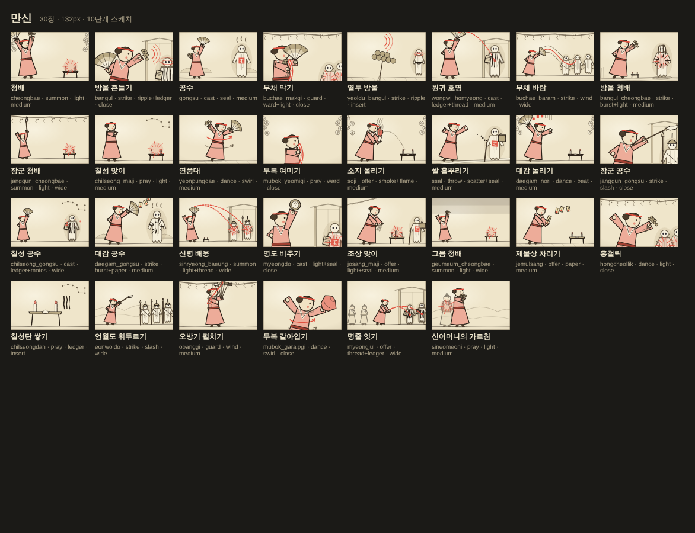
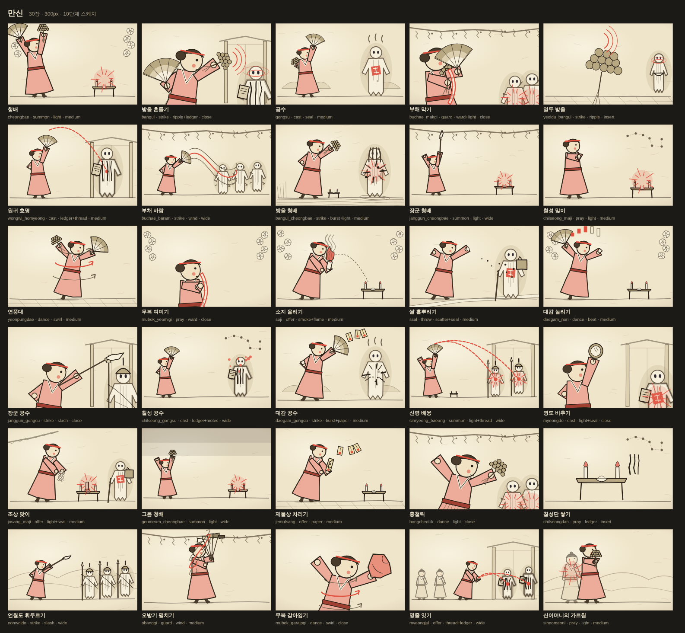

# 카드 삽화 v0.1 (Phase 10 스케치 · 결정 D8-1)

> 작성 2026-11-05 · 상태: **10단계 스케치 완료 — 카드마다 삽화(D8-1). 지금은 나중 그림 제작을 위한 간단한 스케치 수준까지만. 최종 삽화는 11단계**
> 근거: [표현 설계](10-presentation.md) §4.3·§4.4·§5 · [영웅](03-heroes.md) §3·§8 · [카드](04-cards.md) · [표현 조사](research/presentation-reference.md) §4·§5 · [무속 지식 정리](research/lore/shamanism-primer.md) §3·§4·§6·§7·§8
> 브리프: `data/art/cards.json`(자동 생성) ← 원본 `tools/art/briefs/*.mjs` + 어휘 `tools/art/vocab.mjs` · 생성 `node tools/art/build.mjs`
> 스케치: `web/src/art/`(코드로 그린 SVG, `<CardArt>`) · 밀착 인화 `docs/design/art/*.png` · 생성 `node --import tsx tools/art/contact-sheet.mjs`
> 수치(인일)는 모두 **추정**이다.

## 0. 한눈에

- **314장**의 삽화 브리프와 스케치를 만들었다: 카드 296장(영웅 8 × 30 · 합기 28 · 공용·저주·상태·공물 28) + 부적 18장. 강화판 280장은 기본판 그림을 같이 쓴다.
- **브리프**(일러스트레이터용, 한국어): 무엇을 · 어느 순간을 · 어떤 구도로 · 어떤 무구를 · 어떤 모티프와 빛으로 · 무엇을 피하고 · 어느 문서가 근거인지. 카드마다 손으로 쓴 장면(subject·action·초점)에 공용 어휘(무구 용어집·영웅 복식·원귀 계열·윤리)를 붙여 만든다.
- **스케치**(게임에 지금 보이는 것): 한지 바탕 + 먹선 + 강조색 하나. 브리프의 구조 필드(영웅·자세·대상·글리프·구도·배경)로 **실행 중에 코드로 그린다**. SVG 파일 300장을 싣지 않는다. 더한 JS는 약 **70KB(gzip 약 25KB)**, 카드 한 장 그리는 데 약 0.3ms.
- 스케치는 **카드끼리 구별**되고(빌드가 같은 조합을 막는다), **112px 카드에서도 읽힌다**(작은 카드 세밀도: 굵은 선·장식 생략·가장자리를 조금 잘라 크게).

| 카드 크기(132px) | 큰 크기(300px) |
|---|---|
|  |  |

밀착 인화(묶음 10개 × 크기 2 + 카드 틀 안 보기 1): `docs/design/art/sheet-{manshin·jaebi·posu·baksu·seungnyeo·beopsa·talggun·chasa·duo·common}-{132·300}.png`, `docs/design/art/in-card.png`.

## 1. 범위와 수량

| 묶음 | 카드 | 부적 | 합계 | 근경 | 중경 | 원경 | 인서트 | 상징 |
|---|---:|---:|---:|---:|---:|---:|---:|---:|
| 만신 | 30 | 0 | 30 | 7 | 14 | 7 | 2 | — |
| 잽이 | 30 | 3 | 33 | 6 | 11 | 12 | 4 | — |
| 포수 | 30 | 0 | 30 | 4 | 10 | 13 | 3 | — |
| 작두박수 | 30 | 0 | 30 | 6 | 12 | 10 | 2 | — |
| 승려 | 30 | 2 | 32 | 7 | 12 | 10 | 3 | — |
| 법사 | 30 | 5 | 35 | 6 | 9 | 13 | 7 | — |
| 탈꾼 | 30 | 2 | 32 | 7 | 14 | 7 | 4 | — |
| 차사 | 30 | 0 | 30 | 6 | 10 | 12 | 2 | — |
| 합기 | 28 | 6 | 34 | — | 2 | 26 | 6 | — |
| 공용·저주·상태·공물 | 28 | 0 | 28 | 1 | 10 | 4 | 2 | 11 |
| **합계** | **296** | **18** | **314** | **50** | **104** | **114** | **35** | **11** |

- 강화판(`id+`) 280장은 따로 그리지 않는다. 카드 틀의 금박·「강」 인장이 구분한다.
- 굿상 설치물(신령 24종)은 카드가 아니다 — 전투 무대의 굿상 그림(10-presentation §5.1 "굿상 신령·부적")으로 따로 만든다.

## 2. 브리프 형식 (`data/art/cards.json`)

카드 한 장 = 한 덩어리. 사람이 읽는 칸과 스케치 렌더러가 읽는 구조 칸이 함께 있다.

| 칸 | 내용 | 예 (`posu.jojun` 조준) |
|---|---|---|
| `subject` | 누가·무엇이 그려지는가 | 화승총을 어깨에 대고 겨누는 포수 |
| `action` | 그리는 **순간** | 가늠쇠 끝에 들어온 객귀 가슴에 붉은 점지 도장이 떠오른다. 허리 화약통이 한 칸 찬다 |
| `composition` | 구도(근경·중경·원경·인서트·상징), 왼쪽→오른쪽 배치, 배경 겹, **초점**. 16:10 | 중경(전신) … 왼쪽 2/5에 포수 · 오른쪽에 객귀 · 배경: 민화식 겹 산 · 초점: 원귀 가슴의 도장 |
| `costume` | 영웅 복식 열쇠(탈꾼은 이 장면의 탈) | 포수: 털모자, 비스듬히 멘 화승총, 허리의 화약통 |
| `propsText` | 무구 — **정확한 이름과 생김새**(용어집) | 화승총 — 불씨 줄(화승)을 물려 점화하는 긴 총… |
| `motif` | 빌려 오는 한국 시각 모티프 | 사냥굿의 포수 · 넋전 한지 오림 원귀 + 객귀의 봇짐·지팡이 |
| `mood` | 빛과 색. **강조색은 하나** | 넋등의 따뜻한 빛 · 원귀 뒤 흙길빛(#a08a6a) 흐림 · 강조색 하나: 포수 색 #3fae94 |
| `avoid` | 고증·재현 윤리상 피할 것 | 사냥 고어·짐승 사체 금지 · 맞는 원귀는 먹 획과 종이 구김으로 |
| `refs` | 근거 문서(docs/ 기준) | 03-heroes.md §3.3 · 10-presentation.md §4.4 |
| 구조 칸 | `hero` `pose` `target` `count` `fx` `fx2` `framing` `bg` `accent` `mask` `vs` `tier` `emblem` `boss` `downed` `props` | `posu` `aim` `객귀` 1 `seal` — `medium` `hills` `h0` … `["gun","hwayaktong"]` |

**만드는 법**
- 카드마다 손으로 쓰는 것: 자세·대상·글리프·구도·무구 키, `subject`·`action`, 필요하면 초점·모티프·분위기·피할 것·근거(`tools/art/briefs/<묶음>.mjs`).
- 공용 어휘에서 붙는 것: 무구 이름·설명(용어집 73개), 영웅 복식·모티프·윤리, 원귀 계열의 한의 빛깔·덧붙임, 카드 종류별 주의(저주·상태·부적·맞는 원귀·신령).
- `node tools/art/build.mjs` 가 검사한다: 카드 데이터의 모든 id에 브리프가 있는가 · 열거값 · 용어집에 없는 무구 · 합기는 영웅 둘 · **같은 조합(영웅·자세·대상·글리프·구도·무구·배경·탈·강조색)이 두 장 없는가**. 새 카드가 생기면 브리프가 없다고 실패한다.
- 결과 두 개: `data/art/cards.json`(전체 브리프) · `web/src/art/table.ts`(구조 칸만 압축한 표).

**무구 이름의 정확성**(용어집 근거: 무속 지식 정리 §6, 국가민속대백과·한국민족문화대백과 인용)
- 육환장 = 머리 고리에 작은 고리 **여섯**을 단 석장 · 신칼(대신칼) = 칼자루 끝 **흰 종이 술** · 오방기 = 빨강·흰·노랑·파랑·검정 **다섯 색** 깃발 · 오라 = **붉은** 줄 · 적패지 = 차사의 **붉은 저승 문서** · 장구 = **모래시계형** 양면 북(오른쪽 채편은 열채, 왼쪽 북편은 손·궁채) · 대신방울 = 놋쇠 고리 넷에 셋씩 **12개** · 작두 = **쌍날**, 맨발로 선다.
- 확실하지 않은 것은 용어집에 ❓를 달고 감수 대상으로 남긴다(§8).

## 3. 구조 칸의 열거값 — 스케치와 최종 그림이 같이 쓰는 말

### 3.1 자세 (`pose`)

| 값 | 뜻 | 값 | 뜻 |
|---|---|---|---|
| strike | 내리치기·휘두르기 | offer | 바치기·건네기(허리 숙임) |
| aim | 겨누기(두 손 수평) | summon | 청하기(두 팔을 들어 모심) |
| cast | 짚어 내리기(한 손 높이) | rest | 앉음 |
| guard | 막아서기(무구를 세워 앞에) | rescue | 무릎 꿇고 부축·살핌 |
| drum | 악기 치기 | read | 경문·문서 읽기 |
| dance | 춤(두 팔 벌림·한 발 들림) | write | 앉아 쓰기 |
| bind | 던져 묶기 | pray | 합장·여밈 |
| throw | 던지기 | swap · advance · retreat | 자리 바꿈 · 나섬 · 물러섬 |

### 3.2 효과 글리프 (`fx`) — 전투 화면 상태 표식과 같은 "물건 같은" 언어(10-presentation §3, C안에서 빌림)

| 값 | 그림 | 주로 뜻하는 것 |
|---|---|---|
| seal | 대상 가슴의 **붉은 사각 도장** | 점지 |
| ledger | 대상 몸에 세로로 적히는 **먹 이름 획** | 명부 |
| ripple | 무구에서 퍼지는 **겹 원호**, 대상 머리의 고리 | 소리·넋흔들림 |
| crack | 종이 몸에 가는 **금** | 상흔(피 아님) |
| chain | 대상을 감은 **줄 고리** | 오라·묶임·올무 |
| ward | 몸 앞의 반투명 **한지 가림막** | 방어도·엄호 |
| beat | 머리 위 **눈금 다섯** | 장단 |
| paper | 떠오르는 **괴황지 조각** | 부적 생성 |
| light · motes | 모이는 빛살 · 떠오르는 빛 알갱이 | 청배·신령 · 회복·귀기 감소 |
| burst · slash · shot · scatter | 먹 획 튐 · 붓 한 획 · 총구 불빛과 직선 · 부채꼴 낱알 | 타격(피 대신 먹과 구김) |
| thread · swap · wind · swirl · smoke · flame · petals | 실선 · 엇갈린 두 화살 · 바람 결 · 회오리 결 · 연기 · 불꽃 · 종이꽃잎 | 지목·이어짐 · 진형 · 부채 바람 · 연풍대·휘몰이 · 화약·소지 · 화부 · 지화·해원 |

### 3.3 구도 (`framing`) · 배경 (`bg`) · 강조색 (`accent`)

| 구도 | 정의 | 수 |
|---|---|---:|
| close 근경 | 허리 위. 인물과 무구가 높이를 거의 채운다. 대상은 오른쪽 끝에 잘려 들어온다 | 50 |
| medium 중경 | 전신. 바닥선은 아래 1/6 | 104 |
| wide 원경 | 인물은 높이의 절반 이하. 원귀 무리·동료·배경 겹 | 114 |
| insert 인서트 | 사람 없이 무구·물건 하나(부적 카드·능력 카드) — 민화 책거리처럼 평면으로 | 35 |
| emblem 상징 | 저주·상태·넋 부르기 — 사건이 아니라 상태를 한 장의 문양으로 | 11 |

- 배경: 금줄 · 지화 · 달 · 북두칠성 · 겹 산 · 나루 물결 · 대문 · 길베 · 초가 · 돗자리 · 기와 처마 · 그믐 어둠. 원귀 계열마다 기본값이 있다(수귀 = 나루, 객귀 = 길베, 무장 원귀·억울귀 = 대문 …).
- 강조색: `h0`/`h1` 영웅 색(합기는 마무리하는 영웅 하나) · `han` 한의 빛깔(저주·상태) · `lamp` 넋등 빛(공용) · `cin` 경면주사 붉은색(부적·팥·붉은 부적) · `none`.

## 4. 그림 규칙

### 4.1 지금(10단계 스케치)이 뜻하는 것

| 한다 | 하지 않는다 |
|---|---|
| 구도·자세·대상·무구·글리프·배경 겹을 **정한다** | 얼굴 표정·손가락·옷 주름·질감을 그리지 않는다 |
| 영웅은 꼭두 목인 원시 도형(머리쓰개·복식 열쇠·무구), 원귀는 넋전 오림 + 계열 덧붙임 | 개체 변형(얼굴·머리 6×4), 영웅 특수 상태 연출은 없다 |
| 먹선 한 굵기 + 담채 두 단 + **강조색 하나** | 조명·그림자·그라디언트 채색 |
| 카드끼리 **구별**되고 112px에서 **읽힌다** | 아름다움의 최종 판단 — 그것은 11단계 |
| 같은 id = 언제나 같은 그림(시드 떨림) | 그림을 손으로 고치지 않는다(원본은 브리프) |

### 4.2 최종 삽화(11단계)의 규칙

- **선**: 갈색 기 도는 먹(#2b2219)의 붓선. 굵기는 거의 일정하게, 끝은 마른 붓. 스케치의 "두 번 그은 선" 느낌을 남긴다. 윤곽이 먼저 읽혀야 한다(실루엣 우선, 10-presentation §5.2).
- **바탕과 색**: 한지(#efe5ca) 바탕, 먹, 담채 두 단(#ddd0b0 · #b9a983). **강조색은 하나**, 화면 면적의 약 25% 이하. 오방색은 깃발·부채 띠·금줄 같은 물건에만(안티패턴 X2).
- **평면성**: 무신도·꼭두의 평면 정면·측면 도상. 원근은 겹 평면(민화의 산·구름)으로. 영웅은 볼의 붉은 점.
- **구도**: 16:10, 영웅은 왼쪽에서 오른쪽을 본다(전투 무대와 같은 방향). 초점은 가운데 80% 안(가로 10~90%, 세로 12~88%) — 작은 카드 세밀도가 가장자리를 약 4% 자른다. **글자를 넣지 않는다**(카드 문장이 있다).
- **원귀**: 넋전 한지. 맞는 순간은 먹 획과 종이 구김, **피·찢긴 살 없음**, 넋은 찢지 않는다(구김까지). 원귀 뒤 한의 빛깔은 흐림으로만.
- **신령**: 가상 이름, **얼굴 없이** 빛·빈 자리·옷 실루엣. 실제 무신도·명도 도상을 본뜨지 않는다.
- **상태 언어**: §3.2 글리프를 최종 그림에서도 같은 모양으로 쓴다 — 카드와 전투 화면이 한 말을 하게.
- **읽힘 시험**: 98×61px로 줄여 흑백으로 바꿔도 영웅 원형과 동작이 읽힐 것(카드 112px의 안쪽 너비).

### 4.3 재현 윤리 (모든 카드 공통 — 브리프 `avoid`에 카드별로 들어 있다)

- 실존 신령을 적으로 그리지 않는다. 손님(역병 신령)은 원귀 모양으로도, 공격 대상으로도 그리지 않는다(`offering_sonnimsang`).
- 씌임은 "귀신이 붙었다"로만. 저주·상태는 증상이 아니라 상징(발목의 실·눈앞의 가면·어깨 위 작은 넋·그림자).
- 차사는 **적갈색 벙거지**·군졸 조끼 — 검은 갓·검은 두루마기·정장 금지. 재판정·판관·삼차사 구도 금지(`jeoseung_pangyeol`, `eopgyeongdae`).
- 〈신과함께〉·〈도깨비〉·〈KPop Demon Hunters〉·〈쌍갑포차〉·〈샤MONEY즘〉의 외형을 따르지 않는다.
- 법사는 유건·경문 — 중국 도사 모자·일본 음양사 복장·실제 부적 문자를 쓰지 않는다(획은 가상). 진언 문자(범자)도 베끼지 않는다.
- 작두는 긴장과 정적 — 발과 날 사이에 빛 한 줄, 피 없음. 탈은 실제 지역 탈을 본뜨지 않는다.
- 모든 그림은 새로 그린다. 사진·실물·다른 작품을 따라 그리지 않는다(상업 사용).

## 5. 영웅별 시각 어휘

| 영웅 | 실루엣 열쇠 | 머리·복식 | 대표 무구 | 잦은 자세 | 잦은 글리프 | 강조색 |
|---|---|---|---|---|---|---|
| 만신 | 넓은 소매, 펼친 부채 | 쪽진 머리 + 붉은 띠, 무복(홍철릭) | 방울·무선·언월도·오방기·명도·굿상 | 청하기·내리치기·짚기·춤 | 빛·이름 획·도장 | #e0503f |
| 잽이 | 허리에 가로로 멘 장구 | 패랭이 | 장구·열채·징·제금·태평소·피리 | 악기 치기(절반) | 장단 눈금·고리·부적 | #e5b640 |
| 포수 | 비스듬한 긴 총 | 털모자, 가슴 끈, 허리 화약통 | 화승총·화약통·꼬질대·산탄 주머니·바위 | 겨누기(절반) | 도장·총구 직선·금·낱알 | #3fae94 |
| 작두박수 | 흰 도포 + 어두운 전복, 쌍날 위 | 전립 + 상모, 구군복·철릭 | 신칼(흰 술)·작두·삼지창·언월도 | 춤·내리치기·청하기 | 금·붓 획·빛(정적) | #d4dde3(선은 어둡게) |
| 승려 | 긴 육환장, 사선 가사 | 민머리, 목의 염주 | 육환장·염주·목탁·범종·업경대 | 내리치기·합장·막아서기 | 가림막·고리·먹 튐 | #c08a52 |
| 법사 | 앞에 든 경문, 앉은 자세 | 유건 | 경문 두루마리·부적·붓·경면주사 | 읽기·던지기·쓰기·인서트 | 부적 조각·가림막·이름 획 | #6d8fe6 (부적은 경면주사 #c33427) |
| 탈꾼 | 큰 탈, 한삼 | 탈(선두 말뚝이·중열 양반·후열 할미) + 탈보 | 한삼·쥘부채·채찍·지팡이·표주박 | 춤·내리치기·나섬 | 장단 눈금·가림막·먹 튐 | #94c653 |
| 차사 | 벙거지 챙, 붉은 줄 | 적갈색 벙거지 + 붉은 술, 군졸 조끼 | 적패지·오라·육모방망이·쇠사슬·까마귀 | 읽기·내리치기·막아서기 | 이름 획(절반)·줄 고리·도장 | #c26aa0 (오라·적패지 붉게) |

- 합기 28장은 **두 영웅이 한 화면**(대부분 원경). 왼쪽 → 오른쪽 = 카드 데이터 owners 순서. 강조색은 마무리하는 영웅 하나.
- 공용 카드의 인물은 머리쓰개 없는 꼭두 파티원(누구의 카드도 아니다). 저주·상태는 상징 구도.
- 원귀 계열 어휘는 10-presentation §4.4 그대로(수귀 젖은 머리칼·물결 / 객귀 봇짐·지팡이 / 굶주린 넋 마른 몸·빈 그릇 / 잡귀잡신 찢긴 조각 / 억울귀 그을림·장부 / 역귀 아지랑이 / 무장 원귀 투구·창 / 몽달·손각시 댕기). 보스 소품은 뱃사공(삿갓·노·배)·허주(가면).

## 6. 일러스트레이터가 쓰는 법

1. **한 묶음씩**: 영웅 한 명의 300px 밀착 인화(`sheet-<영웅>-300.png`)를 펼쳐 놓고 `cards.json`에서 그 영웅의 브리프 30장을 함께 읽는다. 스케치는 구도·자세·대상·글리프의 **약속**이고, 그림체는 §4.2를 따른다.
2. **썸네일 3안**: 카드마다 `composition`의 초점을 지키며 실루엣만으로 3안. 98×61px로 줄여 흑백으로 읽히는지 본다.
3. **바꿔도 되는 것 / 안 되는 것**: 배경 겹·무구의 각도·대상 수·근경↔중경은 바꿔도 된다. 영웅 원형·대상 계열·글리프의 뜻(§3.2)·`avoid`는 바꾸지 않는다. 바꿨으면 브리프 원본(`tools/art/briefs/*.mjs`)을 고치고 `node tools/art/build.mjs`로 다시 만든다 — 스케치도 같이 바뀐다.
4. **감수**: 무속 감수는 묶음 단위로 두 번(썸네일 · 완성). 근거는 각 브리프의 `refs`.
5. **넘기는 파일**: 마스터 1600×1000(16:10) 레이어 파일(배경 · 인물 · 원귀 · 효과 · 강조색 레이어를 나눈다) + 게임용 640×400 WebP. 이름은 카드 id(`posu.jojun.webp`). 강화판은 따로 넘기지 않는다.
6. **게임에 끼우기**: 지금 `<CardArt cardId=…>`가 스케치 SVG를 그리는 자리에 최종 이미지가 들어간다. 이미지가 있는 카드는 이미지, 없는 카드는 스케치 — 한 장씩 갈아 끼울 수 있다(엔진 결정 D9 뒤에 로더를 정한다).

## 7. 11단계 제작 추정 (⚠️ 추정)

10-presentation §5.4의 영웅·원귀 부품 일러스트(Spine)와 **같은 인물 부품을 재사용**한다는 전제다.

| 묶음 | 수 | 장당 인일 | 인일 |
|---|---:|---:|---:|
| 인서트·상징(사람 없음 또는 한 사람 상징) | 46 | 0.4~0.6 | 18~28 |
| 근경(한 사람 크게) | 50 | 0.8~1.2 | 40~60 |
| 중경(한 사람 + 대상) | 102 | 1.0~1.4 | 102~143 |
| 원경(원귀 무리·동료·배경) | 88 | 1.2~1.8 | 106~158 |
| 합기(두 영웅) | 28 | 1.6~2.2 | 45~62 |
| 스타일 프레임·카드 자세 시트(영웅 8) | — | — | 15~20 |
| 감수 2회 반영·수정(약 15%) | — | — | 45~70 |
| **전부 손으로 그릴 때** | **314** | | **약 370~540 인일** |

| 안 | 내용 | 인일 |
|---|---|---:|
| A 전부 그림 | 위 표 | 370~540 |
| **B 핵심만 그림 + 나머지 조립(추천)** | 기본 32 · 희귀 39 · 합기 28 = 99장은 손으로 그리고(1.5~2.0), 나머지 215장은 Spine 인물 부품을 자세대로 세워 배경·무구·글리프만 덧칠한다(0.4~0.6) + 스타일·감수 | **약 290~400** |
| C 조립만 | 314장 모두 부품 조립 + 덧칠 + 스타일·감수 | 160~240 |

- B안이면 일러스트레이터 2명 기준 약 7~10개월로, 10-presentation §5.4(580~800 인일)와 겹쳐 진행한다. 버티컬 슬라이스(1막)는 영웅 3+1명의 카드 약 120장 중 시작 덱·첫 보상 풀 40장부터.
- 용량: 640×400 WebP 약 25~45KB × 314 = 약 8~14MB. 웹 한 장 아티팩트에는 넣지 않고(지금은 스케치), 최종 엔진(D9)에서 필요할 때 읽는다.

## 8. 열린 문제

| # | 문제 | 다음 |
|---|---|---|
| A1 | 무구 용어집의 세부(화승총 부품 이름, 터주가리, 범종 타종 수의 의미 등)는 국가민속대백과로 다시 확인한다 | 11단계 감수 ① 전 |
| A2 | 차사의 강조색(#c26aa0)과 "붉은 오라·적패지"가 스케치에서 같은 색이다. 최종에서는 오라·적패지를 경면주사 붉은색으로, 영웅 색은 옷에만 | 스타일 프레임 |
| A3 | 작두박수 영웅 색(#d4dde3)이 한지 위에서 약하다 — 스케치는 선을 어둡게 바꿔 그린다. 최종 카드 틀 색과 함께 다시 정한다 | 카드 틀 디자인 |
| A4 | 부적 카드 18장은 인서트라 서로 닮았다(글리프·대상·강조색으로만 구분). 부적마다 고유 문양(가상)을 정하면 더 갈린다 | 11단계 |
| A5 | 전투 무대의 인물(`web/src/ui/scene/`)과 카드 삽화의 인물(`web/src/art/`)이 같은 원시 도형(figures.mjs)을 따로 옮겼다. 11단계 Spine 부품으로 갈 때 하나로 모은다 | D9 뒤 |
| A6 | 공수·청배 계열 카드는 신령을 "빈 자리·빛"으로만 그린다 — 반복되어 단조로울 수 있다. 굿상 신령 그림(§5.1)이 정해지면 옷 실루엣을 더한다 | 신령 그림 |

## 9. 변경 기록

| 날짜 | 변경 |
|---|---|
| 2026-11-05 | v0.1: D8-1(카드마다 삽화, 지금은 스케치) 반영. 314장 브리프(`data/art/cards.json`) + 코드로 그린 스케치(`web/src/art/`, `<CardArt>`) + 밀착 인화 21장(`docs/design/art/`) + 검사 테스트(`tests/card-art.test.ts`). 11단계 제작 추정 |
| 2026-11-05 | ⟨반복 4⟩ 어휘 `gate`(닫힌 대문 기둥) 배경 문장에 「성문이 아니라 댓가지를 엮어 세운 굿판의 문」을 더했다(05-region3 §1.1 G-01). 브리프 67장의 구도 문장만 바뀌고 구조 칸·스케치는 그대로. 카드 데이터는 바꾸지 않았다(새 카드 없음) |
