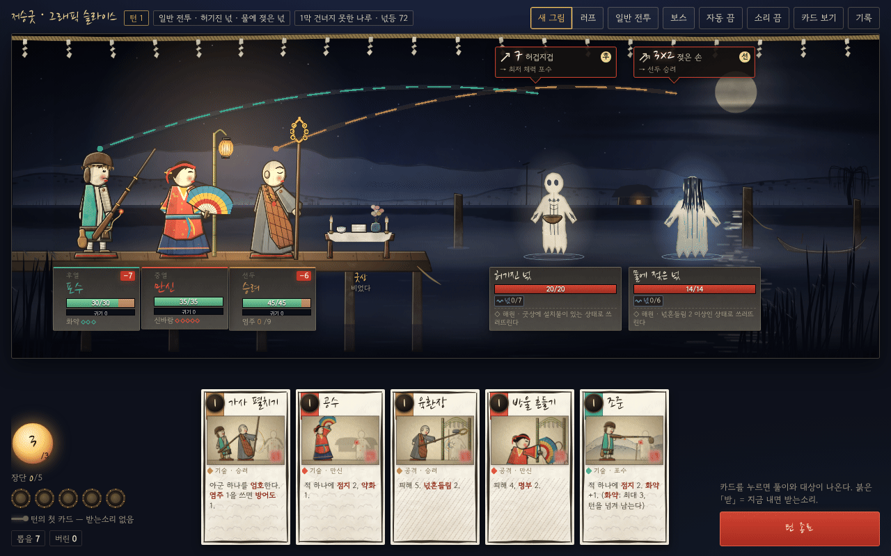
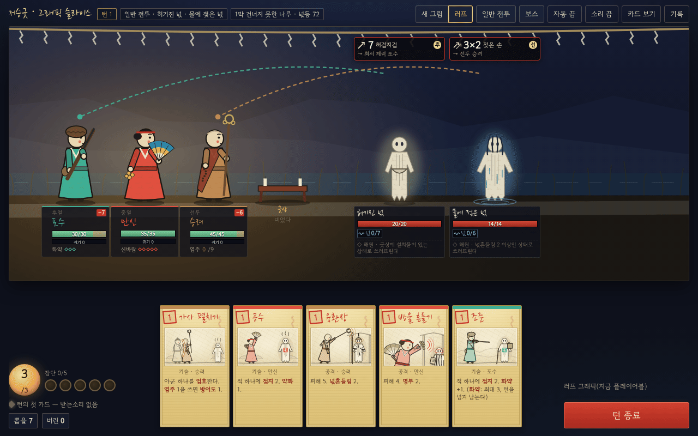
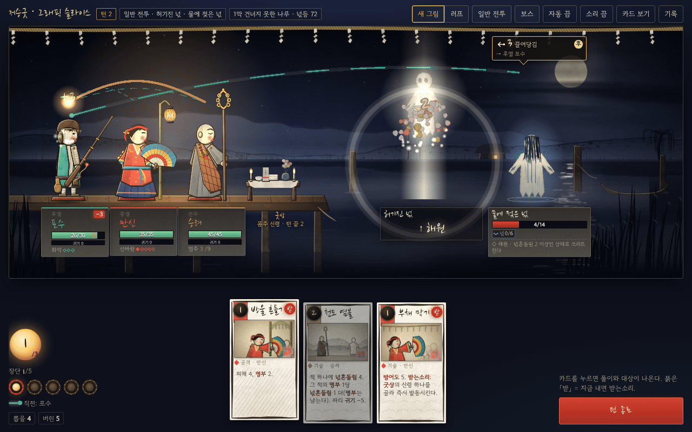
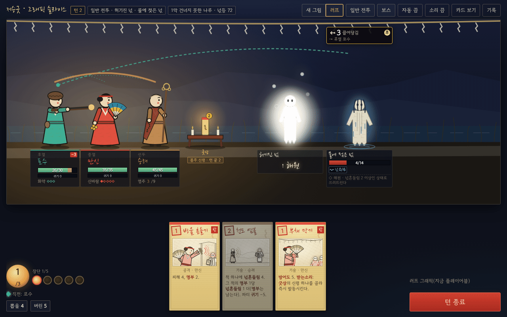
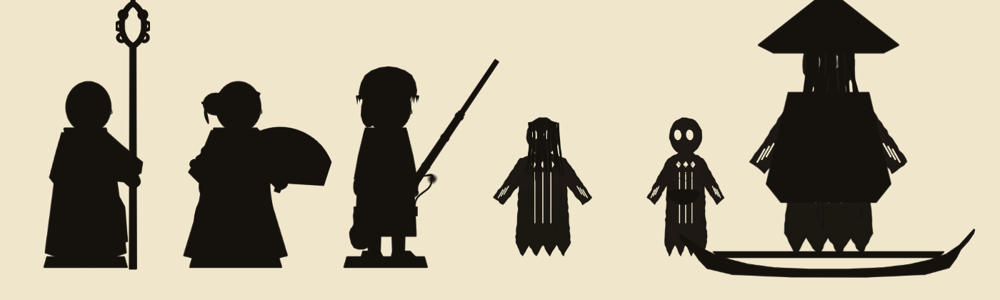
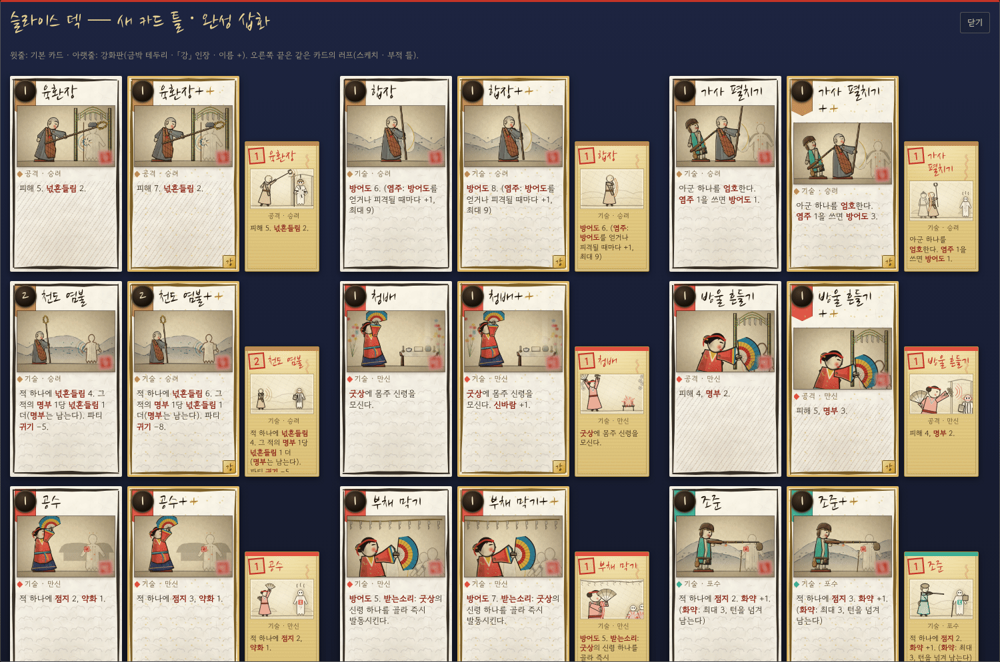
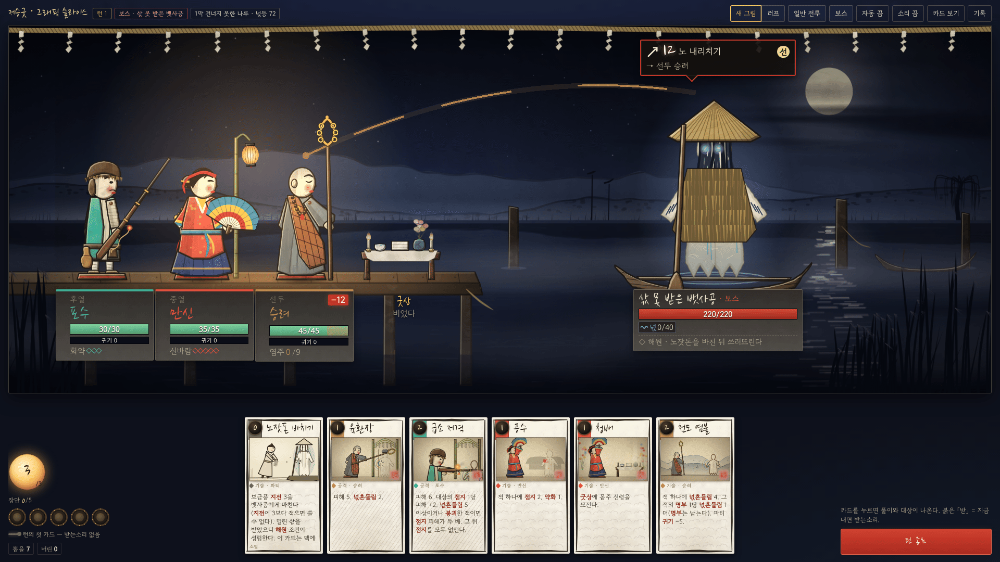
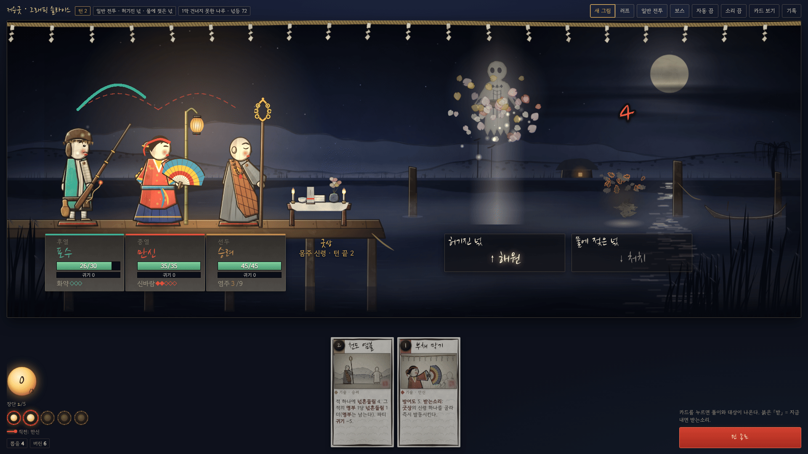
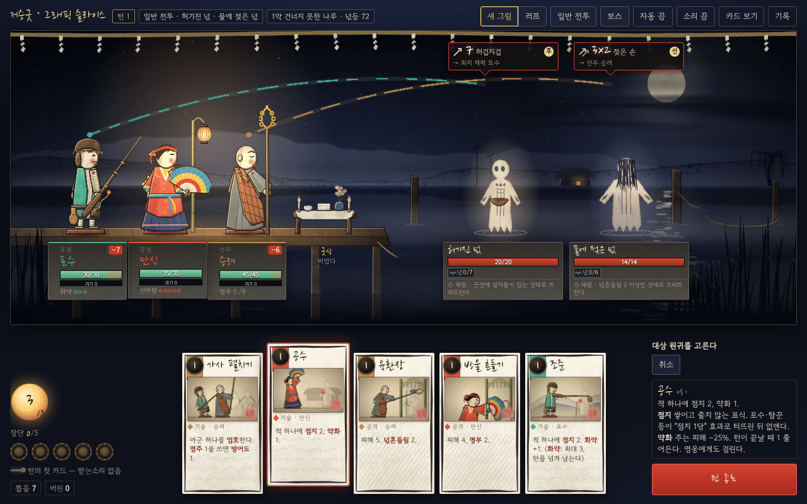
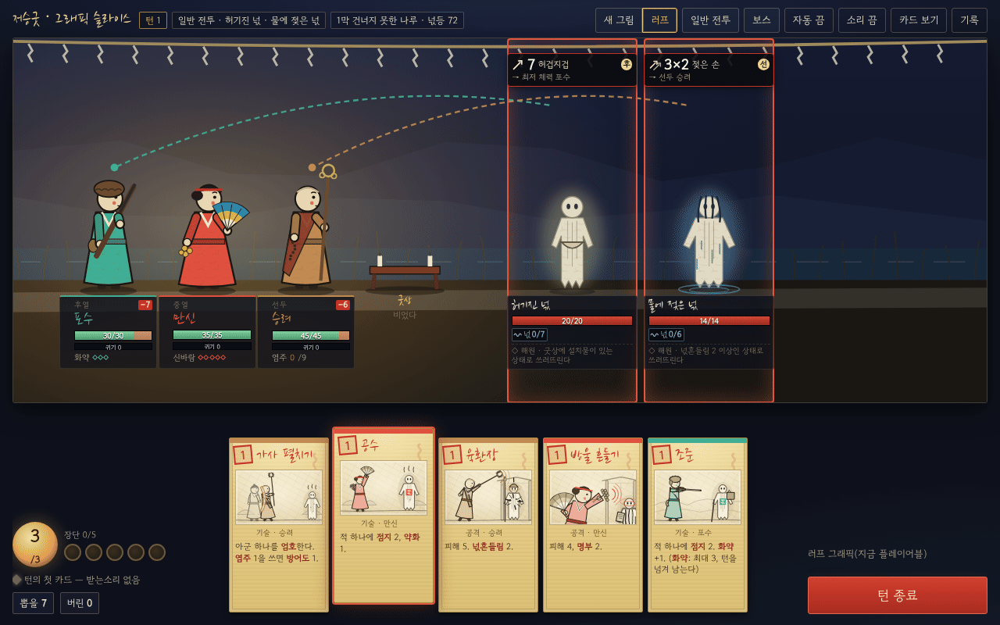

# 그래픽 슬라이스 v0.1 (화풍 판정용 한 부분 · D9 성능 시험)

> 작성 2026-11-06 · 상태: **슬라이스 완성 — 디자이너 판정(A 유지 / B 조정 / C 재연구) 대기.** 플레이어블(`web/src/`)은 그대로다
> 근거: [표현 설계](10-presentation.md) §3 · §4(특히 §4.6·§4.9·§4.10) · §5.3 · §7 D9 · [설계 계획서](00-design-plan.md) D9 · [카드 삽화](11-card-art.md)
> 실행: `npm run web:slice` → `web/dist/slice-artifact.html`(HTML 한 장, 1.24MB) · 연기 시험 `npm run web:slice:e2e` · 성능·증거 `npm run web:slice:bench` → `docs/design/slice/` · 개발 `npm run web:slice:dev`
> 코드: `web/slice/`. 플레이어블의 엔진 호출 순서·대상 고르기·봇(`web/src/game/combat.ts`)과 러프 그림(`web/src/ui/scene/` · `web/src/art/`)은 가져다 쓰기만 한다. 규칙·데이터는 건드리지 않았다(시뮬 수치 변화 없음)
> 수치(작업일)는 모두 **추정**이다.

## 0. 한눈에

디자이너 결정: *"그래픽을 한 부분에만 입혀 보고, 그 화풍으로 계속할지 정한 뒤 전부에 입힌다. 아니면 새 화풍을 더 연구해야 할 수 있다."* — 그 한 부분이 **1막 「건너지 못한 나루」 전투**다. 영웅·원귀·배경·UI·연출이 모두 모이고 가장 오래 보는 화면이라서다.

| 무엇 | 이 슬라이스에서 |
|---|---|
| 전투 | 진짜 엔진으로 일반 전투 1(허기진 넋 · 물에 젖은 넋, `e4`) + 보스(삯 못 받은 뱃사공, `b1`). 파티 승려 · 만신 · 포수(§5.3), 덱은 세 영웅의 시작 카드 12장 |
| 무대 | **PixiJS v8 (WebGL)** — 밤 나루: 달·먹구름 · 수묵 먼 산 · 건너편 기슭(주막 창불·솟대·버드나무) · 움직이는 물 반사(셰이더) · 말뚝·매인 빈 배 · 강 안개 · 앞 갈대 · 금줄. 패럴랙스 4겹, 넋등 빛 감쇠, 한지 결 |
| 영웅 | 꼭두(채색 목인) 컷아웃 3 — 부품 7개를 코드로 깎아 칠하고 회전축으로 이은 리그. 숨쉬기 · 근접/원거리 공격 · 시전 · 피격 · 쓰러짐(작은 넋) · 기상 |
| 원귀 | 넋전(한지 오림) 메시 — 가장자리가 펄럭이는 `MeshPlane`. 계열마다 숨·공격·피격이 다르고, **해원**(펴져 하얗게 떠오름 · 꽃잎)과 **처치**(구겨져 잿빛으로 주저앉음 · 재) |
| 읽기 | 의도 배지 + 대상 영웅까지 흐르는 실 · 장단 북과 받는소리 실 · 영웅 이름판(체력 · 예상 피해 · 방어 · 귀기 · 자원) · 피해 숫자. CZN 배치(§4.9) 그대로 |
| 손패 | 새 카드 틀(한지 · 붓 테두리 · 원형 낙관 · 타입 문양 · 강화 금박) + **시작 카드 12장 완성 삽화**(무대와 같은 부품으로 짠 먹·채색 그림) |
| 견주기 | 화면 위 **「새 그림 / 러프」** 단추 — 같은 전투, 같은 상태를 지금 플레이어블의 러프 그림으로 바로 바꿔 본다 |
| 성능(D9) | 헤드리스 크로뮴 = **CPU 렌더(SwiftShader)** 에서 바쁜 턴 프레임 중앙값 1280×800 **33ms** · 1920×1080 **83ms**, 첫 프레임 0.6초. 비관적 하한이다(§5) — 실제 GPU 확인이 남았다 |

| 새 그림 1280×800 | 러프 1280×800 |
|---|---|
|  |  |
|  |  |

**판정 요청**: §3 체크리스트를 보고 **(A) 이 화풍 유지 · (B) 손잡이만 조정 · (C) 다시 연구** 중 하나 — 다음 걸음은 §4.

## 1. 만든 것과 까닭

### 1.1 범위

| 항목 | 내용 | 까닭 |
|---|---|---|
| 일반 전투 | `e4` 허기진 넋(굶주린 넋) + 물에 젖은 넋(수귀) | 계열이 둘이고, 두 해원 조건(굿상에 설치물 = 만신 · 넋흔들림 2 = 승려)을 이 파티가 낼 수 있다 → 해원과 처치가 한 전투에 함께 나온다 |
| 보스 | `b1` 삯 못 받은 뱃사공 — 노잣돈(지전 3)을 바치면 해원 | §4.4 보스 소품(삿갓 · 노 · 배)의 첫 본보기. 보스 크기 1.6 |
| 엔진 | `createCombat · playCard · endPlayerTurn · enemyTurn · startPlayerTurn` 을 플레이어블 `endTurn` 과 같은 순서로. 대상 고르기(`targetSteps · completeChoice`) · 받는소리 판정 · 의도 표시 · 봇(자동 진행)은 `web/src/game/combat.ts` 함수 그대로 | 화면이 엔진 상태를 읽기만 한다(§4.1) |
| 적 차례 | 원귀 하나씩 차례로 보인다. 복제한 상태에서 같은 시드로 미리 돌려(연출 전용) 원귀마다 결과를 나누고, 실제 `enemyTurn` 결과와 같은지 확인한다(다르면 한꺼번에) | 러프는 한꺼번에 움직여 "누가 누구를 쳤나"가 흐렸다 |
| 바쁜 턴 대본 | 성능 시험·녹화용: 같은 `e4` 에서 손패와 원귀 체력만 정해 두고(규칙 그대로) 실제 카드 6장을 낸다 — 턴 1 청배 · 조준 · 합장 → 적 차례(두 원귀가 친다) → 턴 2 육환장 · 화승총 사격(허기진 넋 **해원**) · 방울 흔들기(물에 젖은 넋 **처치**) | 해원·처치·공격 여럿이 한 장면에 몰리는 가장 바쁜 순간 |

### 1.2 무대 (PixiJS v8, WebGL)

| 겹 | 패럴랙스 | 그림 | 움직임 |
|---|---:|---|---|
| 먼 겹 | 0.1 | 하늘(쪽빛 → 지평선), 별, 달(한지빛 원 + 달무리 + 먹구름 띠), 먼 산 두 능선(위가 짙고 아래로 안개에 풀리는 수묵 번짐 + 마른 붓 능선 + 미점), 산허리 안개, 건너편 기슭(갈대 · 초가 주막의 창불 · 솟대 · 늘어진 버드나무) | 정지(한 장으로 합침) |
| 물 | 0.32 | 거꾸로 비친 능선 · 달기둥(끊긴 가로 물빛) · 물결 결 | GLSL 필터: 가까울수록 큰 가로 물결, 밝은 자리(달기둥)만 반짝임 |
| 가운데 | 0.5 · 0.6 | 물속 말뚝 · 말뚝에 매인 빈 나룻배 · 강 안개 | 배가 흔들린다, 안개가 흐른다 |
| 선창 · 인물 | 1.0 | 판자 선창(이음 · 못 · 물속 말뚝 · 밧줄), 대나무 장대에 건 한지 넋등, 굿상(흰 상보 · 정화수 · 떡 · 지화 · 촛불 둘), 영웅 3, 원귀 | 넋등 흔들림 · 불빛 깜박임 · 촛불 |
| 앞 | 1.02 ~ 1.3 | 금줄(새끼줄 + 흰 종이 술) · 앞 안개 · 앞 갈대 | 술 · 갈대가 바람에 |

- **빛**: 넋등 값(72, 환함)으로 정한 어둠 막 — 넋등 둘레는 밝고 가장자리(특히 원귀 쪽)는 어둡다. 달빛이 닿는 오른쪽 위는 덜 어둡다. 넋등 덧빛(가산)과 선창 바닥 빛이 파티를 감싼다. **원귀는 어둠 위**에 그린다 — 넋등이 비추는 게 아니라 스스로 한(恨)의 빛을 낸다.
- **재료**: 정지 겹에는 한지 결(곱하기) · 넋등 어둠 · 가장자리 어둠을 **미리 입혀** 둔다(매 프레임 화면 전체를 덮는 막 3장을 없앴다 — §5.2). 인물·소품·카드는 부품마다 닥 섬유나 나뭇결을 그려 넣었다.
- **카메라**: 아주 느린 흔들림(±14) + 근접 공격 때 앞으로 쏠림 → 겹마다 다른 배율로 밀려 깊이가 생긴다(3D 없이 2.5D — §3 「B에서 빌릴 것」).

### 1.3 영웅 — 꼭두 목인 리그

*먹으로 칠한 실루엣: 승려 · 만신 · 포수 · 물에 젖은 넋 · 허기진 넋 · 뱃사공(10-presentation §5.2 원칙 1).*

- **부품**: `legs`(받침 · 발) · `body`(몸 · 도포) · `head`(머리 · 머리쓰개) · `backArm`/`frontArm`(팔 · 소매 · 손) · `prop`(앞손 무구) · `backProp`(뒷손 무구). 러프(`web/src/art/figures.ts` 의 머리 · 도포 · 앞팔 · 소품, `hero.tsx` 의 `part-body · part-head · part-arm · part-prop`)와 같은 이름이고, 자세 이름도 `figures.ts POSES`(idle · strike · aim · cast · guard · pray · summon · retreat)를 따른다. 뼈대는 회전축 있는 Container — Spine 컷아웃과 같은 구조라 11단계에 그린 부품을 같은 자리에 끼운다.
- **채색 목인 재료**(부품마다 같은 순서): 칠 → 깎은 면 그늘 → 칠 아래 비치는 나뭇결 → 빗각(위왼쪽 빛 · 아래오른쪽 그늘 = 깎은 모서리) → 칠이 벗겨진 모서리(맨나무) → 먹선. 어깨에 부품을 잇는 나무못, 발밑에 꼭두를 세우던 **받침 나무판**(붉은 띠).
- **얼굴**: 흰 분칠 · 굵은 눈썹 · 작은 눈 · 붉은 입술 · 볼의 붉은 점(무신도).

| 원형 | 실루엣 열쇠 | 무구 | 근접/원거리 · 시전 |
|---|---|---|---|
| 승려 | 민머리 · 머리 위로 솟은 고리 지팡이 · 비스듬한 조각보 가사 · 굵은 염주 | 육환장(놋쇠 고리 여섯) | 들어 올림(150ms) → 내리치며 돌진(150ms, 카메라 쏠림) · 합장 = 두 손 모음 |
| 만신 | 쪽진 머리 + 붉은 띠 · **반달 부채** · 넓은 색동 소매 · 퍼진 남색 치마 | 무선(오방색 띠만, 신령 그림 없음) · 방울 다발 + 오색 천 | 부채를 들고 내리침 · 청배 = 두 팔을 높이(굿상에 빛기둥) |
| 포수 | 털벙거지 · 어깨에 비스듬히 멘 긴 총 · 허리의 호리병 화약통 · 행전 | 화승총(불씨 줄 끝 붉은 불) | 겨눔(220ms) → 반동(70ms) · 총구 불빛 · 불티 · 연기 · 탄 줄 |

| 연출 | 움직임 |
|---|---|
| 숨쉬기 | 윗몸 1.2% 늘었다 줄었다 · 팔 · 머리 · 무구가 조금씩(목인이라 2차 움직임은 작게 — §3 위험 대응) |
| 피격 | 뒤로 젖힘 + 붉은 빛 + 먹 획 + 피해 숫자. 방어도로 다 막으면 막는 자세와 「막음 N」만 |
| 쓰러짐 · 기상 | 받침째 뒤로 넘어가 눕고 잿빛 → 작은 넋(흰 종이)이 위에서 흔들린다(피 없음). 기상 = 되튀며 선다 |
| 자세 사이 | 포즈 투 포즈 — 목인이 "탁" 멈추는 이징(살짝 지나쳤다 되튐) |

### 1.4 원귀 — 넋전 종이

- **종이**: 한지 사람 오림 — 빈 눈 · 칼집선 셋 · 가슴 마름모 오림 · 날개 끝 술 · 톱니 단(오린 자리는 실제로 뚫려 뒤가 비친다). 닥 섬유, 손으로 오린 듯 떨리는 가장자리, 뒤에 한의 빛깔 흐림.
- **메시**: `MeshPlane` 9 × 13 꼭짓점을 매 프레임 움직인다 — 아래 단 · 날개 끝 펄럭임(물에 젖은 넋은 무겁게 0.7, 허기진 넋은 떨리게 1.15), 공격 때 영웅 쪽으로 쏠리며 날개가 뻗고, 맞으면 종이가 가로로 출렁인다.
- **계열 덧붙임**: 수귀 = 얼굴을 덮은 젖은 머리칼 · 물 흐른 자국 · 아래가 젖은 종이 · 발밑 물결 / 굶주린 넋 = 좁은 몸 · 갈비 먹선 · 빈 나무 그릇 / 뱃사공 = 삿갓(그늘 속 눈빛만) · 짚 도롱이 · 따로 휘두르는 노 · 흔들리는 나룻배. 카드 삽화용으로 나머지 5 계열(객귀 · 잡귀잡신 · 억울귀 · 역귀 · 무장 원귀) 덧붙임도 그렸다.

**해원 대 처치 (Q2 — 글자 없이 갈려야 한다)**

| | 해원 | 처치 |
|---|---|---|
| 방향 · 빠르기 | **위로** 150, 1.5초 — 길고 느리다 | **아래로** 주저앉음, 0.4초 — 짧고 무겁다 |
| 빛 | 한의 빛깔이 빠지고 흰빛 · 빛기둥 · 퍼지는 빛 고리 | 한의 빛이 꺼진다 · 잿빛 |
| 종이 모양 | 펄럭임이 잦아들며 **펴진다**(가로 1.1) | 꼭짓점이 가운데로 모이며 **구겨지고** 납작해진다(0.55) |
| 입자 | 지화 꽃잎(분홍 · 흰 · 노랑 · 붉은 한지) + 넋 빛 알 | 재 조각 · 불씨 · 그을음 연기 |
| 남는 것 | 하늘에 떠 있는 희미한 흰 종이 | 물 위 잿빛 구김 + 재 무더기 |
| 글자(덤) | 이름판 「↑ 해원」 | 「↓ 처치」 |

### 1.5 읽기 (Q1)

- **의도**: 원귀 머리 위 한지 꼬리표(그림 · 수치 타당×타수 · 행동 이름 · 대상 칸 글자 선·중·후·전·굿·자 · 「→ 선두 승려」). 테두리는 오방색 규칙(공격 적 · 이동 황 · 귀기 청). 꼬리표에서 대상 영웅 머리까지 **영웅 색 실**이 대상 쪽으로 흐르고 끝에 구슬(전체 = 가는 보라 실 · 여럿 중 하나 = 흐린 실 · 굿상 = 노란 실). 적 차례에는 꼬리표와 실을 걷는다.
- **영웅 이름판**: 칸 · **−N 예상 피해**(방어도 뒤) · 이름(붓글씨, 영웅 색) · 체력(예상 피해가 붉게 깜박) · 방어 방패 · **귀기 막대(보라)** · 개인 자원(염주 · 신바람 · 화약) · 약화/홀림/엄호 · 쓰러짐(넋 부르기 r/N · 버틸 %).
- **원귀 이름판**: 체력(명부 빗금 = 처형선) · 상태 그림 + 숫자 + 이름 · 해원 조건 ◇/◆(조건이 맞으면 빛난다).
- **장단**: 왼쪽 아래 채색 북 다섯 — 장단 수만큼 켜지고 맥박이 빨라진다(1.4 → 0.32초), 받는소리로 오르면 새 북이 크게 한 번. 「직전: 만신」 줄, 손패의 붉은 「받」 도장, 무대 위 직전 주인 → 다른 영웅 점선 실, 받는소리 순간엔 굵은 실이 건너간다.
- **피해 숫자**: 붓글씨로 튀어 올라 뜬다(붉은 피해 · 「막음 N」 · 「방어 +N」 · 「넋흔들림 +2」 · 「귀기 +N」).
- **배치**: §4.9 그대로 — 위 무대, 아래 손패 띠, 왼쪽 아래 에너지 · 장단 · 더미, 오른쪽 아래 턴 종료.

### 1.6 손패 — 새 카드 틀과 완성 삽화

| 부분 | 새 틀 |
|---|---|
| 바탕 | 코드로 만든 한지 섬유 결 + 위가 밝은 종이빛 |
| 테두리 | 붓으로 네 번 그은 먹 테두리(굵기가 변하고 카드마다 획이 다르다) |
| 원형 표시 | 영웅 색 **깃발 띠**(왼쪽 위) + 삽화 오른쪽 아래 붉은 **원형 낙관**(승 · 만 · 포) |
| 비용 | 먹방울 안의 붓글씨 숫자 |
| 타입 문양 | 글 칸 바탕에 옅게 — 공격 **빗살** · 기술 **구름** · 능력 **칠보** |
| 강화 | 금박 안쪽 테두리 · 금가루 · 「강」 금 인장 · 이름 뒤 「+」 |
| 받는소리 | 붉은 둥근 도장 「받」 |

- **완성 삽화 12장**(세 영웅의 시작 카드): 지시서 구조 칸(`pose · target · fx · framing · bg` — `data/art/cards.json` → `web/src/art/table.ts`)을 그대로 읽어, **무대와 같은 부품**(목인 부품 · 넋전 종이 · 굿상)과 수묵 배경(겹 산 · 댓가지 문 · 초가 · 지화 · 금줄)으로 짠다. 그래서 무대와 카드가 같은 재료로 보인다. 나머지 카드(노잣돈 바치기 · 넋 부르기 · 그늘 등)는 스케치 그대로 새 틀에 넣었다.
- 「카드 보기」 창: 12장 × (기본 · 강화판 · 러프).

### 1.7 움직임 줄이기 · 소리

- `prefers-reduced-motion`: 트윈은 바로 끝 상태로, 입자 없음, 숫자는 제자리에서 보였다 사라짐, 물결 잔잔, 숨쉬기 · 흔들림 · 깜박임 멈춤, 연출 대기 0.16초. **끝 모양**(해원 = 떠 있는 흰 종이 + 흰빛 / 처치 = 구김 · 재 무더기) · 이름판 글자 · 체력 · 의도가 그대로 남아 정보 손실이 없다(e2e S2 가 확인).
- 소리는 11단계 몫. 러프 합성 소리 7개의 신호(`cue`: 카드 · 받는소리 · 턴 · 해원 · 처치 · 쓰러짐)는 같은 순간에 그대로 울린다(위 「소리」 단추, 기본 끔).

### 1.8 증거 (`docs/design/slice/`)

| 장면 | 새 그림 | 러프 |
|---|---|---|
| 일반 전투 | `normal-1280x800.png` · `normal-1920x1080.png` | `rough-normal-…` |
| 보스 | `boss-…` | `rough-boss-…` |
| 해원 순간 | `haewon-…` | `rough-haewon-…` |
| 처치 순간 | `cheochi-…` | `rough-cheochi-…` |
| 손패(카드 하나 고름) | `hand-…` | `rough-hand-…` |
| 카드 틀 · 실루엣 | `cards-1920x1080.png` · `silhouettes.png` | (카드 보기 창 오른쪽 끝이 러프) |
| 한 턴 녹화 | `turn-1280x800.webm` — 바쁜 턴 대본(턴 1 → 적 차례 → 턴 2 해원 · 처치), 16.5초 | |
| 성능 원자료 | `perf.json` | |

| 보스 1920×1080 | 처치 순간 1920×1080 |
|---|---|
|  |  |

| 손패 1280×800 (새 그림) | 손패 1280×800 (러프) |
|---|---|
|  |  |

### 1.9 코드 지도 (`web/slice/`)

| 파일 | 하는 일 |
|---|---|
| `index.html` · `vite.config.ts` | 따로 빌드하는 진입점(플레이어블 빌드와 섞이지 않는다) |
| `src/battle.ts` | 엔진 호출 · 상태 비교 → 연출 사건(Ev) · 적 차례 미리 돌리기 · 바쁜 턴 대본 |
| `src/art/paint.ts` | 재료 도구(Canvas 2D): 붓 획 · 먹선 · 채색 목인 · 한지 · 수묵 번짐 · 잡음 |
| `src/art/heroes.ts` · `spirits.ts` · `scene.ts` | 꼭두 부품 · 넋전 · 나루 배경 · 소품 (텍스처로 한 번 그린다) |
| `src/art/cardArt.ts` | 지시서 → 완성 삽화 12장 |
| `src/stage/stage.ts` | PixiJS 무대: 겹 · 빛 · 실 · 연출 감독(Step → land · dur) |
| `src/stage/puppet.ts` · `spirit.ts` · `fx.ts` · `filters.ts` · `tween.ts` · `layout.ts` | 목인 리그 · 종이 메시 · 입자/숫자 · 물 셰이더 · 트윈 · 자리 |
| `src/ui/app.tsx` · `overlay.tsx` · `card.tsx` · `slice.css` | 화면 · 무대 위 HTML 층 · 카드 틀 · 스타일 |
| `web/scripts/slice-e2e.mjs` · `slice-bench.mjs` | 연기 시험 · 성능과 증거 |

## 2. 코드 그림이 닿는 곳과 닿지 않는 곳 (11단계 그린 그림과 견주어)

| | 코드 그림(이 슬라이스) | 11단계 그린 그림(일러스트 + Spine) |
|---|---|---|
| 실루엣 · 비례 · 배치 | **닿는다.** 판정에 충분하다 | 같다(이 슬라이스가 기준이 된다) |
| 색 체계 · 빛 · 분위기 | **닿는다.** 밤 · 넋등 · 한의 빛 · 해원 흰빛까지 | 같은 팔레트에 붓맛이 더해진다 |
| 재료(나뭇결 · 한지 섬유 · 먹 번짐) | 흉내까지 — 규칙적인 결이 가까이서 보면 "생성된 무늬"로 읽힌다 | 붓 · 종이의 우연이 살아 있다 |
| 얼굴 · 손 · 옷주름 | **약하다.** 기호 수준(점 눈 · 붉은 볼) | 표정 · 개성 · 개체 변형(R13) |
| 먹선 | 굵기가 변하는 획까지, 필압의 갈라짐은 얕다 | 진짜 붓 획 |
| 움직임 | 포즈 투 포즈 · 종이 펄럭임 · 입자 — 문법은 판정 가능 | 그린 중간 프레임 · 2차 움직임 · 부드러운 이음 |
| 카드 삽화 | 무대 부품을 다시 짠 구도 — 장면은 읽히나 카드마다의 "한 장면"이 얕다 | 카드마다 그린 그림(D8-1) |
| 수정 비용 | 숫자 하나(색 · 굵기 · 비례)로 전부 바뀐다 | 다시 그려야 한다 |
| 크기 · 용량 | 1.24MB 한 장(그림 0바이트 — 실행할 때 그린다) | 1막 에셋 60MB 목표(§5.3) |

→ 이 슬라이스로 **방향**(측면 종이 무대 · 꼭두 × 넋전 · 수묵 밤 · 읽기 체계 · 움직임 문법 · 성능)은 판정할 수 있다. **마감**(얼굴의 매력 · 붓맛 · 카드 한 장 한 장의 그림)은 판정할 수 없다 — 그건 11단계 첫 원형 시안에서 본다.

## 3. 결정 체크리스트 (디자이너)

스크린숏은 `docs/design/slice/`, 움직임은 `turn-1280x800.webm` 또는 `web/dist/slice-artifact.html` 을 직접 열어 본다(「새 그림 / 러프」 단추).

**가독성**
- [ ] **Q1**(5초): 처음 보는 사람이 `normal-1280x800.png` · `normal-1920x1080.png` 한 장에서 "다음에 누가 몇 피해를 맞는가 · 어느 원귀가 해원에 가까운가"를 말하는가(◆가 빛나는 원귀, 이름판 −N) — 러프와 견주어 나아졌는가
- [ ] **Q2**: 글자를 가리고 `haewon-*` · `cheochi-*` · 녹화만 보고 해원과 처치를 가르는가(위·흰빛·꽃잎 대 아래·잿빛·재)
- [ ] 의도 실이 겹쳐도(두 원귀가 한 영웅을 노릴 때) 누가 누구를 노리는지 보이는가
- [ ] 카드 틀: 비용 · 이름 · 주인 · 타입 · 받는소리 「받」 · 강화가 1280 손패 크기에서 읽히는가

**분위기**
- [ ] 밤 나루의 처연함(공포보다 슬픔, §3 「DD 따라 하기」 대응)이 나는가
- [ ] 넋등 빛 안의 파티 · 어둠 속에서 스스로 빛나는 원귀의 대비가 맞는가(더 어둡게 / 더 밝게?)
- [ ] 보스(뱃사공)가 일반 원귀와 다른 무게로 보이는가

**재료 일관성**
- [ ] 영웅(채색 목인) · 원귀(한지) · 배경(수묵) · UI(한지 카드 · 먹 테두리) · 카드 삽화가 **한 세계**로 보이는가
- [ ] 꼭두가 "상여의 채색 목인"으로, 넋전이 "씻김굿의 종이 넋"으로 읽히는가 — 장난감 · 종이 인형극처럼 가볍게 보이지는 않는가
- [ ] 실루엣 시험(`silhouettes.png`): 검게 칠해도 셋이 갈리는가

**움직임**
- [ ] 목인다운 딱딱함이 "의도한 맛"으로 보이는가, "플래시 같다"로 보이는가(§3 위험)
- [ ] 종이 펄럭임 · 해원 꽃잎 · 처치 재가 과하거나 모자라지 않은가
- [ ] 적 차례가 한 원귀씩 이어지는 길이(원귀당 약 0.9초)가 알맞은가

**성능(§5)**
- [ ] 헤드리스 CPU 수치는 하한일 뿐이라는 점을 받아들이고, **실제 GPU 확인**(§5.3)을 D9 조건으로 둘 것인가

## 4. 세 갈래와 다음 걸음

### (A) 유지 — 이 화풍으로 모든 화면에 입힌다

코드 그림을 플레이어블 전체의 그림으로 올리고, 11단계에서 그린 부품을 같은 리그 · 같은 자리에 끼운다(부품 이름이 같다).

| 묶음 | 일 | 추정(작업일) |
|---|---|---:|
| 공용 정리 | 재료 도구 · 리그 · 연출 감독 · 무대 위 HTML 층을 플레이어블 전투 화면으로 옮김(러프 `CombatStage` 대체), 저장 · 자동 진행 · e2e 연결 | 3 ~ 4 |
| 영웅 나머지 5 | 잽이 · 작두박수 · 법사 · 탈꾼 · 차사 부품과 자세, 특수 상태(강신 무복 · 작두 위 · 탈 교체 · 가락 · 오라), 개체 변형(얼굴빛 · 눈썹 · 무구 색) | 7 ~ 10 |
| 원귀 | 계열 템플릿 8의 덧붙임 마감 + 47 항목(일반 · 졸개 0.3 ~ 0.5 · 엘리트 0.7 · 보스 1 ~ 1.5 — 보스 소품 6과 2단계 연출), 손님 가마 · 놀이 사자 · 산 사람 | 22 ~ 30 |
| 배경 | 지역 1 변형(길목 · 빈 방 · 길굿 터 · 보스 굴), 지역 2(역병 마을 · 열기) · 지역 3(댓가지 열두 문 · 업경대 빈 자리 열넷) | 8 ~ 11 |
| 다른 장면 | 길목 걷기 장면 · 마을 파노라마(시설 8 × 5 상태 · 절기) · 사당 · 결과 · 결말 행렬 | 6 ~ 9 |
| 카드 | 새 틀 전 종류(합기 · 저주 · 상태 · 부적), 삽화 구성기를 나머지 영웅으로 넓혀 314장 — 자동 구성 뒤 손볼 카드(약 30%)만 | 10 ~ 18 |
| 검증 | 플레이어블 e2e 스크린숏 갱신, 움직임 줄이기, 실제 GPU 성능(§5.3) | 2 ~ 3 |
| **합계** | | **58 ~ 85 작업일**(1인, 러프 단계 10단계보다 크고 11단계 본 제작 580 ~ 800 인일보다 훨씬 작다) |

순서 추천: 공용 → 영웅 · 원귀(1막) → 배경 1막 → 카드 → 지역 2 · 3 → 나머지 장면. 1막이 끝나면 §5.3 버티컬 슬라이스의 그림 기준으로 쓴다.

### (B) 조정 — 손잡이만 돌린다

| 손잡이 | 어디서 | 지금 값 | 돌려 볼 쪽 |
|---|---|---|---|
| 팔레트 | `art/scene.ts`(하늘 · 산 · 물 색, `darkness` 어둠 세기) · `HERO_COLOR` · `art/spirits.ts HAN` | 쪽빛 밤 · 가장자리 어둠 0.53 · 한의 빛 8색 | 더 어둡게(공포 쪽) / 새벽빛(처연 쪽) · 영웅 채도 낮추기 |
| 선 굵기 | `paint.ts inkOutline · brush` · 부품의 `outline` | 먹선 1.5 단위(무대에서 약 1.7px) | 굵게(목판화 · 민화 쪽) / 가늘게(공필 쪽) |
| 세부 | `woodPiece`(나뭇결 26줄 · 닳음 `wear`) · `paperPiece`(섬유 밀도) · 미점 수 · 입자 수(꽃잎 50 · 재 30) | 중간 | 덜어 평면 채색 쪽 / 더해 공예품 쪽 |
| 결 | `hanjiTile`(한지 결 반복) · 정지 겹에 입힌 곱하기 | 옅다 | 진하게(종이 위에 그린 그림) / 끄기(깨끗한 채색) |
| 인형 비례 | `heroes.ts`(머리 15.5×17.5 · 키 약 150 · 받침) · `layout.ts HERO_SCALE 1.12` · 원귀 등급 크기 | 머리 ≈ 키의 1/5 | 머리를 키워 귀엽게(꼭두 원형에 가깝게) / 줄여 의젓하게 · 받침 빼기 |
| 움직임 | `tween.ts E.snap` · `puppet.ts act` 시간 · `spirit.ts flutter` | 포즈 투 포즈, 공격 0.3초 | 더 딱딱하게(인형극) / 더 부드럽게 |
| 빛 | 넋등 값(지금 72) · 원귀를 어둠 위에 둘지 | 원귀 자체 발광 | 원귀도 어둠 아래(더 무섭게) |

한 바퀴(고치고 스크린숏 · 녹화를 다시 뽑기)는 0.5 ~ 2일. `npm run web:slice && npm run web:slice:bench` 가 증거를 같은 이름으로 다시 만든다.

### (C) 재연구 — 다른 화풍을 더 본다

**조사할 참고 계열**(실물 · 도록 · 영상 — 특정 게임의 그림은 본뜨지 않는다)
- 꼭두 실물(상여 장식 목인: 시종 · 광대 · 호위 · 용수판)과 상여 장식 전체 — 칠 · 비례 · 받침
- 넋전 · 지화 · 지전 · 넋당석 등 씻김굿 종이 무구, 한지 공예(지승 · 지호)
- 무신도 · 민화의 평면 채색, 오방색 쓰는 법
- 수묵 산수(진경산수의 미점 · 피마준), 조선 풍속화의 밤 장면
- 전통 인형극: 남사당 꼭두각시놀음(덜미), 만석중놀이(그림자극)
- 탈 · 단청 무늬(카드 틀 문양)

**목업할 다른 방향 4**(같은 나루 전투 한 장면 + 짧은 움직임, 방향당 2 ~ 3일)

| # | 방향 | 무엇이 달라지나 | 얻는 것 · 잃는 것 |
|---|---|---|---|
| C1 | **그림자극**(만석중놀이식 실루엣 + 한지 막 뒤의 빛) | 인물이 검은 오림 + 색 한지 조각, 배경은 빛 막 | 실루엣 · 분위기 최대, 얼굴 · 애착(P4)이 약해진다 |
| C2 | **민화 · 무신도 평면 채색** | 굵은 윤곽 · 평면 색 · 장식 무늬, 밝고 화사한 밤 | 한국적 색이 가장 선명, 처연함이 줄어든다 |
| C3 | **수묵 담채** | 먹 번짐 위주, 색은 영웅 색 한 점씩 | 처연함 최대, 정보 색(의도 · 상태)이 묻힐 수 있다 |
| C4 | **종이 공예 입체**(접은 한지 · 지호 질감 + 조명 그림자) | 인물 · 원귀 · 배경을 접은 종이로, 2.5D 빛 | 재료감 최대(안 B에 가깝다), 제작비 · 성능 부담 |

## 5. 성능 결과와 D9

측정: `npm run web:slice:bench`(원자료 `docs/design/slice/perf.json`). 바쁜 턴 대본(§1.1: 카드 6장 · 적 차례 · 해원 · 처치 · 입자 · 피해 숫자) 동안 `requestAnimationFrame` 간격. 1280×800 · 1920×1080, 장치 배율 1, 각 3회. 같은 대본을 러프(SVG + CSS)로도 돌렸다.

### 5.1 결과 (헤드리스 크로뮴 153, WebGL = SwiftShader · CPU 4코어)

바쁜 턴(약 10.6초 · 1920 은 12초, 카드 6장 · 적 차례 · 해원 · 처치) 동안의 프레임 간격. 새 그림은 3회 모두 거의 같았다(중앙값은 3회 모두 같은 값).

| 크기 | 그림 | 프레임 중앙값 | p95 | p99 | 16.7ms 이하 | 평균 fps | 첫 프레임 |
|---|---|---:|---:|---:|---:|---:|---:|
| 1280×800 | **새 그림(PixiJS)** | **33.4ms** | 50.1ms | 50 ~ 67ms | 0 ~ 0.4% | 24 | **0.63초** |
| 1280×800 | 러프(SVG + CSS) | 16.7ms | 16.8ms | — | 50%* | 60 | — |
| 1920×1080 | **새 그림(PixiJS)** | **83.3ms** | 100 ~ 117ms | 117ms | 0% | 11 | **0.68초** |
| 1920×1080 | 러프(SVG + CSS) | 16.7ms | 16.7ms | — | 49%* | 60 | — |

\* 러프는 사실상 모두 60Hz 다 — 간격이 16.6 ~ 16.8ms 로 문턱에 걸쳐 절반만 "이하"로 센다. 러프 대본은 연출 대기 없이 바로 넘어가 약 4.9초에 끝난다.

| 첫 프레임까지(1280, 3회 중앙값) | ms |
|---|---:|
| DOMContentLoaded | 264 |
| 첫 글자 그림(FCP) | 388 |
| PixiJS 렌더러 준비 | 433 |
| 무대 그림 다 그림(배경 · 소품 텍스처) | 566 |
| 첫 프레임(영웅 · 원귀 부품까지) | 628 |

| 묶음 | 크기 |
|---|---:|
| JS(엔진 · 데이터 · UI · 러프 그림 · 슬라이스 · PixiJS) | 1,207KB · gzip 340KB |
| 그중 PixiJS 상한(쓰지 않는 기능까지 다 묶은 값) | 909KB · gzip 263KB |
| CSS | 59KB |
| 아티팩트 한 장 | 1,266KB(플레이어블 825KB) |

가만히 있을 때(입력 없음, 물 · 안개 · 숨쉬기만): 1280 33.4ms · 1920 83.3ms — 바쁜 턴과 중앙값이 같다. **입자 · 연출이 아니라 무대 전체를 다시 그리는 값이 바닥이다.**

### 5.2 읽는 법 · 한계

- **이 수치는 비관적 하한이다.** 헤드리스 크로뮴은 GPU 없이 WebGL 을 CPU 로 그린다(`ANGLE … SwiftShader`). 프레임 시간은 거의 **채움(픽셀 수)** 에 비례한다 — 장면 객체를 모두 숨기면 16.7ms(60Hz)로 떨어지고, 자바스크립트(연출 · 메시 꼭짓점 · 실 다시 그리기)는 몇 ms 안이다. 1920 이 1280 의 약 2.5배인 것도 픽셀 수(2.3배)를 따른다.
- **러프가 60fps 로 나오는 까닭**: SVG + CSS 는 크로뮴 합성기가 바뀐 곳만 다시 그린다. PixiJS 는 매 프레임 무대 전체를 다시 그린다(물 · 안개 · 메시가 늘 움직이므로). CPU 렌더에서는 이 차이가 그대로 드러나고, GPU 에서는 뒤집힌다(GPU 는 채움이 싸고 SVG 재래스터가 비싸다). **러프와 새 그림의 수치를 그대로 견주지 않는다.**
- **채움을 줄인 것**(이번에 한 최적화, 같은 하한 환경에서 프레임 중앙값 1280 100ms → 33ms · 1920 약 233ms → 83ms): MSAA 끔(그림은 텍스처 가장자리가 이미 부드럽다), 정지 겹 넷을 한 장으로 합침, 화면 전체를 덮던 막 셋(넋등 어둠 · 비네트 · 한지 결)을 정지 겹에 미리 입힘, 투명도 0 인 것은 그리지 않음, 물 필터는 반 해상도. 이것이 D9 의 실제 교훈이다 — **웹 무대의 비용은 겹친 화면 크기 막의 수**이고, 4K(장치 배율 2)의 내장 그래픽에서도 같은 원칙이 성능을 가른다.
- 첫 프레임 약 0.6초는 탐색 시작 → 스크립트 → PixiJS 준비 → **모든 그림을 코드로 그리는 시간**(배경 · 부품 · 카드 삽화) → 첫 그림. 그린 그림(이미지 에셋)으로 바꾸면 그리는 시간 대신 내려받기 · 해독 시간이 든다.

### 5.3 실제 GPU 확인에 필요한 것

| 무엇 | 어떻게 |
|---|---|
| 기계 | §5.3(10-presentation) 합격선 기준 "내장 그래픽 노트북" — 예: Intel Iris Xe / UHD 620급, AMD 680M급 각 1대 + 보통 데스크톱 GPU 1대 |
| 실행 | 같은 측정을 화면을 띄워 실제 GPU 로: `npm run web:slice && npm run web:slice:bench -- --headed --no-shots --no-video` (크롬 `chrome://gpu` 에서 하드웨어 가속 확인). Steam 판 가정이면 같은 HTML 을 Electron 창에 띄워 한 번 더 |
| 조건 | 장치 배율 1 · 1.5 · 2(4K), 60Hz · 120Hz 화면, 전원 연결 · 배터리 |
| 합격선 | 바쁜 턴에서 16.7ms 이하 **95% 이상**(10-presentation §5.3), 첫 화면 3초 안 |
| 더 볼 것 | 30분 연속 전투의 발열 · 프레임 저하, 원귀 5(상여 + 상여꾼 넷) 장면, 텍스처 메모리(지금 약 20MB 추정 — 배경 겹 · 부품 텍스처) |

### 5.4 D9 에 주는 뜻

- **웹 유지(Preact UI + PixiJS 무대)는 기능으로는 성립한다.** 엔진 · 시뮬 · UI 가 한 코드로 돌고, 무대 · 카드 · 이름판이 같은 상태를 읽고, 단일 HTML 아티팩트 계약(16MB 이하 · 외부 자원 Google Fonts 뿐)까지 지켰다. 첫 프레임은 CPU 렌더에서도 1초 안이다.
- **성능은 아직 판정 못 한다.** CPU 하한(33ms · 83ms)은 합격선 밖이지만, 비용이 채움에 몰려 있고 1280 에서 한 프레임에 그리는 픽셀이 화면 약 3장 분량이라 내장 그래픽에서 60fps 가 나올 것으로 **예상**한다 — 예상일 뿐이다. §5.3 실제 GPU 확인을 D9 의 마지막 조건으로 둔다.
- Spine 런타임은 시험하지 않았다(이 리그는 코드로 만든 컷아웃이다). 11단계에 그린 부품을 넣을 때 Spine(또는 같은 구조의 코드 리그 유지)을 같은 측정으로 다시 잰다.
- 권고: **D9 = ① 웹 유지, 단 실제 GPU 확인 통과를 조건으로.** 통과하지 못하면 먼저 채움을 더 줄이고(물 · 안개를 정지 겹에 합치는 "가벼운 무대" 설정) 그래도 안 되면 ② Godot 을 다시 본다.

## 6. 스스로 보는 약점

- **얼굴과 손**이 기호 수준이다(점 눈 · 붉은 볼 · 둥근 손). 꼭두 실물의 익살과 슬픔이 함께 있는 얼굴에는 못 미친다 — 코드 그림의 한계(§2).
- **카드 삽화가 작다.** 1280 손패(카드 128px)에서 삽화 창은 약 116 × 72px — 무대 부품을 다시 짠 구도라 장면은 읽히지만, 카드마다의 "결정적 한 장면"은 얕다. 큰 카드(카드 보기)에서 더 낫다.
- **재료가 규칙적이다.** 나뭇결 · 섬유가 비슷한 밀도로 반복되어, 가까이서 보면 생성된 무늬로 읽힌다. 수묵 산은 번짐이 얌전하다.
- **원귀 다양성은 셋뿐**(수귀 · 굶주린 넋 · 뱃사공 — 나머지 계열은 카드 삽화의 작은 그림까지). 원귀 다섯이 선 장면(상여 보스)은 시험하지 않았다.
- **밤이 고르게 밝다.** 넋등 빛의 감쇠가 보이지만 원귀 쪽 어둠이 아직 얕다 — 원귀를 어둠 위에 둔 결정(자체 발광) 때문이다. 더 무섭게 갈지 처연하게 갈지에 따라 §4(B) 빛 손잡이로 바꾼다.
- **영웅 쓰러짐 · 기상**은 바쁜 턴 대본에 없다(엔진이 그렇게 흘러갈 때만 나온다). 연출은 넣었지만 녹화 · 스크린숏 증거가 없다.
- **성능은 CPU 하한뿐**이다(§5).
- 무대 위 실은 MSAA 를 꺼서 가장자리가 조금 계단진다(1920 에서 거의 안 보인다).

## 7. 디자이너에게 묻는 것

1. 꼭두를 세운 **받침 나무판**을 유지할까(목인임이 분명해진다 / 무대가 장난감처럼 보일 수 있다)?
2. 원귀를 **스스로 빛나게**(처연) 둘까, **넋등 어둠 아래**(공포)로 내릴까?
3. 카드의 **원형 낙관**을 한글 한 글자(승 · 만 · 포)로 둘까, 한자 · 문양으로 바꿀까?
4. 적 차례를 원귀 하나씩 보이는 길이(원귀당 약 0.9초)가 알맞은가 — 빨리 감기 단추가 필요한가?
5. (A)라면 원귀 47 항목과 카드 314장 중 무엇을 먼저(§4 순서 추천: 1막 원귀 → 카드)?
6. 실제 GPU 확인(§5.3)에 쓸 기계를 누가 · 언제 마련하나 — D9 를 닫는 마지막 조건이다.

## 8. 변경 기록

| 날짜 | 변경 |
|---|---|
| 2026-11-06 | v0.1: 그래픽 슬라이스(1막 나루 전투 일반 · 보스) — PixiJS v8 무대, 꼭두 목인 리그 3, 넋전 메시 원귀 3, 해원 · 처치 연출, 읽기 체계, 새 카드 틀 + 완성 삽화 12장, 러프 견주기 단추, 움직임 줄이기. `npm run web:slice` · `web:slice:e2e` · `web:slice:bench`, 증거 `docs/design/slice/`, 성능 하한(SwiftShader)과 채움 최적화 |
