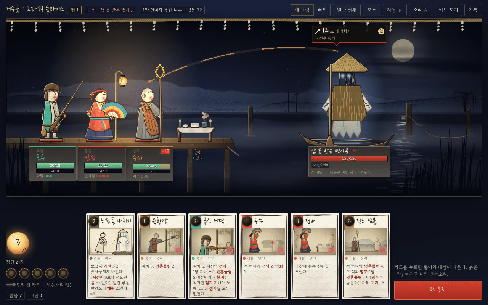
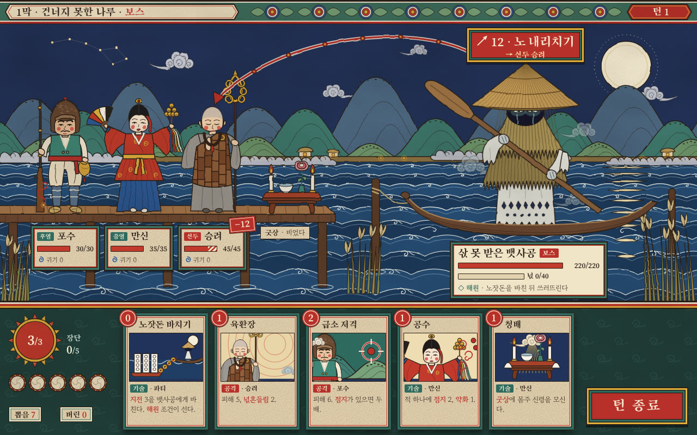
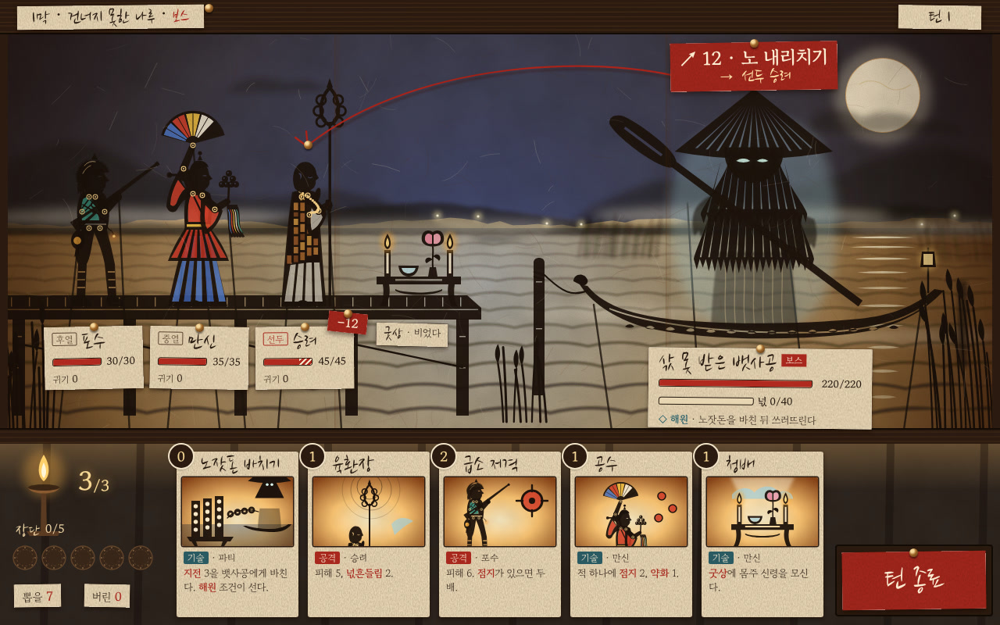
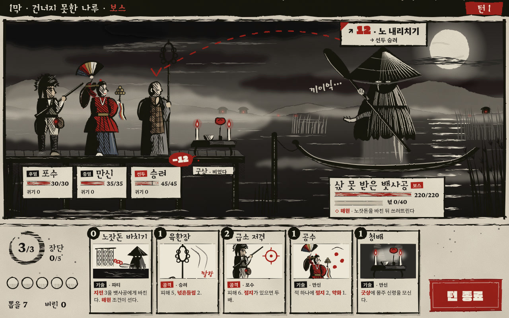
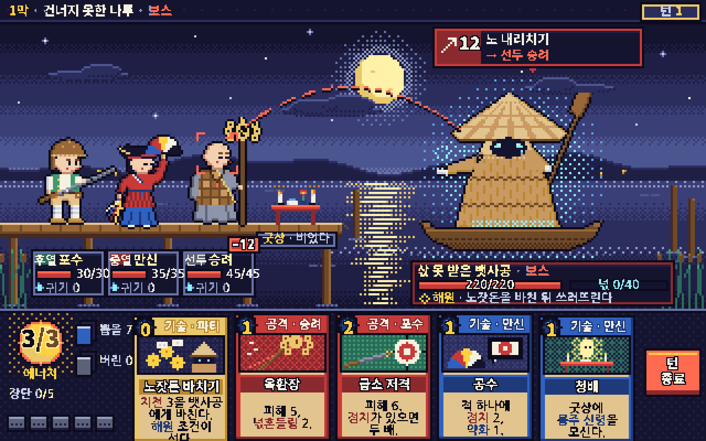
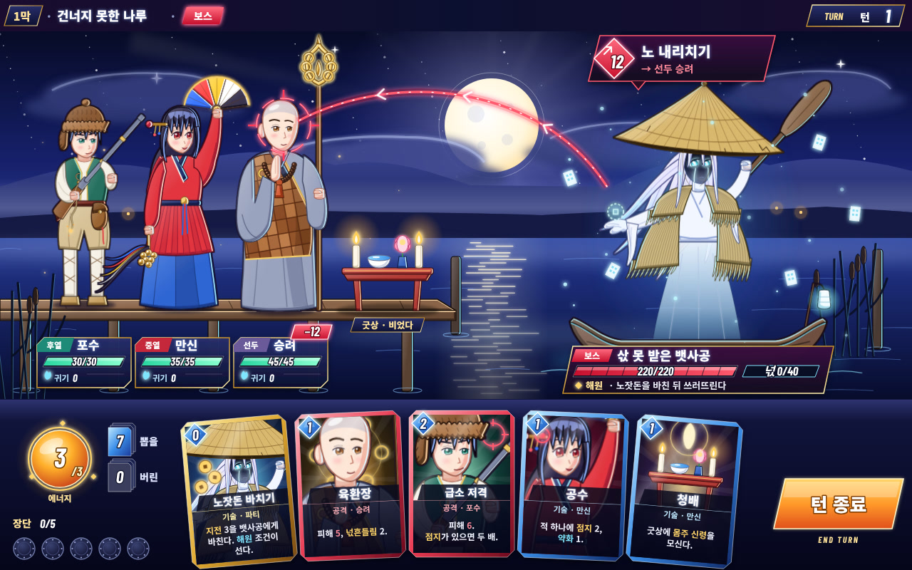
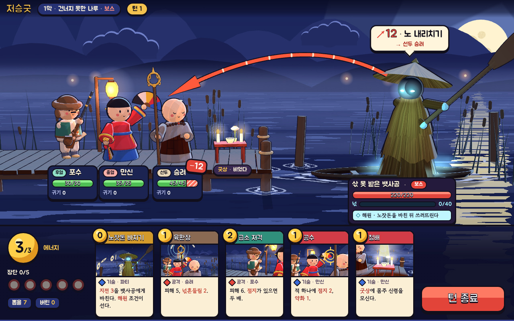
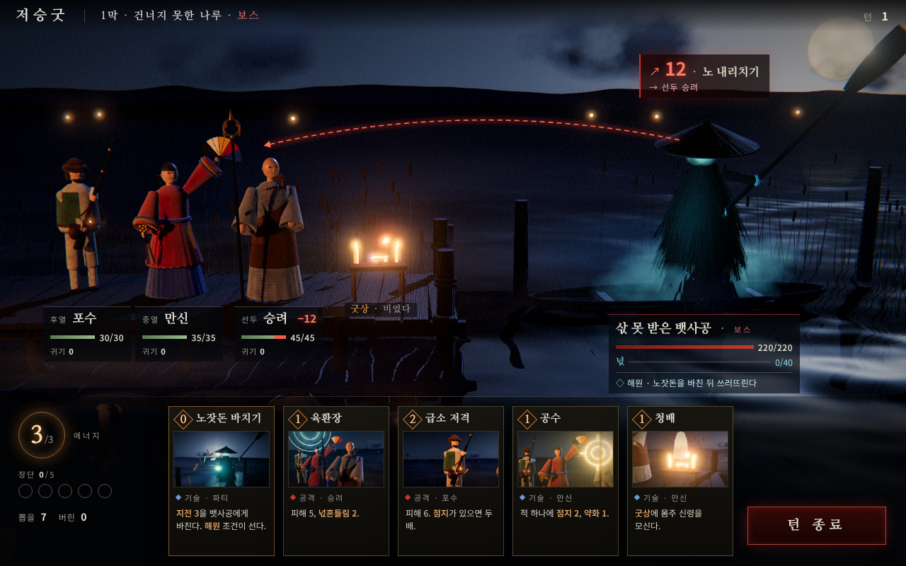
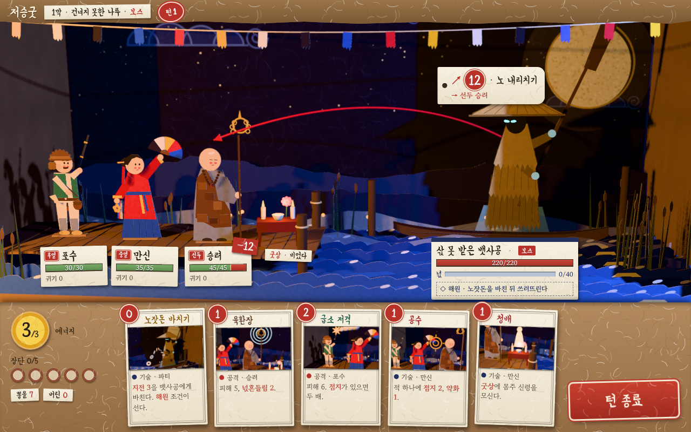

# 화풍 연구 v0.1 — 게임의 그림을 갈래로 나누고 「저승굿」에 맞는 갈래를 고른다

> 작성 2026-11-07 · 상태: **조사 완료 — 시안 s1~s9 그림 대기, 디자이너 판정 대기.** 안 A(지금 방향)를 바꿀지는 시안을 본 뒤 정한다
> 계기: 디자이너 지적 — *"기존 게임을 조사하면 그래픽 톤과 화풍을 분류할 수 있다(언리얼 3D 사실풍, 카툰 등). 그리는 방식에도 더 다양한 대안이 필요하다."*
> 근거: [표현 설계](10-presentation.md) §2(안 A·B·C) · §5.4(본 제작 580~800 인일) · [그래픽 슬라이스](12-graphic-slice.md) §2·§4(C)·§6 · [표현 조사](research/presentation-reference.md)(덱빌더 13종 · 한국 모티프 9가지 — 여기서 되풀이하지 않는다) · [세계관·톤](research/world-tone-options.md) · [시안 공통 명세](design/style-study/scene-spec.md)
> 표기: ⚠️ = 확인 못 함 또는 출처끼리 다름 · ❓ = 한 곳에서만 확인 · (관찰) = 공개 화면에서 본 것, 글 출처 없음 · (판단) = 이 문서의 평가, 출처 없음 · (추정) = 수치 추정
> Steam 수치: **2026-11-07** Steam 상점 API(개발사 · 출시일 · 리뷰 수)와 SteamSpy(소유자 추정 · 태그)로 조회했다. 날짜는 Steam 판 출시일이고, 원작이 먼저 나왔으면 원작 연도를 앞에 적는다. 리뷰 수는 상점이 보여 주는 전체 리뷰 수다.
> 원칙: 스크린숏·이미지는 저장소에 넣지 않는다. 게임은 이름과 링크로만 적는다. 개인 이름은 쓰지 않는다(1인 개발사는 "1인 개발"로 적는다).

---

## 0. 한눈에

**화풍은 일곱 축의 좌표다**(§1). 그 좌표가 자주 모이는 자리가 **갈래**다. 이 문서는 갈래 15개를 정의하고(§2), 갈래마다 제작 조건(§3)과 「저승굿」 적합도(§4)를 매긴다. 시안 s0~s9 는 이 갈래에 하나씩 걸린다(§5).

| # | 발견 | 근거 | 우리에게 |
|---|---|---|---|
| G1 | **덱빌더에는 사실풍 3D 가 거의 없다.** Steam 「Roguelike Deckbuilder」 2,255개 중 「Realistic」 태그는 12개(0.5%)다. Steam 전체 8.4%의 1/16 | §3.3 태그 집계 | s8(3D 사실풍)은 시장이 비어 있지만, 비어 있는 까닭(비용 · 가독성)이 그대로 우리 위험이다 |
| G2 | **덱빌더에서 가장 붐비는 화풍은 픽셀**(27.1%)이다. 2D 는 65.8% | §3.3 | 픽셀(s5)은 가장 싸지만 첫인상으로 갈리지 않는다 |
| G3 | **공포 덱빌더가 드물다.** 「Horror」 태그는 덱빌더 3.1%(전체 12.5%)이고, 「Dark Fantasy」는 14.9%(전체 5.4%)로 붐빈다 | §3.3 | "서양 다크 판타지"가 아닌 **민속 공포 · 애도**는 빈자리다. 화풍이 그 차이를 첫 화면에서 보여 줘야 한다 |
| G4 | **문화 고유 회화는 "읽기 쉽고 움직이기 쉬워서" 고른다.** Apotheon 은 그리스 흑화식 도기를 "애니메이션하기 쉽고 굵고 읽기 쉽다"며 골랐고, Pentiment 는 필사본 · 목판화의 정면 · 측면 도상을 그대로 화면 문법으로 썼다 | [Destructoid](https://www.destructoid.com/reviews/review-apotheon/) · [Killscreen](https://www.killscreen.com/apotheon-brings-greek-art-digital/) · 표현 조사 §2.15 | 무신도 · 민화 · 꼭두 · 넋전은 모두 평면 정면 · 측면 도상이다 → 측면 무대 · 컷아웃 비용 그대로 화풍만 바꿀 수 있다 |
| G5 | **종이 덱빌더와 "망자의 종이" 공포 게임이 이미 있다.** Book of Demons · HELLCARD(종이 팝업북 덱빌더), Paper Ghost Stories(동남아 지전(紙錢) 공예에서 온 "종이 극장" 공포) | §2.12 | 종이 재료만으로는 차별화가 안 된다. **넋전 · 지화 · 굿판이라는 한국 의례의 쓰임**이 차별화다 |
| G6 | **한국 그림자극은 색이 있다.** 만석중놀이는 채색한 반투명 한지로 **색 그림자**를 만들었다(가죽 인형의 흑백 그림자극과 다르다) ❓ | [헤리티지: 역사와 과학 논문](https://koreascience.kr/article/JAKO200271663777263.page) | 그림자극(s2)의 가장 큰 약점인 "색 정보가 없다"를 원전이 풀어 준다 |
| G7 | **2D → 3D 는 인원을 늘린다.** DD2 는 5명 → 14명, Black Myth 는 13명 → 약 140명. DD2 는 3D 모델에 1편의 붓으로 손칠을 하고 환경은 2D 로 먼저 그렸다 | [Game Developer](https://gamedeveloper.com/design/how-a-theme-of-a-road-trip-from-hell-would-shape-darkest-dungeon-ii) · [위키백과 Game Science](https://en.wikipedia.org/wiki/Game_Science) · 표현 조사 F4 | s7 · s8 은 비용 ×2~4 와 엔진 이전을 함께 가져온다(§3) |

**추천 후보(시안 보기 전, §4.3)**: ① **s1 민화 · 무신도 평면 채색** ② **s3 굵은 먹선** ③ **s2 그림자극(만석중놀이)** ④ **s9 종이 공예**(재료 층으로). 세 갈래 모두 지금의 **2D 측면 무대 · 컷아웃 리그 · PixiJS** 를 그대로 쓴다 — 바뀌는 것은 무대 구조가 아니라 **표면(선 · 색 · 재료)** 이다. 3D 갈래(s7 · s8)는 추천하지 않는다.

솔직한 판정: **안 A 의 구조는 맞고, 안 A 의 표면이 약하다.** 슬라이스가 스스로 적은 약점(기호 수준의 얼굴, 생성된 무늬로 읽히는 나뭇결 · 섬유, 얌전한 수묵 — [슬라이스](12-graphic-slice.md) §6)은 모두 "재료를 흉내 내는" 표면에서 나온다. 민화 · 무신도의 평면 채색과 먹선은 재료 흉내 대신 **양식**으로 한국을 말한다. "지금의 안 A 가 아니다"가 결론일 수 있다.

---

## 1. 분류 축

화풍 하나는 아래 일곱 축 위의 한 점이다. 축은 서로 독립이다 — 같은 측면 2D 무대에 픽셀도, 민화도, 그림자극도 올릴 수 있다.

| 축 | 값 | 판단 기준 | 우리 제약(근거) |
|---|---|---|---|
| ① 차원 · 카메라 | **2D** · **2.5D**(2D 그림을 3D 공간에 세움, 또는 3D 를 2D 처럼) · **3D** / **측면** · 비스듬히(아이소) · 위 · 1인칭 | 무엇으로 만들고 어디서 보는가 | 진형 3칸이 가로로 읽혀야 한다 → **측면 고정**(10-presentation R1 · §3) |
| ② 렌더링 | **평면**(채색만) · **셀/툰**(2~3단 명암) · **페인터리**(붓 칠 · 번짐) · **PBR 사실**(물리 기반 재질 · 실시간 조명) · **픽셀** · **벡터** · **혼합** | 빛과 면을 어떻게 칠하는가 | 의도 · 상태 색이 묻히지 않아야 한다(R2 · R4) |
| ③ 선 | **없음** · **가는 선** · **굵은 먹선**(굵기가 변하는 붓 선) | 형태를 선이 묶는가, 면이 묶는가 | 1280×800 에서 영웅 셋 · 원귀 넷이 겹쳐도 갈려야 한다 |
| ④ 형태 · 비례 | **사실** · **양식화**(과장) · **SD/치비**(2~3등신) · **애니메 이상화**(큰 눈 · 긴 다리) | 얼굴과 몸을 얼마나 바꾸는가 | 꼭두는 원래 2~4등신의 익살스러운 목인이다([표현 조사](research/presentation-reference.md) §4.4) |
| ⑤ 팔레트 · 빛 | 고채도 · 저채도 · 단색 · 제한 팔레트 / 자연광 · 연극 조명 · 자체 발광 | 화면의 감정 온도 | 처연함 > 공포, 오방색은 강조만(조사 X2) · 넋등 5구간의 어둠(R9) |
| ⑥ 재료감 | 종이 · 나무 · 먹 · 천 · 금속 · 없음(디지털 매끈) | 무엇으로 만든 세계처럼 보이는가 | 한지 · 먹 · 채색 목인 · 넋전(안 A 의 정체성) |
| ⑦ 애니메이션 | **프레임 손그림** · **컷아웃**(Spine 류 뼈대) · **메시 변형**(Live2D) · **3D 리그**(+모션 캡처) · **트윈만** | 움직임을 어떻게 만드는가 | 원귀 47 + 영웅 8 → 프레임 손그림은 범위 밖. 컷아웃이 기준(10-presentation §5.2) |

**지금 안 A(s0)의 좌표**: 2D · 측면 / 평면 + 붓 질감 흉내 / 가는 먹선(약 1.7px) / 양식화(머리 ≈ 키의 1/5) / 쪽빛 밤 · 넋등 · 원귀 자체 발광 / 채색 목인 · 한지 · 수묵 / 코드 컷아웃 + 종이 메시([슬라이스](12-graphic-slice.md) §1.2~§1.4 · §4(B)).

---

## 2. 화풍 갈래 15

### 2.0 갈래 지도

| # | 갈래 | 한 줄 | 좌표(①·②·③·④·⑦) | 시안 |
|---|---|---|---|---|
| F1 | **3D 사실풍** (UE식 PBR) | 실물처럼 — 스캔 질감 · 물리 재질 · 실시간 전역 조명 | 3D · PBR · 없음 · 사실 · 3D 리그 + 모캡 | **s8** |
| F2 | **3D 스타일라이즈드** (손칠 3D) | 3D 모델에 손으로 칠한 텍스처, 비례 과장 | 3D · 페인터리 · 가늘거나 없음 · 양식화 · 3D 리그 | s7 (일부) |
| F3 | **셀 셰이딩 애니메 3D** (툰) | 3D 를 2단 명암 + 외곽선으로 애니 원화처럼 | 3D · 셀 · 외곽선 · 애니메 · 3D 리그(제한 애니) | **s7** |
| F4 | **2D 손그림 페인터리** | 칠한 일러스트를 부품으로 나눠 뼈대로 움직인다. 덱빌더의 주류 | 2D · 페인터리 · 가늘게 · 양식화 · 컷아웃 | s0 (구조) |
| F5 | **굵은 먹선 그래픽 노블** | 굵기가 변하는 검은 선 · 고인 검정 · 평면 채색 | 2D(또는 3D) · 평면 · 굵은 먹선 · 양식화 · 컷아웃 | **s3** |
| F6 | **카툰** (두꺼운 외곽선) | 둥근 형태 · 큰 머리 · 고른 굵은 외곽선. "으스스 귀여움" 포함 | 2D · 평면/셀 · 굵고 고른 선 · SD · 컷아웃/프레임 | **s4** |
| F7 | **애니메 · 서브컬처 2D** | 고해상 애니메 일러스트를 메시 변형 · 뼈대로 숨 쉬게 | 2D · 셀/페인터리 · 가는 선 · 애니메 이상화 · Live2D/Spine | **s6** |
| F8 | **픽셀 아트** | 낮은 해상도의 점 그림. 제한 팔레트 | 2D · 픽셀 · 픽셀 외곽 · 양식화/SD · 프레임 | **s5** |
| F9 | **로우폴리 · 레트로 3D** | 면이 적은 3D, 낮은 해상도 · 필터(PS1 풍) | 3D · 평면/텍스처 · 없음 · 양식화 · 3D 리그 | (시안 없음) |
| F10 | **수묵 · 잉크 워시** | 먹의 농담 · 번짐 · 여백, 색은 점으로 | 2D/3D · 페인터리 · 붓 선 · 양식화 · 컷아웃/셀 | s0 배경 · s3 (일부) |
| F11 | **문화 고유 회화 양식** | 한 문화의 전통 회화 · 공예의 도상과 채색 문법을 화면 문법으로 | 2D · 평면 · 굵은 윤곽 · 원전 비례 · 컷아웃 | **s1** (민화 · 무신도) |
| F12 | **종이 공예 · 디오라마** | 접고 오린 종이 · 팝업북 · 미니어처 모형, 실제 그림자 | 2.5D/3D · 재료 · 오린 가장자리 · SD/양식화 · 리그/종이 메시 | **s9** · s0 (넋전) |
| F13 | **실루엣 · 그림자극** | 빛 막 위의 오림 인형. 형태가 전부 | 2D · 평면(단색/색 한지) · 없음 · 양식화 · 관절 컷아웃 | **s2** (만석중놀이) |
| F14 | **미니멀 · 추상** | 기하 형태 · 단색 면 · 여백. 기호로 말한다 | 2D/3D · 평면 · 없음 · 추상 · 트윈 | (시안 없음) |
| F15 | **2D + 3D 하이브리드** (HD-2D · 빌보드 디오라마) | 2D 인물을 3D 무대에 세우고 실시간 빛 · 피사계 심도 | 2.5D · 픽셀/일러스트 + 3D 조명 · 혼합 · SD · 프레임/컷아웃 | s9 (일부) · 안 B |

> 갈래는 겹친다. 예: DD1 은 F4(컷아웃) × F5(먹선) × F11(목판화 · 필사본), Okami 는 F3(셀) × F10(수묵) × F11(우키요에). 아래 표는 **가장 가까운 갈래 하나**에 넣었다.

### F1. 3D 사실풍 (UE식 PBR) — s8

- **정의**: 실제 재질이 빛에 반응하는 방식(PBR)과 사진 스캔 질감, 실시간 전역 조명 · 볼륨 안개로 "실물처럼" 그린다. 영화 같은 카메라 · 모션 캡처.
- **보이는 것**: 젖은 천 · 땀구멍 · 금속 반사 · 안개 속 빛줄기. 인물은 실제 비례.

| 게임 | 연도 · 스튜디오 | 플랫폼 | 이 갈래에서 볼 점 | 링크 |
|---|---|---|---|---|
| Black Myth: Wukong | 2024 · Game Science(중국) | PC · PS5 | UE5 · Lumen 전역 조명, PC 는 경로 추적 선택. 팀 13명(2018) → 크레딧 약 140명. Steam 리뷰 약 88만 | [Steam](https://store.steampowered.com/app/2358720/) · [NVIDIA](https://www.nvidia.com/en-gb/geforce/news/black-myth-wukong-full-ray-tracing-dlss-3) · [PCGH](https://www.pcgameshardware.de/Black-Myth-Wukong-Spiel-72938/Specials/Benchmark-Test-Review-Tuning-Tipps-1453917/) |
| Lies of P | 2023 · NEOWIZ · Round8(한국) | PC · PS · Xbox | **한국산 사실풍.** UE4 로 처음부터 제작, 한 달 안에 100만 장, 판매 90% 이상이 일본 · 북미 · 유럽. 후속작은 UE5 | [Steam](https://store.steampowered.com/app/1627720/) · [코리아중앙데일리](https://www.koreajoongangdaily.com/business/neowizs-lies-of-p-surpasses-1-million-copies-sold/11529122) · [Exputer](https://exputer.com/news/games/lies-of-p-sequel-use-unreal-engine-5/) |
| Stellar Blade | 2024 PS5 · 2025 PC · SHIFT UP(한국) | PS5 · PC | 한국 대형사의 사실풍 인물. Steam 리뷰 약 6.3만 | [Steam](https://store.steampowered.com/app/3489700/) |
| Devotion | 2019 · Red Candle Games(대만) | PC(자체 상점) | **아시아 민속 공포.** 1980년대 대만 가정 · 민간신앙을 1인칭 사실 3D 로. 출시 두 주 만에 Steam 에서 내려가 지금은 개발사 상점에서만 판다 | [PC Gamer](https://pcgamer.com/revived-horror-game-devotion-hits-just-as-hard-as-ever) · [AV Club](https://www.avclub.com/horror-game-devotion-returns) |
| FATAL FRAME / PROJECT ZERO: Maiden of Black Water | 2014 Wii U · 2021 리마스터 · Koei Tecmo | PC · 콘솔 | 일본 민속 공포. 사진기로 넋을 찍는 3D 3인칭 | [Steam](https://store.steampowered.com/app/1732190/) |
| White Day: A Labyrinth Named School | 2001 원작 · 2017 PC 리메이크 · 손노리(한국) | PC · PS4 | 한국 학교 괴담 1인칭 3D | [Steam](https://store.steampowered.com/app/466130/) |
| Hand of Fate 2 | 2017 · Defiant Development | PC · 콘솔 | **카드 덱 + 3D 전투.** 카드 탁자(사실풍 조명)에서 3D 아레나로 넘어간다. Steam 리뷰 약 5.3천 | [Steam](https://store.steampowered.com/app/456670/) |

### F2. 3D 스타일라이즈드 (손칠 3D) — s7 일부

- **정의**: 3D 모델이지만 비례를 과장하고 질감을 손으로 칠해(핸드 페인티드 텍스처) 그림처럼 보이게 한다. PBR 대신 제한된 빛 · 칠한 그늘.
- **보이는 것**: 애니메이션 영화 같은 인물, 붓 자국이 남은 바닥 · 벽, 강한 실루엣.

| 게임 | 연도 · 스튜디오 | 플랫폼 | 이 갈래에서 볼 점 | 링크 |
|---|---|---|---|---|
| Darkest Dungeon II | 2023 · Red Hook Studios | PC · 콘솔 | **2D 손그림을 3D 로 옮긴 사례.** 3D 모델에 1편과 같은 붓 모양 · 설정으로 손칠, 환경은 2D 로 먼저 그린다. 팀 5 → 14명. Steam 긍정 76%(1편 92%) | [Steam](https://store.steampowered.com/app/1940340/) · [Game Developer](https://gamedeveloper.com/design/how-a-theme-of-a-road-trip-from-hell-would-shape-darkest-dungeon-ii) · [GDC Vault — 2D 유산에서 3D 환경 만들기](https://gdcvault.com/play/1034192/Facing-Our-Failures-Creating-3D) |
| Kena: Bridge of Spirits | 2021 PS · 2022 Steam · Ember Lab | PC · PS | **톤 쌍둥이.** 넋 안내자가 상처나 못다 한 일 때문에 머문 넋을 풀어 다음 세상으로 보낸다. 애니메이션 스튜디오 출신의 영화풍 3D | [Steam](https://store.steampowered.com/app/1954200/) · [위키백과](https://en.wikipedia.org/wiki/Kena:_Bridge_of_Spirits) |
| Sifu | 2022 PS · 2023 Steam · Sloclap | PC · 콘솔 | 개발사가 "손그림 화풍"이라 부르는 3D 무술(쿵후 영화 헌사). UE4. 팀 50명 이상 → 100명 이상, 누적 300만 장 이상 | [Steam](https://store.steampowered.com/app/2138710/) · [위키백과](https://en.wikipedia.org/wiki/Sifu_(video_game)) · [Gamespress](https://gamespress.com/Sifu-Delivers-a-Knockout-Performance-With-Three-Million-Sales-Two-Free) |
| Ravenswatch | 2024 · Passtech Games | PC · 콘솔 | 민담 영웅 로그라이트. "만화책 밖으로 뛰어나온" 셀 · 일러스트풍 3D | [Steam](https://store.steampowered.com/app/2071280/) · [CGM](https://www.cgmagonline.com/articles/previews/ravenswatch-preview/) |
| Death's Door | 2021 · Acid Nerve | PC · 콘솔 | 넋을 거두는 까마귀. 저채도 손칠 3D | [Steam](https://store.steampowered.com/app/894020/) |
| Gordian Quest | 2022 · Mixed Realms · SwagSoft | PC | **3D 파티 덱빌더.** 작은 격자 위 3D 인물. Steam 리뷰 약 5.3천 | [Steam](https://store.steampowered.com/app/981430/) |

### F3. 셀 셰이딩 애니메 3D (툰) — s7

- **정의**: 3D 모델을 2~3단 명암(셀)과 외곽선으로 그려 애니메 원화처럼 보이게 한다. 얼굴 법선을 손으로 고치고, 일부러 프레임을 덜어 내는 **제한 애니메이션**을 쓴다.
- **보이는 것**: 애니메 비례의 인물이 360° 로 돈다. 화려한 필살기 컷인.

| 게임 | 연도 · 스튜디오 | 플랫폼 | 이 갈래에서 볼 점 | 링크 |
|---|---|---|---|---|
| Genshin Impact | 2020 · miHoYo | PC · 모바일 · PS | Unity. 개발비 1억 달러 보도, 2021년 초 700명 투입 | [위키백과](https://en.wikipedia.org/wiki/Genshin_Impact) · [Gamepressure](https://www.gamepressure.com/newsroom/genshin-impact-staggering-costs-of-a-live-service-game/ze2dfb) |
| Honkai: Star Rail | 2023 · HoYoverse | PC · 모바일 · PS5 | **4인 파티 턴제** 애니메 3D. Unity | [위키백과](https://en.wikipedia.org/wiki/Honkai:_Star_Rail) |
| GUILTY GEAR -STRIVE- | 2021 · Arc System Works | PC · 콘솔 | 3D 를 2D 애니처럼 만드는 기법의 표준. 전작 Xrd 의 GDC 2015 강연: 셀 셰이더 전용 모델 · 법선 편집 · 제한 애니메이션 | [Steam](https://store.steampowered.com/app/1384160/) · [GDC Vault](https://gdcvault.com/play/1022031/GuiltyGearXrd-s-Art-Style-The) |
| Persona 5 Royal | 2019 · 2022 PC · ATLUS | PC · 콘솔 | 턴제 파티 + 강한 그래픽 UI. Steam 리뷰 약 9.4만 | [Steam](https://store.steampowered.com/app/1687950/) |
| Hi-Fi RUSH | 2023 · Tango Gameworks | PC · 콘솔 | 만화 · 애니 툰 3D, 박자에 맞춘 움직임 | [Steam](https://store.steampowered.com/app/1817230/) |
| Blue Archive | 2021 · NEXON Games(한국) | 모바일 · PC(Steam 2025) | 한국 서브컬처. 전투는 3D SD 인물 ⚠️(글 출처 없음, 관찰), 로비는 2D(→ F7) | [Steam](https://store.steampowered.com/app/3557620/) · [위키백과](https://www.wikiwand.com/en/articles/Blue_Archive) |

### F4. 2D 손그림 페인터리 (일러스트 + 컷아웃) — s0 의 구조

- **정의**: 포토샵 · 크리타로 칠한 그림을 부품으로 나누고 뼈대(Spine 류)로 움직인다. 배경은 칠한 한 장. 로그라이크 덱빌더의 주류다(표현 조사 F3).
- **보이는 것**: 일러스트 같은 인물, 붓 자국, 은은한 그늘.

| 게임 | 연도 · 스튜디오 | 플랫폼 | 이 갈래에서 볼 점 | 링크 |
|---|---|---|---|---|
| Slay the Spire 2 | 2026 앞서 해보기 · Mega Crit | PC | 장르 기준선. 1편(리뷰 약 19.5만)은 "기능적", 2편은 아트 디렉터 · 전담 애니메이터. Steam 리뷰 약 21.5만 | [Steam](https://store.steampowered.com/app/2868840/) · 표현 조사 §2.2 |
| Hades · Hades II | 2020 · 2025 · Supergiant Games | PC · 콘솔 | 팀 20명 미만. 2D 는 포토샵, 3D 도구(Maya · ZBrush)도 쓴다. 초상 59 · 모델 68. 리뷰 약 28.8만 · 11.6만 | [Steam](https://store.steampowered.com/app/1145360/) · [MCV](https://mcvuk.com/business-news/behind-the-art-of-hades-we-value-artistic-integrity-and-excellence-in-artistic-craft-at-supergiant-however-were-first-and-foremost-a-game-design-lead-team/) |
| Monster Train 1 · 2 | 2020 · 2025 · Shiny Shoe | PC · 콘솔 | 일러스트 2D 덱빌더. 리뷰 약 2만 · 8.8천 | [Steam](https://store.steampowered.com/app/1102190/) · 표현 조사 §2.3 |
| Spiritfarer | 2020 · Thunder Lotus | PC · 콘솔 | **애도 톤의 기준.** "본질적으로 죽음에 관한 게임" — 넋을 배로 저승까지 배웅한다. Toon Boom 으로 프레임 + 컷아웃을 섞는다. 리뷰 약 4.8만 | [Steam](https://store.steampowered.com/app/972660/) · [Toon Boom](https://www.toonboom.com/?p=10981) |
| Detention | 2017 · Red Candle Games(대만) | PC · 콘솔 | **아시아 민속 공포 2D.** 계엄기 대만 학교 · 민간신앙. 측면 횡이동 | [Steam](https://store.steampowered.com/app/555220/) |
| Nine Sols | 2024 · Red Candle Games | PC · 콘솔 | 도교 신화 손그림 2D. 리뷰 약 4.1만 | [Steam](https://store.steampowered.com/app/1809540/) |
| Muramasa: The Demon Blade | 2009 Wii · Vanillaware | Wii · Vita · 2027 PC 예정 | 일본 회화풍 고밀도 2D. 리마스터 「Revenant Blades」가 2027년 Steam 으로 나온다 | [위키백과](https://en.wikipedia.org/wiki/Muramasa:_The_Demon_Blade) · [Steam](https://store.steampowered.com/app/4253770/) |
| Across the Obelisk | 2022 정식 · Dreamsite Games | PC · 콘솔 | 4인 파티 측면 덱빌더. 포토샵 + Spine. "플래시 같다"는 평도 | [Steam](https://store.steampowered.com/app/1385380/) · 표현 조사 §2.7 |

### F5. 굵은 먹선 그래픽 노블 — s3

- **정의**: 굵기가 변하는 검은 선, 넓게 고인 검정(스폿 블랙), 평면 또는 2단 채색. 서양 만화 · 판화 계열.
- **보이는 것**: 검정이 형태를 묶고, 색은 적고 넓다. 그림자가 무늬가 된다.

| 게임 | 연도 · 스튜디오 | 플랫폼 | 이 갈래에서 볼 점 | 링크 |
|---|---|---|---|---|
| Darkest Dungeon | 2016 · Red Hook Studios | PC · 콘솔 | **이 갈래의 파티 RPG 기준.** 목판화 · 채식 필사본, 짙게 고인 검정 · 평면적 스타일, 포토샵 + Spine. 리뷰 약 14.2만 | [Steam](https://store.steampowered.com/app/262060/) · 표현 조사 §2.5 |
| The Wolf Among Us | 2013 · Telltale | PC · 콘솔 | 그래픽 노블을 3D 셀로. 굵은 외곽선 · 네온 보라 | [Steam](https://store.steampowered.com/app/250320/) |
| Borderlands GOTY Enhanced | 2009 원작 · 2019 · Gearbox | PC · 콘솔 | 3D 에 손그림 먹선 텍스처 | [Steam](https://store.steampowered.com/app/729040/) |
| Mark of the Ninja: Remastered | 2012 · 2018 · Klei | PC · 콘솔 | 굵은 선 + 빛 · 그림자가 규칙(은신)이 된다 | [Steam](https://store.steampowered.com/app/860950/) |
| WORLD OF HORROR | 2023 정식 · 1인 개발(폴란드) | PC · 콘솔 | **일본 공포 만화 × 1비트.** 그림판으로 그린 흑백 로그라이트, 일본 괴담 | [Steam](https://store.steampowered.com/app/913740/) · [PC Gamer](https://pcgamer.com/world-of-horror-a-creepy-1-bit-style-horror-rpg-will-release-next-month) |
| Sable | 2021 · Shedworks | PC · 콘솔 | 반대 끝 — 가는 선 · 평면 색의 3D(바닥이 굵은 선이 아니어도 "선 화풍"이 된다) | [Steam](https://store.steampowered.com/app/757310/) |

### F6. 카툰 (두꺼운 외곽선) — s4

- **정의**: 둥근 형태 · 큰 머리 · 고르고 두꺼운 외곽선 · 평면 채색. 귀여운 형태에 어두운 내용을 담는 "으스스 귀여움"도 여기 든다.
- **보이는 것**: 아이콘처럼 또렷한 인물, 과장된 몸짓.

| 게임 | 연도 · 스튜디오 | 플랫폼 | 이 갈래에서 볼 점 | 링크 |
|---|---|---|---|---|
| Cult of the Lamb | 2022 · Massive Monster | PC · 콘솔 | 귀여운 2D 인물을 3D 평면에 세운다. 핵심 3인, Unity. "익숙한 스타일이라 골랐다". 리뷰 약 11.3만 | [Steam](https://store.steampowered.com/app/1313140/) · [Unity](https://unity.com/blog/games/recipe-behind-smash-hit-cult-of-the-lamb) · [PC Gamer](https://pcgamer.com/games/action/the-making-of-cult-of-the-lamb-a-lot-of-the-design-was-trying-to-encourage-the-player-to-be-evil) |
| Don't Starve | 2013 · Klei | PC · 콘솔 | 고딕 카툰. 리뷰 약 9.7만 | [Steam](https://store.steampowered.com/app/219740/) |
| Wildfrost | 2023 · Deadpan Games · Gaziter | PC · Switch | **카툰 덱빌더.** "Spire 는 기능적, Wildfrost 는 쇼를 훔친다"(표현 조사 §2.12) | [Steam](https://store.steampowered.com/app/1811990/) |
| Cuphead | 2017 · StudioMDHR | PC · 콘솔 | **프레임 손그림의 비용.** 약 4.5~5만 프레임, 프레임당 평균 25분 — 프레임 작업만 약 2년. 배경은 수채화 | [Steam](https://store.steampowered.com/app/268910/) · [Guinness](https://www.guinnessworldrecords.de/world-records/508061-most-hand-drawn-frames-of-animation-in-a-videogame) · [Unity](https://unity.com/madewith/cuphead) |
| Hollow Knight | 2017 · Team Cherry | PC · 콘솔 | 핵심 3인, 손그림, Unity. 저채도 카툰 고딕. 리뷰 약 50.9만 | [Steam](https://store.steampowered.com/app/367520/) · [MCV](https://mcvuk.com/when-we-made-hollow-knight/) |
| Ratropolis | 2020 · Cassel Games(한국) | PC | **한국 카툰 덱빌더.** 리뷰 약 5.2천 | [Steam](https://store.steampowered.com/app/1108370/) |
| Yomawari: Night Alone | 2016 PC · Nippon Ichi Software | PC · 콘솔 | 귀여운 아이 × 일본 밤 괴담 — 형태와 공포의 대비 | [Steam](https://store.steampowered.com/app/477870/) |

### F7. 애니메 · 서브컬처 2D (Live2D · Spine) — s6

- **정의**: 애니메 비례(큰 눈 · 이상화된 얼굴 · 긴 다리)의 고해상 일러스트를 메시 변형(Live2D)이나 뼈대(Spine)로 숨 쉬게 한다. 가챠 · 비주얼 노벨 · 한국 서브컬처의 주류.
- **보이는 것**: 크고 공들인 캐릭터 초상, 컷인, 반짝이는 UI.

| 게임 | 연도 · 스튜디오 | 플랫폼 | 이 갈래에서 볼 점 | 링크 |
|---|---|---|---|---|
| Chaos Zero Nightmare | 2025-10 · Super Creative · Smilegate(한국) | PC(STOVE) · 모바일 | **3인 공유 덱 덱빌더.** "2D 애니메이션 기반 서브컬처 RPG" · 다크 판타지 | [Smilegate 보도](https://newsroom.smilegate.com/eng/1761563064) · [KED Global](https://m.kedglobal.com/korean_games/newsView/ked202404220015) · 표현 조사 §2.13 · §2.16 |
| Library Of Ruina | 2021 · ProjectMoon(한국) | PC · 콘솔 | **한국 카드 전투.** 무대 위에서 벌어지는 전투, 비주얼 노벨 장면. 리뷰 약 4.2만 | [Steam](https://store.steampowered.com/app/1256670/) · [위키백과](https://en.wikipedia.org/wiki/Library_of_Ruina) |
| Chrono Ark | 2024 정식 · Al Fine(한국) | PC · Switch | **한국 파티 덱빌더.** 조사대를 이끄는 파티. 리뷰 약 1.3만 | [Steam](https://store.steampowered.com/app/1188930/) · [Automaton](https://automaton-media.com/en/indie-games/chrono-ark-is-the-hot-new-deckbuilder-roguelike-rpg/) |
| GODDESS OF VICTORY: NIKKE | 2022 · SHIFT UP(한국) | 모바일 · PC | 2D 캐릭터 애니(방식 확인 못 함 ⚠️). 누적 매출 1.5조 원, 절반 이상 일본 | [byline](https://byline.network/2025/02/4-256/) · [뉴시스](https://www.newsis.com/view/NISX20250814_0003291146) |
| Blue Archive (로비) | 2021 · NEXON Games(한국) | 모바일 · PC | 움직이는 2D 로비 일러스트(메모리얼 로비). 애니 방식(Live2D · Spine)은 확인 못 함 ⚠️. 일본 하루 매출 1위 | [Steam](https://store.steampowered.com/app/3557620/) · [뉴시스](https://www.newsis.com/view/NISX20250207_0003057549) |
| The Coma: Recut | 2015 원작 · 2017 · Devespresso Games(한국) | PC · 콘솔 | **한국 학교 공포.** "손으로 그린 만화(만화) 스타일" 2D 횡이동 | [Steam](https://store.steampowered.com/app/600090/) · [Windows Central](https://www.windowscentral.com/coma-recut-review) |
| PARANORMASIGHT: The Seven Mysteries of Honjo | 2023 · Square Enix | PC · Switch · 모바일 | **일본 괴담.** 손그림 인물 + 브라운관 잡음 필터, 쇼와 시대 | [Steam](https://store.steampowered.com/app/2106840/) · [Nintendo Life](https://www.nintendolife.com/features/paranormasight-devs-on-urban-legend-crt-tvs-and-potential-sequels) |
| Yao-Guai Hunter | 2025 · MyACG Studio(중국) | PC | 중국 요괴 덱빌더, 애니메 2D | [Steam](https://store.steampowered.com/app/1915510/) |

### F8. 픽셀 아트 — s5

- **정의**: 낮은 해상도의 점으로 그린다. 제한 팔레트 · 프레임 애니메이션. 3D 모델을 픽셀로 렌더해 프레임을 뽑는 방식도 있다.
- **보이는 것**: 또렷한 실루엣, 계단진 가장자리, 레트로 감각.

| 게임 | 연도 · 스튜디오 | 플랫폼 | 이 갈래에서 볼 점 | 링크 |
|---|---|---|---|---|
| Balatro | 2024 · 1인 개발 | PC · 콘솔 · 모바일 | 픽셀 + 셰이더 하나. 리뷰 약 16.3만 | [Steam](https://store.steampowered.com/app/2379780/) · 표현 조사 §2.11 |
| Cobalt Core | 2023 · Rocket Rat Games | PC · Switch | 픽셀 해상도가 정보량을 제한해 가독성을 지켰다. Metacritic 94 | [Steam](https://store.steampowered.com/app/2179850/) · 표현 조사 §2.4 |
| Dead Cells | 2018 · Motion Twin | PC · 콘솔 | **3D → 픽셀 파이프라인.** 3ds Max 로 모델 · 애니를 만들고 자체 도구로 작은 크기 픽셀 스프라이트를 뽑는다(한 사람이 모델 · 애니) | [Steam](https://store.steampowered.com/app/588650/) · [80.lv 인터뷰](https://80.lv/articles/interview-with-the-developers-of-dead-cells) |
| Blasphemous | 2019 · The Game Kitchen | PC · 콘솔 | **종교 도상 × 공포 × 픽셀.** 스페인 가톨릭 도상을 고밀도 픽셀로 | [Steam](https://store.steampowered.com/app/774361/) |
| SANABI · Skul: The Hero Slayer | 2023 · 2021 · Wonder Potion · SouthPAW(한국) | PC · 콘솔 | 한국 픽셀 히트. 리뷰 약 4.2만 · 5.1만 | [Steam SANABI](https://store.steampowered.com/app/1562700/) · [Steam Skul](https://store.steampowered.com/app/1147560/) |
| Mangui | 2025 · Damulchi(한국) | PC | **한국 민담 로그라이크.** 도트 · 민담 분위기 호평 | [Steam](https://store.steampowered.com/app/3220010/) · 매체 조사 §3 |
| Pamali: Indonesian Folklore Horror | 2018 · Storytale | PC | 인도네시아 민속 공포 픽셀 | [Steam](https://store.steampowered.com/app/854570/) |
| Loop Hero | 2021 · Four Quarters | PC · 콘솔 | 카드 배치 로그라이크 픽셀. 리뷰 약 3.4만 | [Steam](https://store.steampowered.com/app/1282730/) |

### F9. 로우폴리 · 레트로 3D (PS1 풍) — 시안 없음

- **정의**: 면이 적은 3D 모델, 낮은 해상도 텍스처, 화면 필터(잡음 · 흔들림 · 낮은 해상도). 90년대 콘솔 감각.
- **보이는 것**: 뭉툭한 인물, 어스름한 실내, 불안한 화질.

| 게임 | 연도 · 스튜디오 | 플랫폼 | 이 갈래에서 볼 점 | 링크 |
|---|---|---|---|---|
| Inscryption | 2021 · 1인 개발 | PC · 콘솔 | **1인칭 탁자 카드 대결.** 3D · 픽셀 · 실사 혼합, Unity. 리뷰 약 13.6만 | [Steam](https://store.steampowered.com/app/1092790/) · 표현 조사 §2.10 |
| SIGNALIS | 2022 · rose-engine(2인) | PC · 콘솔 | PS1 로우폴리 + 2D, Unity. 2014년 시작 | [Steam](https://store.steampowered.com/app/1262350/) · [위키백과](https://en.wikipedia.org/wiki/Signalis) |
| Buckshot Roulette | 2023 itch · 2024 Steam · 1인 개발 | PC | **탁자 위 확률 대결.** Godot, 첫 판 약 두 달 반, 600만 장 | [Steam](https://store.steampowered.com/app/2835570/) · [위키백과](https://en.wikipedia.org/wiki/Buckshot_Roulette) · [GamesRadar](https://www.gamesradar.com/games/horror/he-made-a-viral-horror-game-in-2-months-it-sold-6-million-copies-and-now-he-can-make-whatever-he-wants-for-the-rest-of-his-life-my-final-theory-is-that-gambling-is-very-fun) |
| Mouthwashing | 2024 · Wrong Organ | PC | 로우폴리 심리 공포. 리뷰 약 3.5만 | [Steam](https://store.steampowered.com/app/2475490/) |
| Lethal Company | 2023 · 1인 개발 | PC | 로우폴리 협동 공포. 리뷰 약 41만 | [Steam](https://store.steampowered.com/app/1966720/) |
| Bad North | 2018 · Plausible Concept | PC · 콘솔 | 미니멀 로우폴리 섬 디오라마 | [Steam](https://store.steampowered.com/app/688420/) |

### F10. 수묵 · 잉크 워시 — s0 배경 · s3 일부

- **정의**: 먹의 농담 · 번짐 · 마른 붓 · 여백으로 그린다. 색은 점이나 한 가지로만.
- **보이는 것**: 흰 바탕 위 먹 번짐, 붓 획이 곧 형태.

| 게임 | 연도 · 스튜디오 | 플랫폼 | 이 갈래에서 볼 점 | 링크 |
|---|---|---|---|---|
| Ōkami · Okami HD | 2006 PS2 · Clover Studio / 2017 PC · Capcom | PS2 · PC · 콘솔 | 수묵 · 우키요에 셀 셰이딩. **호평받았지만 팔리지 않았다** — 감독이 "초기 출하 9만 장, 큰 실패"라 했다. 스튜디오가 닫힌 까닭이 판매인지 핵심 인력 이탈인지는 출처끼리 다르다 ⚠️ | [Steam](https://store.steampowered.com/app/587620/) · [Nintendo Wire](https://nintendowire.com/news/2026/04/20/okami-capcoms-beloved-legend-of-zelda-like-adventure-is-20-years-old-today/) · [Engadget](https://www.engadget.com/2007-02-16-clover-studios-replaced-by-seeds.html) |
| Eastern Exorcist | 2021 · Wildfire Game(중국) | PC · 콘솔 | **동양 퇴마 × 수묵 손그림 프레임 애니.** 리뷰 약 6.1천 | [Steam](https://store.steampowered.com/app/1120810/) · [Indie Games Plus](https://indiegamesplus.com/eastern-exorcist-review/) |
| Mirages of Winter (겨울 신기루) | 2020 모바일 · 2022 Steam · Mirari Games(프랑스) | PC · 모바일 | **한국 전통을 다룬 수묵풍 1인칭.** 대금 음악 · 오행 퍼즐 · 한국어 문장 — 프랑스 개발사가 만들었다 | [Steam](https://store.steampowered.com/app/1937510/) · [게임메카](https://www.gamemeca.com/news.php?ca=M&p=406) · [TouchArcade](https://toucharcade.com/2020/02/06/mirages-of-winter-release-date/) |
| Assassin's Creed Chronicles: China | 2015 · Climax Studios | PC · 콘솔 | 중국 수묵 · 수채 2.5D. "중국 먹처럼 — 검정과 빨강" | [Steam](https://store.steampowered.com/app/354380/) · [Destructoid](https://www.destructoid.com/assassins-creed-chronicles-china-gives-the-series-a-fresh-perspective/) |
| Sumioni: Demon Arts | 2012 · Acquire | PS Vita | 손가락으로 먹 붓을 그어 발판을 만드는 수묵 액션 | [Siliconera](https://www.siliconera.com/sumioni-hands-on-with-a-demons-magical-brush-and-vitas-touchscreen/) · [God is a Geek](https://godisageek.com/2013/02/sumioni-demon-arts-reviews/) |

### F11. 문화 고유 회화 양식 — s1 (민화 · 무신도)

- **정의**: 한 문화의 전통 회화 · 공예(필사본 · 도기 · 민속화 · 불화 · 무신도)의 **도상 · 구도 · 채색 문법**을 화면 문법으로 삼는다. 도상을 복제하지 않고 문법만 빌린다(표현 조사 §4 공통 원칙).
- **보이는 것**: 원전의 비례(정면 · 측면 · 평면), 평면 색면, 장식 무늬, 원전의 재료(종이 · 안료).

| 게임 | 연도 · 스튜디오 | 플랫폼 | 이 갈래에서 볼 점 | 링크 |
|---|---|---|---|---|
| Pentiment | 2022 · Obsidian | PC · 콘솔 | 16세기 필사본 · 목판화. 2명 → 13~14명, 2년 반~3년. 중세사 학자 자문 | [Steam](https://store.steampowered.com/app/1205520/) · [위키백과](https://en.wikipedia.org/wiki/Pentiment_(video_game)) · 표현 조사 §2.15 |
| Inkulinati | 2024 · Yaza Games | PC · 콘솔 | **중세 여백 그림이 그대로 전장.** 턴제 전략, 게임스컴 2022 독창상 | [Steam](https://store.steampowered.com/app/957960/) · [Gamesbeat](https://gamesbeat.com/inkulinati-launches-february-22-yaza-games-daedalic-entertainment/) |
| Apotheon | 2015 · Alientrap | PC · 콘솔 | 그리스 **흑화식 도기**. 사실풍 · 카툰 대신 골랐다 — "애니메이션하기 쉽고 굵고 읽기 쉽다" | [Steam](https://store.steampowered.com/app/208750/) · [Destructoid](https://www.destructoid.com/reviews/review-apotheon/) |
| Raji: An Ancient Epic | 2020 · Nodding Heads Games(인도) | PC · 콘솔 | 인도 **파하리 회화** + 그림자 인형 컷신(→ F13) | [Steam](https://store.steampowered.com/app/730390/) · [Nintendo World Report](https://nintendoworldreport.com/review/54942/raji-an-ancient-epic-switch-review) |
| Never Alone (Kisima Ingitchuna) | 2014 · Upper One Games · E-Line | PC · 콘솔 | 이누피아트 공동체와 함께 만든 민담 게임. 원전 공동체의 참여가 곧 고증 | [Steam](https://store.steampowered.com/app/295790/) |
| Darkest Dungeon (다시) | 2016 | PC | 목판화 · 채식 필사본을 다크 판타지에 쓴 사례(F5 와 겹침) | 표현 조사 §2.5 |
| 풍비박산 | 2025 행사 시연 · 한국 인디 | ⚠️ | 민화 · 장식물의 밝은 색감을 쓴 리듬 게임 — 출시 · 플랫폼 확인 못 함 | [게임메카](https://www.gamemeca.com/news.php?p=399) ❓ |

> 한국 회화 양식(민화 · 무신도 · 불화 · 풍속화)을 **전면 화풍**으로 쓴 덱빌더 · 로그라이크는 이번 조사에서 찾지 못했다.

### F12. 종이 공예 · 디오라마 — s9

- **정의**: 접고 오리고 붙인 종이, 팝업북, 미니어처 모형. 실제 그림자 · 종이 두께 · 오린 가장자리가 보인다. 실물을 찍기도 하고(사진), 3D 로 종이를 흉내 내기도 하고, 2D 로 흉내 내기도 한다.

| 게임 | 연도 · 스튜디오 | 플랫폼 | 이 갈래에서 볼 점 | 링크 |
|---|---|---|---|---|
| Paper Mario: The Thousand-Year Door | 2004 GC · 2024 Switch 리메이크 · Intelligent Systems | Switch | 종이 인물 × 3D 무대 턴제. 리메이크 194만 장, 일본 첫 주 1위 | [Nintendo Life](https://nintendolife.com/news/2024/11/paper-mario-the-thousand-year-door-on-switch-has-already-outsold-the-gamecube-original) · [Gematsu](https://www.gematsu.com/2024/05/famitsu-sales-5-20-24-5-26-24) |
| Tearaway | 2013 · Media Molecule | PS Vita · PS4(2015) | 종이 공예 세계 전체. 플레이어가 종이를 오려 세계에 붙인다 | [위키백과](https://en.wikipedia.org/wiki/Tearaway_(video_game)) · [Game Informer](https://gameinformer.com/games/tearaway/b/playstation_vita/archive/2013/05/20/unfolding-the-tactile-world-of-media-molecule-39-s-vita-platformer) |
| Tengami | 2014 iOS · 2015 PC · Nyamyam | 모바일 · PC · Wii U | **일본 목판화 × 팝업북.** 접고 펴는 것이 곧 퍼즐. 리뷰는 "그림은 훌륭, 퍼즐은 지루" | [Steam](https://store.steampowered.com/app/299680/) · [GamesRadar](https://gamesradar.com/tengami-review) |
| Lumino City | 2014 · State of Play | PC · 모바일 | **실물 모형.** 종이 · 판지 · 나무 · 전구 · 모터로 3m 도시를 3년간 손으로 만들어 찍었다. BAFTA 예술상 | [Steam](https://store.steampowered.com/app/205020/) · [MCV](https://mcvuk.com/development-news/crafting-the-lumino-city) · [UCL](https://www.ucl.ac.uk/bartlett/news/2015/mar/alum-wins-bafta-artistic-achievement) |
| Book of Demons · HELLCARD | 2018 · 2024 · Thing Trunk | PC · 콘솔 | **종이 팝업북 × 카드.** HELLCARD 는 같은 세계의 덱빌더. 리뷰 약 9.8천 · 3.4천 | [Steam BoD](https://store.steampowered.com/app/449960/) · [Steam HELLCARD](https://store.steampowered.com/app/1201540/) · [보도 자료](https://media.thingtrunk.com/press-kit/hellcard/index.html) |
| Paper Ghost Stories: Third Eye Open | 2024 · Cellar Vault Games(말레이시아) | PC · 콘솔 | **망자의 종이 × 아시아 민속 공포.** 말레이시아 민속, 동남아 지전(Joss paper) 공예에서 온 "종이 극장". 규모는 작다 | [Steam](https://store.steampowered.com/app/1983300/) · [Game Developer 보도](https://gamedeveloper.com/press-release/paper-ghost-stories-third-eye-open-haunts-its-way-onto-pc-and-consoles-today-) |
| Papetura | 2021 · Petums | PC | 실제 종이로 만든 세계를 찍은 어드벤처 | [Steam](https://store.steampowered.com/app/593640/) |

### F13. 실루엣 · 그림자극 — s2 (만석중놀이)

- **정의**: 빛 막 위에 비친 오림 인형. 형태(실루엣)가 전부이고, 얼굴 · 주름 · 재질은 없다. 관절 인형을 막대로 움직인다(컷아웃 그 자체).
- **보이는 것**: 밝은 막 · 검은(또는 색) 형태 · 깊이는 흐림과 크기로.
- **한국 원전**: **만석중놀이** — 사월 초파일의 말 없는 그림자 인형극. 나무 인형 만석중 · 연등 · 십장생 · 용 · 잉어가 나오고, 1920년대 개성 근방에서 공연되다 끊겼다고 본다. **채색한 반투명 한지로 색 그림자**를 냈다 ❓([헤리티지: 역사와 과학](https://koreascience.kr/article/JAKO200271663777263.page)). 지정 여부는 출처끼리 다르다 ⚠️.

| 게임 | 연도 · 스튜디오 | 플랫폼 | 이 갈래에서 볼 점 | 링크 |
|---|---|---|---|---|
| LIMBO | 2010 Xbox · 2011 PC · Playdead | PC · 콘솔 | 흑백 실루엣 공포의 기준. 리뷰 약 4.1만 | [Steam](https://store.steampowered.com/app/48000/) |
| INSIDE | 2016 · Playdead | PC · 콘솔 | 3D 지만 실루엣 · 저채도로 읽힌다. 리뷰 약 7만 | [Steam](https://store.steampowered.com/app/304430/) |
| Projection: First Light | 2020 · Shadowplay Studios | PC · 콘솔 · Apple Arcade | **세계 그림자극 여행** — 중국 · 인도네시아 · 그리스 · 튀르키예. 그림자극 연구자 자문. 규모는 작다 | [Steam](https://store.steampowered.com/app/726490/) · [Pocket Gamer](https://www.pocketgamer.com/articles/081123/projection-first-light-brings-shadow-puppet-platforming-to-apple-arcade) · [Gamesbeat](https://gamesbeat.com/projection-first-light-is-a-puzzle-platformer-with-puppetry/) |
| Raji: An Ancient Epic (컷신) | 2020 · Nodding Heads Games | PC · 콘솔 | **이야기 장면만 그림자 인형극** — "비싼 컷신을 피하는 영리한 방법"이라는 평 | [Steam](https://store.steampowered.com/app/730390/) · [Geek Vibes Nation](https://geekvibesnation.com/raji-an-ancient-epic-nintendo-switch-indie-game-review) |
| Shadow Puppeteer | 2014 · Sarepta studio | PC · 콘솔 | 그림자와 몸이 따로 움직이는 협동 퍼즐. 평은 낮다(Metacritic 57) | [Steam](https://store.steampowered.com/app/316480/) |
| BADLAND | 2013 · 2015 PC · Frogmind | PC · 모바일 | 실루엣 전경 × 색 배경 | [Steam](https://store.steampowered.com/app/269670/) |

### F14. 미니멀 · 추상 — 시안 없음

- **정의**: 기하 형태 · 단색 면 · 여백 · 상징. 인물은 기호에 가깝다.

| 게임 | 연도 · 스튜디오 | 플랫폼 | 이 갈래에서 볼 점 | 링크 |
|---|---|---|---|---|
| GRIS | 2018 · Nomada Studio | PC · 콘솔 | **슬픔의 단계를 색으로.** 수채 손그림 배경 · 프레임 손그림, Unity, 심리학자 자문. 리뷰 약 8.4만 | [Steam](https://store.steampowered.com/app/683320/) · [위키백과](https://en.wikipedia.org/wiki/Gris) |
| Journey | 2012 PS3 · 2020 PC · thatgamecompany | PC · PS | 말 없는 순례 — 초월의 톤 | [Steam](https://store.steampowered.com/app/638230/) |
| Monument Valley | 2014 모바일 · 2022 PC · ustwo games | 모바일 · PC | 불가능 도형 · 파스텔 | [Steam](https://store.steampowered.com/app/1927720/) |
| Thumper | 2016 · Drool | PC · 콘솔 | 추상 형태만으로 공포를 낸 리듬 게임 | [Steam](https://store.steampowered.com/app/356400/) |
| Reigns | 2016 · Nerial | PC · 모바일 | **평면 벡터 카드.** 카드 한 장 · 넘기기 두 방향 | [Steam](https://store.steampowered.com/app/474750/) |
| Cultist Simulator | 2018 · Weather Factory | PC · 모바일 | 카드 탁자 + 최소 UI, 카드 그림만 칠했다. 덱빌더 리뷰 상위 | [Steam](https://store.steampowered.com/app/718670/) |

### F15. 2D + 3D 하이브리드 (HD-2D · 빌보드 디오라마) — 안 B · s9 일부

- **정의**: 2D 인물(픽셀 · 일러스트 · 종이)을 3D 무대에 세우고 실시간 조명 · 그림자 · 피사계 심도를 준다. 안 B(2.5D 굿판 디오라마)가 이 갈래다.

| 게임 | 연도 · 스튜디오 | 플랫폼 | 이 갈래에서 볼 점 | 링크 |
|---|---|---|---|---|
| OCTOPATH TRAVELER | 2018 Switch · 2019 PC · Square Enix · Acquire | PC · 콘솔 | **HD-2D** — 2D 픽셀을 3D 환경에 합쳤다. UE4 로 "작은 인원으로" | [Steam](https://store.steampowered.com/app/921570/) · [Unreal 스포트라이트](https://www.unrealengine.com/spotlights/octopath-traveler-s-hd-2d-art-style-and-story-make-for-a-jrpg-dream-come-true) · [위키백과 HD-2D](https://en.wikipedia.org/wiki/HD-2D) |
| DAVE THE DIVER | 2023 · MINTROCKET(한국) | PC · 콘솔 | 픽셀 인물 × 3D 바다. 리뷰 약 14.5만 | [Steam](https://store.steampowered.com/app/1868140/) |
| Cult of the Lamb (다시) | 2022 | PC · 콘솔 | 2D 인물을 3D 평면에 세운다(F6 와 겹침) | §F6 |
| Paper Mario (다시) | 2024 | Switch | 종이 2D 인물 × 3D 무대(F12 와 겹침) | §F12 |
| Darkest Dungeon II (다시) | 2023 | PC · 콘솔 | 3D 모델 + 손칠, 환경은 2D 로 먼저(F2 와 겹침) | §F2 |
| Tails of Iron | 2021 · Odd Bug Studio | PC · 콘솔 | 손그림 2D 를 깊이 있는 겹 무대에 — 그림책 같은 2.5D | [Steam](https://store.steampowered.com/app/1283410/) |

---

## 3. 갈래별 제작 조건

### 3.1 기준

- **비용 배수**는 [표현 설계](10-presentation.md) §5.1 의 같은 범위(영웅 8 · 원귀 47 + 특수 3 · 배경 3지역 · 마을 · VFX · UI)를 그 갈래로 만들 때, **안 A = 1.0(580~800 인일)** 에 대한 배수다. (추정) — 공개 팀 규모 · 사례에서 거꾸로 짐작했다.
- **엔진(D9)**: 지금 규칙 엔진 · 시뮬 · UI 는 TypeScript(웹)이고, 슬라이스가 PixiJS v8 무대로 기능을 확인했다([슬라이스](12-graphic-slice.md) §5.4).
  - **웹 유지**: PixiJS(2D) · Spine 공식 런타임(PixiJS v8 지원 — 표현 조사 §6) · three.js(3D).
  - **엔진 이전**: Unity · Unreal · Godot. 규칙 엔진을 다시 쓰지 않으려면 TypeScript 를 그 엔진에서 돌려야 한다 — **PuerTS**(텐센트 오픈소스)가 Unity · Unreal 에서 TypeScript 를 돌린다(시험 안 함 ❓) ([GitHub](https://github.com/Tencent/puerts)). Godot 은 GDScript · C# 이 공식이다 ⚠️(TS 는 커뮤니티 확장뿐인 것으로 안다, 확인 못 함).
- **가독성 위험**은 (판단)이다 — 의도 배지 · 대상 선 · 예상 피해(−N) · 해원/처치를 한눈에 읽는 데 무엇이 방해되는가.

### 3.2 갈래별 표

| 갈래 | 팀 · 역할(아트만, 대략) | 비용 배수 (추정) | 파이프라인 · 도구 | 엔진(D9) | 카드 전투 가독성 위험 (판단) |
|---|---|---|---|---|---|
| **F1 3D 사실풍** | 10명 이상: 캐릭터 모델러 · 스캔/텍스처 · 리거 · 모캡 애니 · 환경 · 라이팅 · 테크 아트 · VFX | **×3~4** + 엔진 이전 2~4 인월. Black Myth 13 → 약 140명, DD2 5 → 14명 | ZBrush · Maya/Blender · Substance · 사진 스캔 · 모션 캡처 · UE | **Unreal 사실상 필수**(Lumen · 나나이트). 웹 PBR 은 품질 · 성능 한계 | **높음.** 조명 · 안개 · 피사계 심도가 의도 배지 · 대상 선과 다툰다. 어두운 장면에서 실루엣이 묻힌다. 원귀 47 이 모두 사실 모델 |
| **F2 손칠 3D** | 5~8명: 3D 모델러(손칠) · 리거/애니 · 환경 · 셰이더 테크 아트 · VFX | **×1.8~2.2** + 엔진 이전(안 B 추정 그대로) | Blender · 3D-Coat/Substance(손칠) · Spine 대신 3D 리그 | three.js 로 단순한 것은 가능, DD2 수준은 **Unity/Godot** | 중간. 측면 고정이면 괜찮다. 원근 카메라면 먼 원귀가 작다(안 B 목업에서 확인) |
| **F3 애니메 3D 셀** | 6~10명: 원화 · 모델러(법선 편집) · 셀 셰이더 테크 아트 · 애니(제한 애니) · 컷인 연출 | **×2~3** + 엔진 이전 | Maya/Blender · 법선 전송 · 커스텀 툰 셰이더 · Unity(Genshin · HSR) | **Unity/UE.** three.js 툰은 장난감 수준을 넘기 어렵다 | 중간~높음. 고채도 인물 · 화려한 컷인이 정보를 덮는다(CZN 반면교사 X5). 의도 색이 캐릭터 색과 다툰다 |
| **F4 2D 페인터리 컷아웃** | 3~4명: 일러스트(부품) · Spine 애니 · 배경 · VFX/UI | **×1.0~1.3** — 안 A 와 같은 파이프라인, 칠의 밀도만큼 | Photoshop/Krita → 부품 → Spine → 런타임 | **PixiJS + Spine 유지** | 낮음~중간. 칠이 많아지면 인물 · 배경 대비가 흐려져 "붐빈다"(MT2 평) |
| **F5 굵은 먹선** | 3~4명: 선화(먹선) · 채색 · Spine · VFX/UI | **×0.9~1.1** — 평면 채색이 칠 시간을 줄이고 선 품질이 비용을 늘린다 | 붓 브러시 선화 → 평면 채색 → Spine. 선 굵기 일관이 품질 관리 대상 | **PixiJS 유지** | **낮음.** 검정이 형태를 묶고 평면 색이 정보 색 자리를 비워 둔다. 위험: 검정이 많으면 넋등 어둠 단계의 여지가 준다 |
| **F6 카툰** | 3~4명: 캐릭터 디자인 · Spine(또는 프레임 애니 다수) · 배경 · VFX | **컷아웃 ×0.8~1.0 · 프레임 손그림 ×2~3**(Cuphead 4.5~5만 프레임) | Spine 또는 Toon Boom · Animate | **PixiJS 유지** | **낮음.** 위험: 귀여운 형태가 원귀의 위협(의도)을 가볍게 읽히게 한다 |
| **F7 애니메 2D** | 4~6명: 원화(고해상 캐릭터) · Live2D/Spine 리거 · 배경 · 서브컬처 UI | **×1.3~1.8** — 캐릭터마다 고해상 원화 + 메시 리깅. 원귀 47 에 다 하면 비싸다 | Photoshop(레이어 분리) → Live2D Cubism 또는 Spine | PixiJS + Spine 유지. Live2D 는 커뮤니티 `pixi-live2d-display` + Cubism Core(PixiJS v8 지원 ❓). **Live2D 출시 라이선스** — 소규모는 면제, 그 위는 계약 · 수익 배분 ⚠️(기준 금액이 출처마다 다름) | 중간. 큰 초상이 무대를 좁힌다. 아이콘 · 장식 과다의 서브컬처 UI 문법 |
| **F8 픽셀** | 2~3명: 픽셀 아티스트(스프라이트 · 애니) · 배경 · UI | **저해상(Cobalt Core 형) ×0.5~0.7 · 고밀도(Blasphemous · SANABI 형) ×1.0~1.3** | Aseprite · 3D → 픽셀(Dead Cells 형) | **PixiJS 유지**(정수 배율) | 낮음. 해상도가 정보량을 제한한다(CC). 위험: 1280×800 에서 작은 숫자 · 한글 |
| **F9 로우폴리** | 1~3명: 3D 제너럴리스트 · 후처리 셰이더 | **×0.6~0.9** | Blender · 저해상 텍스처 · 화면 필터 | **three.js** 로 웹 유지 가능(Buckshot 는 Godot, Inscryption 은 Unity) | 중간. 필터 · 저해상이 글자를 망친다 → 숫자 · 글자는 UI 층으로 분리 |
| **F10 수묵** | 2~3명: 수묵 일러스트 · 번짐 셰이더 · Spine | **×0.8~1.1** | 실제 먹 스캔 + 디지털 붓 · 번짐 셰이더 · Spine | **PixiJS 유지**(필터) | **높음.** 원귀 · 배경 · 영웅이 같은 먹이라 겹치면 갈리지 않는다. 오방색 정보가 튀거나 묻힌다 |
| **F11 민화 · 무신도** | 3~4명 + **고증 자문**: 전통 채색을 아는 일러스트 · 문양 디자이너 · Spine · 자문(무속 · 미술사) | **×0.9~1.1 + 자문** — 안 A 와 같은 컷아웃, 평면 채색. Pentiment 13~14명 · 학자 자문 | 도록 연구 → 굵은 윤곽 · 평면 안료색 → 문양 소재 → Spine | **PixiJS 유지** | **낮음.** 평면 채색 · 굵은 윤곽 = 색이 곧 정보. 위험: 장식 오방색과 정보 색(의도 · 상태)이 섞인다 → 장식 색을 줄인다 |
| **F12 종이 공예** | 3~5명: 종이 모형(실물) 또는 3D 종이 셰이더 · 조명 · 카메라 | **2D 흉내 ×1.0~1.2 · three.js 입체 ×1.4~1.8 · 실물 모형 촬영 ×2~3**(Lumino City 3년) | 실물: 종이 공예 → 촬영 → 합성 / 3D: 접힌 종이 메시 · 그림자 | 2D 흉내는 PixiJS, 입체는 **three.js**, 실물 촬영은 이미지 에셋(용량↑) | 중간. 종이 그림자 · 겹침이 숫자를 가린다. 측면 고정이면 낮아진다 |
| **F13 그림자극** | 2~3명: 실루엣 디자이너 · 관절 컷아웃 애니 · 빛 막 셰이더 | **×0.5~0.7** — 얼굴 · 주름 · 재질이 없다 | 오림 실루엣(벡터) → 관절 → 빛 막 · 색 한지 겹 | **PixiJS 유지**(가장 가볍다) | 중간. **형태는 강하고 정체(얼굴) · 상태(색)는 약하다.** 전부 검으면 아군 · 적이 갈리지 않는다 → 색 한지(만석중놀이)로 영웅 색을 낸다 |
| **F14 미니멀** | 1~2명: 아트 디렉터 · 모션 | **×0.4~0.6** | 벡터 · 트윈 | PixiJS 유지 | 중간. 기호는 깨끗하지만 원귀 47 의 개성 · 위협이 약하다 |
| **F15 HD-2D 하이브리드** | 4~6명: 2D 스프라이트 · 3D 환경 · 라이팅 · 후처리 | **×1.4~2.0** + 3D 엔진 | 2D 스프라이트 + 3D 무대 + 틸트시프트 · 피사계 심도 | three.js 가능, Octopath 수준은 **UE** | 중간. 피사계 심도 흐림이 먼 원귀의 정보를 가린다 |

**읽는 법**: 2D 컷아웃 갈래(F4 · F5 · F6 · F10 · F11 · F13)는 **무대 구조 · 리그 · 엔진이 안 A 와 같다** → 바꿔도 D9(웹 유지) 판단과 슬라이스 코드(부품 이름 · 연출 감독)가 그대로 산다. 3D 갈래(F1 · F2 · F3 · F15)는 비용과 엔진을 함께 바꾼다.

### 3.3 시장 신호 — 어떤 화풍이 팔리나

**Steam 태그 집계** (2026-11-07, Steam 상점 검색 「게임」 분류, 사용자 태그 기준 — 태그는 사용자가 붙이므로 거칠다)

| 태그 | Steam 전체 (188,787) | 로그라이크 덱빌더 (2,255) | 카드 배틀러 (4,675) | 덱빌더 / 전체 |
|---|---:|---:|---:|---:|
| 2D | 37.2% | **65.8%** | 63.2% | 1.77배 |
| 3D | 30.8% | 12.1% | 17.5% | 0.39배 |
| Pixel Graphics | 19.1% | **27.1%** | 20.2% | 1.42배 |
| Stylized | 14.6% | 16.0% | 17.0% | 1.10배 |
| Hand-drawn | 6.7% | 12.3% | 12.8% | 1.83배 |
| Cartoony · Cartoon | 8.8% · 4.9% | 8.1% · 5.7% | 9.6% · 6.5% | 0.91 · 1.16배 |
| Anime | 8.5% | 6.7% | **11.9%** | 0.78배 |
| Minimalist | 7.1% | 4.2% | 4.0% | 0.58배 |
| Comic Book | 1.9% | 1.9% | 3.8% | 1.00배 |
| Abstract | 2.7% | 1.2% | 1.7% | 0.42배 |
| **Realistic** | 8.4% | **0.5%** (12개) | 1.5% | **0.06배** |
| Dark Fantasy | 5.4% | **14.9%** | 14.2% | 2.73배 |
| Horror | 12.5% | **3.1%** | 3.7% | 0.24배 |
| Mythology | 1.8% | 3.3% | 4.4% | 1.86배 |

출처: [Steam 검색 — Roguelike Deckbuilder](https://store.steampowered.com/search/?category1=998&tags=1091588) · [+ Realistic](https://store.steampowered.com/search/?category1=998&tags=1091588%2C4175) · [+ Pixel Graphics](https://store.steampowered.com/search/?category1=998&tags=1091588%2C3964) (태그 번호는 Steam 공개 태그 목록 `tagdata/populartags`). 출시 예정작이 섞였을 수 있다 ⚠️.

- **덱빌더는 2D 의 장르다**(65.8%). 사실풍(0.5%)은 거의 없고, 애니메는 덱빌더(6.7%)보다 카드 배틀러 전체(11.9% — 가챠 · TCG 포함)에서 많다.
- **리뷰 수 상위 덱빌더**(SteamSpy 「Roguelike Deckbuilder」 태그 464개를 리뷰 수로 정렬, [SteamSpy](https://steamspy.com/tag/Roguelike+Deckbuilder)): Slay the Spire(2D 일러스트) · Balatro(픽셀) · ROUNDS(평면 2D) · Monster Train(2D 일러스트) · Backpack Battles(손그림 카툰) · Rogue Legacy 2(카툰) · Griftlands(손그림) · Cultist Simulator(미니멀 카드 탁자) · **Chrono Ark(한국 · 애니메)** · **Book of Demons(종이 팝업북)** · Across the Obelisk(2D) · Dicey Dungeons(평면 카툰) · Luck be a Landlord(픽셀) · Hand of Fate(3D) — 화풍 분류는 (관찰). 상위 50개 안에 사실풍은 없고, 3D 는 Hand of Fate 1 · 2 · Gordian Quest 정도다. Inscryption(리뷰 약 13.6만)은 SteamSpy 태그 목록에 빠져 있다.

**지역 신호**

| 시장 | 신호 | 출처 | 우리에게 |
|---|---|---|---|
| 한국 | Steam 사용 언어 중 한국어 **1.36%**(2026-10). 일본어 2.47%, 중국어 간체 21.98%, 영어 39.04% | [Steam 하드웨어 · 소프트웨어 조사](https://store.steampowered.com/hwsurvey/Steam-Hardware-Software-Survey-Welcome-to-Steam) | 한국어 판만으로는 작다. 화풍은 해외 첫인상으로 고른다 |
| 한국 | 한국 개발 덱빌더 · 로그라이크는 애니메(Chrono Ark · Library of Ruina · CZN) · 카툰(Ratropolis) · 픽셀(SANABI · Skul · Mangui)이 많다 | §2 목록 (관찰) | 한국 팀의 "기본값"은 애니메 · 픽셀이다 → 그 안에서는 차별화가 어렵다 |
| 한국 → 일본 | 한국 서브컬처 게임의 매출은 일본이 크다 — NIKKE 누적 1.5조 원의 절반 이상이 일본, Blue Archive 는 일본 양대 앱마켓 하루 매출 1위 | [뉴시스 NIKKE](https://www.newsis.com/view/NISX20250814_0003291146) · [뉴시스 Blue Archive](https://www.newsis.com/view/NISX20250207_0003057549) | 애니메 2D(F7)는 한국 · 일본에서 가장 검증된 화풍이다. 다만 모바일 가챠의 신호다 |
| 일본 | Steam 일본어 사용자 비율이 오르는 중(2015년 0.85% → 2025년 2.56% 보도, 2026-10 조사 2.47%). 애니메 스타일 게임 매출의 42% 가 일본 게임(Sensor Tower, 2025년 1~7월) ❓(2차 인용) | [Automaton](https://automaton-media.com/en/news/20230705-19941) · [gamedevreports](https://gamedevreports.substack.com/p/weekly-gaming-reports-recap-october-790) ❓ · Steam 조사 | 일본 민속 공포 게임은 사실 3D(Fatal Frame) · 만화 2D(PARANORMASIGHT) · 귀여운 인물(Yomawari)로 다양하다 |
| 일본 · 서구 | 한국산 사실풍 Lies of P 는 판매 90% 이상이 일본 · 북미 · 유럽 | [코리아중앙데일리](https://www.koreajoongangdaily.com/business/neowizs-lies-of-p-surpasses-1-million-copies-sold/11529122) | 사실 3D 는 한국 대형사의 무기이지 인디 덱빌더의 무기가 아니다 |
| 중국 | Black Myth 리뷰의 92% 가 중국어 | 세계관 조사 [^bmw] | 사실풍 대작은 자국 시장 의존이 크다. 수묵(F10)은 중국 게임과 쉽게 묶인다(Eastern Exorcist · AC China) |
| 서구 | 덱빌더 리뷰 최상위는 서구 인디(StS · Balatro · Inscryption · Monster Train) — 2D 일러스트 · 픽셀 · 로우폴리 | 위 표 · §2 | 장르 첫인상은 "읽히는 2D" |
| 전체 | 문화 회화풍은 평은 높고 판매는 작다 — Okami 초기 출하 9만 장, Pentiment 리뷰 약 9.4천(Game Pass 별도), Inkulinati 약 0.7천, Apotheon 약 3.3천 | §F10 · §F11 | **양식만으로는 팔리지 않는다.** 양식은 첫인상 · 차별화를, 규칙 · 톤이 판매를 맡는다 |

[^bmw]: [세계관 · 톤 제안](research/world-tone-options.md)의 Black Myth 출처 — [WN Hub](https://wnhub.io/news/analytics/item-45169)

### 3.4 엔진(D9)에 주는 뜻

| 엔진 선택 | 받을 수 있는 갈래 | 비고 |
|---|---|---|
| **웹 유지 — PixiJS + Spine**(지금) | F4 · F5 · F6(컷아웃) · F7(Spine) · F8 · F10 · F11 · F12(2D 흉내) · F13 · F14 | 슬라이스가 기능을 확인했다. 성능은 실제 GPU 확인이 남았다([슬라이스](12-graphic-slice.md) §5) |
| 웹 유지 — three.js 추가 | F9 · F12(입체) · F15(단순) · F2 · F3(단순) | 2D UI(Preact)와 3D 무대를 겹친다. 슬라이스의 "채움 = 비용" 교훈이 더 세게 걸린다 |
| Unity · Godot | F2 · F3 · F15 고품질 | 규칙 엔진은 PuerTS(Unity) ❓ 또는 C# 이식. StS2 는 Unity → Godot 이전에 2년치 작업을 갱신했다(표현 조사 §6) |
| Unreal | F1 · F15(Octopath 수준) | PuerTS 로 TS 를 돌릴 수 있다 ❓. 인디 덱빌더 범위 밖 |

---

## 4. 「저승굿」 적합도

### 4.1 채점 기준 (1~5, 높을수록 좋다 — 모두 (판단))

| 기준 | 5 | 1 |
|---|---|---|
| **톤** | 애도 · 해원 · 민속 공포가 화풍만으로 난다(Spiritfarer · Kena · Detention 처럼) | 밝고 경쾌해 처연함과 부딪힌다 |
| **민속 재료** | 한지 · 먹 · 무신도 · 민화 · 꼭두 · 넋전 · 오방색이 **화풍 자체**다 | 재료가 소품으로만 남는다 |
| **전투 가독성** | 의도 · 대상 · −N · 해원/처치가 1280×800 한 장에서 5초 안에 읽힌다(Q1 · Q2) | 조명 · 겹침 · 장식이 정보를 가린다 |
| **비용 · 팀** | 안 A 이하 비용, 지금 팀 · 웹 스택으로 된다 | ×3 이상 또는 엔진 이전 |
| **시장 차별화** | 덱빌더 · 한국 민속 게임 안에서 처음 보는 첫인상 | 가장 붐비는 갈래이거나 기존 대표작이 너무 크다 |

### 4.2 점수

| 갈래 | 시안 | 톤 | 민속 재료 | 가독성 | 비용 · 팀 | 차별화 | **합** | 한 줄 |
|---|---|---:|---:|---:|---:|---:|---:|---|
| F11 민화 · 무신도 평면 채색 | s1 | 3 | **5** | **5** | 4 | **5** | **22** | 한국이 양식으로 말한다. 밝음이 처연함을 깎을 수 있다 |
| F5 굵은 먹선 그래픽 노블 | s3 | **5** | 4 | **5** | 4 | 3 | **21** | 가장 잘 읽히고 가장 어둡다. DD 그림자가 짙다 |
| F13 그림자극 (만석중놀이) | s2 | **5** | 4 | 3 | **5** | 4 | **21** | 가장 싸고 가장 애도답다. 얼굴이 없다 |
| F12 종이 공예 · 디오라마 | s9 | 4 | **5** | 3 | 3 | 4 | **19** | 넋전 · 지화 · 지전이 곧 재료. 귀여움 · 비용 위험 |
| F4 2D 페인터리 컷아웃 | s0 | 4 | 3 | 4 | 4 | 2 | 17 | 장르 주류 — 안전하지만 묻힌다 |
| F6 카툰 | s4 | 3 | 3 | **5** | 4 | 2 | 17 | 꼭두의 익살과 맞는다. 애도가 가벼워진다 |
| F10 수묵 · 잉크 워시 | (s0 배경) | **5** | 4 | 2 | 4 | 2 | 17 | 분위기 최고, 정보가 묻힌다. 중국 · 일본과 묶인다 |
| F14 미니멀 · 추상 | — | 4 | 2 | 3 | **5** | 2 | 16 | 슬픔(GRIS)은 나지만 원귀 47 의 개성이 사라진다 |
| F2 손칠 3D | (s7) | 4 | 3 | 3 | 2 | 3 | 15 | 아름답지만 안 B 의 비용 |
| F8 픽셀 | s5 | 3 | 2 | 4 | **5** | 1 | 15 | 가장 싸고 가장 붐빈다(27.1%) |
| F15 HD-2D 하이브리드 | (s9 · 안 B) | 4 | 3 | 3 | 2 | 3 | 15 | 공간감은 좋고 엔진 · 원근 문제 |
| F9 로우폴리 | — | 3 | 1 | 3 | 4 | 3 | 14 | 공포는 나지만 한지 · 먹이 사라진다 |
| F7 애니메 · 서브컬처 2D | s6 | 3 | 2 | 4 | 2 | 2 | 13 | 한국 · 일본에서 가장 검증됐고, 그래서 가장 붐빈다 |
| F1 3D 사실풍 | s8 | 4 | 2 | 2 | 1 | 3 | 12 | 공포는 강하고 나머지가 모두 비싸다 |
| F3 애니메 3D 셀 | s7 | 2 | 2 | 3 | 1 | 2 | 10 | 「KPop Demon Hunters 아류」 위험(세계관 조사) + 가챠 규모 |

### 4.3 추천 후보 (시안 보기 전)

**① s1 민화 · 무신도 평면 채색 (F11) — 1순위**
- 까닭
  - 원전이 우리 화면 문법과 같다. 무신도 · 민화 · 꼭두 · 넋전은 평면 정면 · 측면 도상이다 → 측면 무대 · 컷아웃 그대로(표현 조사 V8, Pentiment · Apotheon).
  - 평면 채색 + 굵은 윤곽은 가독성이 가장 높은 축이다. Apotheon 이 같은 까닭으로 도기 양식을 골랐다.
  - 비용이 안 A 와 같고(×0.9~1.1) 웹 유지(D9) 판단이 그대로다.
  - 한국 회화 양식을 전면에 쓴 덱빌더 · 로그라이크는 찾지 못했다 — 첫인상이 가장 다르다.
- 위험 → 대응
  - **밝은 민화 색이 처연함을 깎는다** → 민화의 해학이 아니라 **무신도의 엄숙**(정면 시선 · 붉은 볼 점 · 광물 안료)을 앞에 두고, 밤 · 넋등 팔레트로 채도를 누른다. 해학은 마을 · 사자 놀이 장면에만(표현 조사 §4.2).
  - **신앙 대상의 도상** → 무신도는 신체(神體)다. 실물 도상을 본뜨지 않고 문법만 빌린다. 신령은 적으로 쓰지 않는다(표현 조사 §5). 아트 착수 전 감수(Pentiment 의 학자 자문 · Never Alone 의 공동체 참여가 선례).
  - **교과서 · 기념품 같은 인상** → 굵은 윤곽에 먹선의 필압(s3)을 섞어 "그림"으로 만든다.
  - 장식 오방색과 정보 색이 섞인다 → 장식은 바탕(먹 · 쪽 · 한지)에 가깝게 누르고 정보 색만 순색으로.

**② s3 굵은 먹선 그래픽 노블 (F5) — s1 과 합칠 후보**
- 까닭: 가독성 5 · 톤 5. 검정이 형태를 묶어 원귀 넷 · 영웅 셋이 겹쳐도 갈린다. 먹(墨)이 곧 재료다. 비용 ×0.9~1.1.
- 위험 → 대응
  - **"DD 따라 하기"로 보인다** — DD1 이 이미 목판화 · 짙은 검정 · 측면 4인 파티다(10-presentation §3 위험과 같다). → 서양 만화의 빗금 대신 **붓의 필압 · 마른 붓**, 고인 검정 대신 **한지 바탕의 여백**, 색은 무신도 평면 색.
  - 검정이 많으면 넋등 5구간의 어둠 표현 여지가 준다 → 어둠은 검정 대신 쪽빛 막으로.
- 제안: **s1 × s3 = 「먹선 무신도」** — 선은 s3, 면은 s1. 두 시안을 나란히 본 뒤 비율을 정한다.

**③ s2 그림자극 · 만석중놀이 (F13) — 연출 층 후보**
- 까닭: 비용이 가장 낮고(×0.5~0.7) 톤이 가장 애도답다. 한국 원전(만석중놀이)이 있고, **색 한지 그림자**라는 원전의 특징이 그림자극의 약점(색 정보 없음)을 푼다 ❓. 꼭두가 원래 관절 목인이라 막대 인형과 같은 움직임 문법이다.
- 위험 → 대응
  - **얼굴이 없다 → 애착(P4) · 개체(R13)가 약하다.** 영웅 셋을 얼굴 없이 오래 사랑하기 어렵다.
  - LIMBO 연상 → 흑백이 아니라 색 한지로.
  - 정보 색 → 영웅 색 한지 · 원귀 한의 빛.
- 제안: **전면 화풍보다 연출 층으로.** Raji 가 이야기 장면만 그림자 인형극으로 만든 것처럼, 해원 순간 · 넋 부르기 · 길굿 · 결말 행렬을 한지 막 위 그림자극으로 보여 준다. 전투 무대는 ①②로.

**④ s9 종이 공예 (F12) — 재료 층으로 유지**
- 까닭: 넋전 · 지화 · 지전은 의례의 종이다. 해원(펴짐) · 처치(구겨짐)가 재료 성질로 갈린다(슬라이스 §1.4 — 이미 검증). 종이 덱빌더(Book of Demons · HELLCARD)가 장르 안에서 통했다.
- 위험 → 대응
  - 종이만으로는 차별화가 안 된다(G5). Paper Mario · Tearaway 의 "귀여운 종이" 연상.
  - 입체 종이(three.js) · 실물 모형은 비용 ×1.4~3, 성능 부담.
- 제안: **원귀 = 넋전 종이**는 어느 화풍이 이기든 유지한다. 전면 디오라마(s9)는 마을 · 사당 같은 정지 화면에서 먼저 시험한다.

### 4.4 추천하지 않는 것과 까닭

| 시안 | 까닭 |
|---|---|
| **s8 3D 사실풍** | 덱빌더 0.5%. 비용 ×3~4 + Unreal. 조명 · 안개가 정보를 가린다. 한지 · 먹 · 민화가 소품으로 줄어든다. 공포는 가장 강하다 — 그 힘은 트레일러 · 컷신 한 편에서만 빌린다 |
| **s7 3D 툰** | 애니메 3D(F3)면 가챠 규모(Genshin 700명), 손칠 3D(F2)면 안 B 비용(×1.8~2.2) + 엔진 이전. 밝은 툰은 「KPop Demon Hunters 아류」 위험(세계관 조사) |
| **s6 애니메 2D** | 한국 · 일본에서 가장 검증된 화풍이고, 그래서 한국 팀의 기본값이다(Chrono Ark · Library of Ruina · CZN). 첫인상이 다르지 않다. **배울 점은 얼굴 · 초상의 매력**(슬라이스 약점 1번) — 사당 위패 · 계보도 초상에만 빌린다 |
| **s5 픽셀** | 덱빌더 27.1%로 가장 붐빈다. 한지 결 · 먹 번짐이 저해상에서 사라진다. 비용은 가장 낮다 — 예산이 무너지면 돌아올 자리 |
| **s4 카툰** | 가독성 5 · 비용 좋음. 꼭두의 익살과도 맞는다. 다만 원귀의 처연함이 가벼워진다(Wildfrost · Cult of the Lamb 은 "귀여움 × 잔혹" 대비를 노렸다 — 우리 톤은 "슬픔 × 아름다움"이다) |
| **s0 지금 안 A** | 구조(측면 · 컷아웃 · 넋전 · 웹)는 유지. **표면(코드로 흉내 낸 나뭇결 · 한지 섬유 · 기호 얼굴)** 은 ①②로 바꾸는 쪽을 추천한다. 2D 페인터리(F4)는 장르 주류라 묻힌다 |

### 4.5 시안을 볼 때 물을 것

| # | 질문 | 어느 시안 |
|---|---|---|
| V1 | 글자를 가려도 "한국 · 굿 · 애도"가 첫 화면에서 읽히는가 | 전부 |
| V2 | 보스 의도(`↗ 12 · 노 내리치기 → 선두 승려`)와 승려의 −12 가 5초 안에 읽히는가(Q1) | 전부 |
| V3 | 뱃사공이 "무섭지만 풀어 줄 넋"으로 보이는가 — 악마 · 괴물로 보이지 않는가 | s1 · s3 · s8 |
| V4 | 영웅 셋을 얼굴만으로 기억할 수 있는가(P4) | s2 · s5 · s9 |
| V5 | 같은 갈래의 대표작(DD · Limbo · Paper Mario · Okami)이 먼저 떠오르는가 | s3 · s2 · s9 |
| V6 | 이 화풍으로 원귀 47 · 카드 314장을 같은 품질로 낼 수 있는가 | 전부 |

---

## 5. 시안

**갤러리(크게 보기 · 두 시안 밀어서 견주기)**: https://claude.ai/artifact/MXWN3rtUehj3WjjmUumqMZ — 다시 만들기 `node tools/presentation/style-gallery.mjs <출력.html>`.

공통 장면: 1막 「건너지 못한 나루」 보스전 첫 턴 · 밤 · 1280×800([시안 공통 명세](design/style-study/scene-spec.md)). 각 시안의 `notes.md` 에 참고 게임 · 보여 주는 것 · 못 보여 주는 것이 있다.

| id | 시안 | 갈래(§2) | 비용 배수(§3) | 엔진 | 이 시안이 시험하는 것 |
|---|---|---|---|---|---|
| **s0** | 지금 안 A 슬라이스 (기준) | F4 구조 × F12 넋전 × F10 수묵 배경 | ×1.0 | PixiJS | 기준선 — 코드로 흉내 낸 재료의 한계(슬라이스 §6) |
| **s1** | 민화 · 무신도 평면 채색 | **F11** | ×0.9~1.1 + 자문 | PixiJS | 한국 회화 양식이 첫인상 · 가독성을 동시에 올리는가, 밝음이 처연함을 깎는가 |
| **s2** | 그림자극 (만석중놀이) | **F13** | ×0.5~0.7 | PixiJS | 색 한지 그림자로 정보 · 정체가 읽히는가, 얼굴 없이 애착이 생기는가 |
| **s3** | 굵은 먹선 그래픽 노블 | **F5** (× F10) | ×0.9~1.1 | PixiJS | 먹선이 DD 와 다르게 한국적으로 보이는가 |
| **s4** | 카툰 셀 | **F6** | ×0.8~1.0 | PixiJS | 꼭두의 익살 × 애도의 균형 |
| **s5** | 픽셀 아트 | **F8** | ×0.5~1.3 | PixiJS | 저해상에서 한지 · 먹 · 한글이 살아남는가 |
| **s6** | 애니메 · 서브컬처 2D | **F7** | ×1.3~1.8 | PixiJS + Spine/Live2D | 얼굴 매력 대 차별화 |
| **s7** | 3D 툰 셰이딩 | **F3** (× F2) | ×1.8~3 | three.js 시안 / 본 제작 Unity·UE | 3D 공간감이 비용 · 엔진 이전을 감당할 만큼인가 |
| **s8** | 3D 사실풍 (UE식 PBR) | **F1** | ×3~4 | three.js 시안 / 본 제작 UE | 사실 공포의 힘 대 가독성 · 비용 |
| **s9** | 종이 공예 디오라마 | **F12** (× F15) | ×1.0~3 | three.js 또는 PixiJS | 의례 종이가 "귀여운 종이"와 다르게 보이는가 |

### s0 — 지금 안 A 슬라이스 (기준)

- **모습**: 밤 나루 수묵 배경 위에 채색 목각 꼭두와 넋전 종이 원귀. 지금 그래픽 슬라이스 그대로(움직이는 판은 슬라이스 링크).
- **좋은 점**: 재료감과 해원 · 처치 연출이 이미 움직인다. 엔진 · 리그 · 배치가 검증됐다.
- **걸리는 점**: 얼굴이 기호 수준이고 나뭇결 · 한지 결이 코드 흉내로 읽힌다. 붓글씨 숫자는 러프보다 덜 읽힌다.
- 원본 · 노트: [`s0-paper-stage/`](design/style-study/s0-paper-stage/notes.md)

### s1 — 민화 · 무신도 평면 채색

- **모습**: 쪽빛 밤하늘에 영지운 구름 · 북두칠성, 말린 물마루 물결, 정면에 선 영웅과 볼 붉은 점. 단청 머리띠 · 현판 이름판 · 비단 표구 카드.
- **좋은 점**: 한국이 첫눈에 읽히고 정보도 가장 또렷하다. 영웅 셋이 색 · 무구로 바로 갈린다. 컷아웃 비용 그대로.
- **걸리는 점**: 잔칫날 그림처럼 밝아 애도 · 공포가 가장 약하다. 일부는 평면 벡터 그림처럼 보인다.
- 원본 · 노트: [`s1-minhwa/`](design/style-study/s1-minhwa/notes.md)

### s2 — 그림자극 (만석중놀이)

- **모습**: 등잔불로 뒤에서 비춘 한지 막. 옆모습 실루엣에 관절 실매듭 · 조종 막대, 색은 오려 낸 자리에 댄 색 한지에서만. 정보는 압정으로 꽂은 종이쪽, 의도는 붉은 실.
- **좋은 점**: 애도 · 의례 분위기와 넋전 = 종이 문법이 가장 잘 맞는다. 해원 연출 가능성이 크고 가장 싸다.
- **걸리는 점**: 얼굴이 없어 영웅 애착이 약하고 호박색 단색조가 오래 보면 단조롭다. 만석중놀이(불교 연희)를 굿판에 빌려도 되는지 감수가 필요하다.
- 원본 · 노트: [`s2-shadow/`](design/style-study/s2-shadow/notes.md)

### s3 — 굵은 먹선 그래픽 노블

- **모습**: 기필 · 수필이 있는 굵은 붓 획, 빗금 그늘, 번진 먹구름과 비워 둔 달. 강조색은 붉은 먹 하나(의도 · 수치 · 체력 · 만신 철릭).
- **좋은 점**: 민속 공포가 가장 강하다. 붉은색 하나가 곧 정보 색이라 의도 · −12가 바로 읽힌다.
- **걸리는 점**: 화면이 무겁고 '수묵 사무라이'류 범동아시아 이미지로 미끄러지기 쉽다. 손그림 먹선이라 품질 관리가 어렵다.
- 원본 · 노트: [`s3-ink-novel/`](design/style-study/s3-ink-novel/notes.md)

### s4 — 카툰 셀

- **모습**: 굵고 고른 외곽선 · 그림자 한 단 · 3등신. 뱃사공은 눈물 고인 처진 눈으로 빈 손을 내밀어 삯을 청한다.
- **좋은 점**: 가장 잘 읽힌다(의도 배지 · −12 · 카드 색). 원래 익살스러운 꼭두와 결이 맞고 비용이 낮다.
- **걸리는 점**: 애도 · 민속 공포의 무게가 가벼워진다. 카툰 로그라이크가 많아 첫인상 차별이 약하다.
- 원본 · 노트: [`s4-cartoon/`](design/style-study/s4-cartoon/notes.md)

### s5 — 픽셀 아트

- **모습**: 320×200 · 32색을 네 배로 키운 진짜 저해상. 달무리 · 안개 · 물빛만 디더링.
- **좋은 점**: 밤 분위기가 좋고 정보가 또렷하다. 제작 인원이 가장 적다.
- **걸리는 점**: 한글 카드 글은 그림보다 두 배 고운 격자로 따로 찍어야 한다(혼합 해상도). 염주 · 육환장 같은 무구 세부가 점 몇 개로 준다. 덱빌더에서 가장 붐비는 화풍.
- 원본 · 노트: [`s5-pixel/`](design/style-study/s5-pixel/notes.md)

### s6 — 애니메 · 서브컬처 2D

- **모습**: 큰 눈 미형 · 셀 두 단 · 청록 림라이트 · 광택 UI. 뱃사공은 흩날리는 흰 머리와 빛 눈물의 비극미. 카드 그림이 곧 캐릭터 얼굴.
- **좋은 점**: 캐릭터 매력과 시장 주목도가 가장 크다.
- **걸리는 점**: 반짝이는 문법이 애도와 부딪힌다. 코드 그림과 실제 일러스트 · Live2D의 거리가 가장 크고, 본 제작 비용도 크다.
- 원본 · 노트: [`s6-anime/`](design/style-study/s6-anime/notes.md)

### s7 — 3D 툰 셰이딩

- **모습**: 2.5~3등신의 뭉툭한 3D 인형, 3단 툰 음영 · 굵은 외곽선 · 달빛 림. 의도는 승려 머리까지 가는 붉은 3D 호.
- **좋은 점**: 공간감이 있고 정보가 또렷하다. 카드 그림을 같은 장면의 다른 카메라로 뽑을 수 있다.
- **걸리는 점**: 장난감 같은 비율이 애도 · 공포를 깎는다. 아트가 3D 모델 · 리그로 바뀌어 비용이 2배 안팎으로 뛴다.
- 원본 · 노트: [`s7-toon3d/`](design/style-study/s7-toon3d/notes.md)

### s8 — 3D 사실풍 (UE식 PBR)

- **모습**: 물리 기반 재질 · 안개 · 반사하는 물 · 블룸 · 필름 그레인. 인물은 그레이박스(진짜 언리얼 품질은 직접 만든 모델 필요).
- **좋은 점**: 분위기와 공포는 단연 가장 강하다.
- **걸리는 점**: 어두운 화면에서 파티가 실루엣으로 묻혀 조명으로 가독성을 다시 세워야 한다. 원귀가 '괴물' 쪽으로 밀린다. 비용 ×3~4에 언리얼 이전(규칙 엔진 이식).
- 원본 · 노트: [`s8-real3d/`](design/style-study/s8-real3d/notes.md)

### s9 — 종이 공예 디오라마

- **모습**: 진짜 3D 상자 무대에 두께 있는 오린 종이 인형, 따뜻한 등 · 찬 달빛의 실제 그림자, 물결로 오린 종이 띠, 오색 종이 술, 붉은 실 의도.
- **좋은 점**: 굿의 지화 · 넋전 · 지전이 원래 종이라 재료가 곧 주제다. 손으로 만든 굿판 미니어처의 정감과 깊이가 있다.
- **걸리는 점**: 아기자기한 종이 공작으로 읽힐 수 있다(더 어둡게 · 그림자극 연출로 지켜야). 실물 촬영이나 입체 3D면 비용이 오른다.
- 원본 · 노트: [`s9-papercraft/`](design/style-study/s9-papercraft/notes.md)

> 시안에 없는 갈래: F9 로우폴리 · F14 미니멀 · F10 수묵(전면) · F15 HD-2D. 필요하면 s10 이후로 같은 장면을 더한다. 추천 후보 조합 **s1 × s3(먹선 무신도)** 은 두 시안을 본 뒤 따로 만든다.

---

## 6. 출처

### 6.1 Steam 상점 (개발사 · 출시일 · 플랫폼 · 리뷰 수, 2026-11-07 조회)

각 게임 행의 「Steam」 링크가 출처다. 조회 방법: Steam 상점 API `storesearch` · `appdetails`(리뷰 수 = `recommendations.total`) · SteamSpy `appdetails`(소유자 추정 · 긍정/부정 · 태그). 태그 집계는 Steam 상점 검색 결과 수(`total_count`)다.

### 6.2 제작 · 기술

| 주제 | 출처 |
|---|---|
| Black Myth: Wukong UE5 · Lumen · 경로 추적 | [NVIDIA](https://www.nvidia.com/en-gb/geforce/news/black-myth-wukong-full-ray-tracing-dlss-3) · [PCGH](https://www.pcgameshardware.de/Black-Myth-Wukong-Spiel-72938/Specials/Benchmark-Test-Review-Tuning-Tipps-1453917/) |
| Game Science 팀 규모(13 → 약 140) | [위키백과](https://en.wikipedia.org/wiki/Game_Science) · [PC Gamer](https://pcgamer.com/games/action/black-myth-wukong-developer-gamescience-had-to-grow-into-a-aaa-powerhouse-to-bring-its-vision-of-journey-to-the-west-to-life) — 초기 인원은 출처끼리 다르다 ⚠️ |
| Lies of P — UE4, 100만 장, 판매 지역 | [Gamepressure](https://www.gamepressure.com/newsroom/lies-of-p-engine-explained-is-it-more-suited-for-soulslike-genre/z8589b) · [Gematsu](https://www.gematsu.com/2023/10/lies-of-p-sales-top-one-million) · [코리아중앙데일리](https://www.koreajoongangdaily.com/business/neowizs-lies-of-p-surpasses-1-million-copies-sold/11529122) |
| Darkest Dungeon II — 3D 손칠 · 2D 먼저 그린 환경 | [Game Developer](https://gamedeveloper.com/design/how-a-theme-of-a-road-trip-from-hell-would-shape-darkest-dungeon-ii) · [GDC Vault](https://gdcvault.com/play/1034192/Facing-Our-Failures-Creating-3D) · [PC Gamer](https://www.pcgamer.com/interview-darkest-dungeon-2s-new-3d-look-monsters-the-narrator-and-its-surprising-aspirational-spirit) |
| Guilty Gear Xrd — 3D 로 만든 2D 애니(셀 셰이더 · 제한 애니) | [GDC Vault](https://gdcvault.com/play/1022031/GuiltyGearXrd-s-Art-Style-The) · [Arc System Works](https://www.arcsystemworks.com/guilty-gear-xrd-art-talk-at-game-developers-conference-2015/) |
| Genshin Impact — 개발비 · 인원 · Unity | [Gamepressure](https://www.gamepressure.com/newsroom/genshin-impact-staggering-costs-of-a-live-service-game/ze2dfb) · [위키백과](https://en.wikipedia.org/wiki/Genshin_Impact) |
| Honkai: Star Rail — Unity · 4인 턴제 | [위키백과](https://en.wikipedia.org/wiki/Honkai:_Star_Rail) |
| Hades — 팀 · 도구 · 에셋 수 | [MCV](https://mcvuk.com/business-news/behind-the-art-of-hades-we-value-artistic-integrity-and-excellence-in-artistic-craft-at-supergiant-however-were-first-and-foremost-a-game-design-lead-team/) · [Game Developer](https://gamedeveloper.com/art/learn-how-supergiant-brought-i-hades-i-hand-painted-characters-to-life) |
| Sifu — UE4 · 팀 · 판매 | [위키백과](https://en.wikipedia.org/wiki/Sifu_(video_game)) · [Gamespress](https://gamespress.com/Sifu-Delivers-a-Knockout-Performance-With-Three-Million-Sales-Two-Free) |
| Dead Cells — 3D → 픽셀 | [80.lv 인터뷰](https://80.lv/articles/interview-with-the-developers-of-dead-cells) · [Game Developer 아카이브 제목](https://www.jikguard.com/news/art-design-deep-dive-using-a-3d-pipeline-for-2d-animation-in-dead-cells) ❓(본문 못 읽음) |
| Octopath Traveler — HD-2D · UE4 | [Unreal 스포트라이트](https://www.unrealengine.com/spotlights/octopath-traveler-s-hd-2d-art-style-and-story-make-for-a-jrpg-dream-come-true) · [위키백과](https://en.wikipedia.org/wiki/HD-2D) |
| Cult of the Lamb — 팀 · Unity · 2D 인물을 3D 평면에 | [Unity](https://unity.com/blog/games/recipe-behind-smash-hit-cult-of-the-lamb) · [PC Gamer](https://pcgamer.com/games/action/the-making-of-cult-of-the-lamb-a-lot-of-the-design-was-trying-to-encourage-the-player-to-be-evil) |
| Cuphead — 프레임 수 · 프레임당 시간 · 수채 배경 | [Guinness](https://www.guinnessworldrecords.de/world-records/508061-most-hand-drawn-frames-of-animation-in-a-videogame) · [Unity](https://unity.com/madewith/cuphead) — 4.5만 · 5만으로 출처가 다르다 ⚠️ |
| Hollow Knight — 3인 · Unity · 손그림 | [MCV](https://mcvuk.com/when-we-made-hollow-knight/) · [Unity](https://unity.com/madewith/hollow-knight) |
| Spiritfarer — Toon Boom 프레임 + 컷아웃, "죽음에 관한 게임" | [Toon Boom](https://www.toonboom.com/?p=10981) · [Game Developer](https://gamedeveloper.com/design/inside-the-thoughtful-design-of-thunder-lotus-i-spiritfarer-i-) |
| GRIS — Unity · 수채 · 심리학자 자문 | [위키백과](https://en.wikipedia.org/wiki/Gris) |
| SIGNALIS — 2인 · Unity · PS1 | [위키백과](https://en.wikipedia.org/wiki/Signalis) |
| Buckshot Roulette — Godot · 1인 · 600만 장 | [위키백과](https://en.wikipedia.org/wiki/Buckshot_Roulette) · [GamesRadar](https://www.gamesradar.com/games/horror/he-made-a-viral-horror-game-in-2-months-it-sold-6-million-copies-and-now-he-can-make-whatever-he-wants-for-the-rest-of-his-life-my-final-theory-is-that-gambling-is-very-fun) |
| Pentiment — 팀 규모 · 기간 | [위키백과](https://en.wikipedia.org/wiki/Pentiment_(video_game)) · [Game Developer](https://gamedeveloper.com/design/the-value-of-small-storytelling-in-obsidan-s-next-rpg-pentiment) — 13 · 14명, 2년 반 · 3년으로 출처가 다르다 ⚠️ |
| Apotheon — 흑화식 도기를 고른 까닭 | [Destructoid](https://www.destructoid.com/reviews/review-apotheon/) · [Killscreen](https://www.killscreen.com/apotheon-brings-greek-art-digital/) |
| Lumino City — 실물 모형 · BAFTA | [MCV](https://mcvuk.com/development-news/crafting-the-lumino-city) · [UCL](https://www.ucl.ac.uk/bartlett/news/2015/mar/alum-wins-bafta-artistic-achievement) |
| Book of Demons · HELLCARD — 종이 팝업북 | [위키백과](https://en.wikipedia.org/wiki/Book_of_Demons) · [Thing Trunk 보도 자료](https://media.thingtrunk.com/press-kit/hellcard/index.html) |
| Paper Ghost Stories — 지전 공예 · 종이 극장 | [Game Developer 보도](https://gamedeveloper.com/press-release/paper-ghost-stories-third-eye-open-haunts-its-way-onto-pc-and-consoles-today-) · [Gematsu](https://www.gematsu.com/2022/05/narrative-adventure-game-paper-ghost-stories-third-eye-open-announced-for-ps5-xbox-series-ps4-xbox-one-switch-and-pc) |
| Projection: First Light — 세계 그림자극 · 자문 | [Gamesbeat](https://gamesbeat.com/projection-first-light-is-a-puzzle-platformer-with-puppetry/) · [Pocket Gamer](https://www.pocketgamer.com/articles/081123/projection-first-light-brings-shadow-puppet-platforming-to-apple-arcade) |
| Raji — 파하리 회화 · 그림자 인형 컷신 | [PCGamesN](https://www.pcgamesn.com/raji-an-ancient-epic/raji-an-ancient-epic-art-style) · [Nintendo World Report](https://nintendoworldreport.com/review/54942/raji-an-ancient-epic-switch-review) |
| Okami — 판매 · 스튜디오 폐쇄 | [Nintendo Wire](https://nintendowire.com/news/2026/04/20/okami-capcoms-beloved-legend-of-zelda-like-adventure-is-20-years-old-today/) · [Engadget](https://www.engadget.com/2007-02-16-clover-studios-replaced-by-seeds.html) — 폐쇄 시점은 출처끼리 다르다 ⚠️ |
| Spine · PixiJS v8 | [Esoteric — spine-pixi](https://esotericsoftware.com/spine-pixi) (표현 조사 §6) |
| Live2D 웹 런타임 · 라이선스 | [pixi-live2d-display](https://www.npmjs.com/package/pixi-live2d-display) · [Live2D SDK 출시 라이선스](https://www.live2d.com/en/sdk/license/) |
| PuerTS (Unity · Unreal 에서 TypeScript) | [GitHub](https://github.com/Tencent/puerts) |

### 6.3 시장

| 주제 | 출처 |
|---|---|
| Steam 언어 비중(2026-10) | [Steam 하드웨어 · 소프트웨어 조사](https://store.steampowered.com/hwsurvey/Steam-Hardware-Software-Survey-Welcome-to-Steam) |
| Steam 일본어 사용자 추세 | [Automaton](https://automaton-media.com/en/news/20230705-19941) |
| 애니메 스타일 매출 중 일본 게임 42% | [gamedevreports 요약(Sensor Tower)](https://gamedevreports.substack.com/p/weekly-gaming-reports-recap-october-790) ❓ |
| NIKKE · Blue Archive 매출 · 일본 비중 | [byline NIKKE](https://byline.network/2025/02/4-256/) · [byline Blue Archive](https://byline.network/2025/02/19-439/) · [뉴시스](https://www.newsis.com/view/NISX20250814_0003291146) · [뉴시스](https://www.newsis.com/view/NISX20250207_0003057549) |
| Paper Mario TTYD 판매 | [Nintendo Life](https://nintendolife.com/news/2024/11/paper-mario-the-thousand-year-door-on-switch-has-already-outsold-the-gamecube-original) |
| 덱빌더 태그 목록(리뷰 수 정렬) | [SteamSpy](https://steamspy.com/tag/Roguelike+Deckbuilder) |

### 6.4 문화

| 주제 | 출처 |
|---|---|
| 만석중놀이 — 색 한지 그림자 · 등장물 · 단절 | [헤리티지: 역사와 과학 논문](https://koreascience.kr/article/JAKO200271663777263.page) ❓ · [위키문헌 — 한국의 인형극](https://ko.wikisource.org/wiki/%EA%B8%80%EB%A1%9C%EB%B2%8C_%EC%84%B8%EA%B3%84_%EB%8C%80%EB%B0%B1%EA%B3%BC%EC%82%AC%EC%A0%84/%EB%AC%B8%ED%99%94%C2%B7%EB%AF%BC%EC%86%8D/%ED%95%9C%EA%B5%AD%EC%9D%98_%EC%97%B0%EA%B7%B9/%ED%95%9C%EA%B5%AD%EC%9D%98_%EC%9D%B8%ED%98%95%EA%B7%B9/%ED%95%9C%EA%B5%AD%EC%9D%98_%EC%9D%B8%ED%98%95%EA%B7%B9%E3%80%94%EC%84%9C%EC%84%A4%E3%80%95) |
| 무신도 · 민화 · 넋전 · 꼭두 · 지화 · 오방색 | [표현 조사](research/presentation-reference.md) §4 (출처 그대로) |

### 6.5 확인 못 한 것

- Steam **리뷰 언어 분포**(게임별 한국어 · 일본어 리뷰 비율)는 조회 경로가 막혀 재지 못했다 — 지역 신호는 언어 비중 · 매출 보도로 대신했다.
- Steam 에서 **일본 · 한국 이용자가 어떤 화풍을 더 사는지** 직접 보여 주는 자료는 찾지 못했다. 애니메 신호는 모바일 매출이다.
- 태그 집계에 출시 예정작이 섞였는지 ⚠️. 사용자 태그라 거칠다.
- Lies of P 팀 규모. Hades 인물 애니가 3D 렌더인지. Blue Archive 전투 인물이 3D 인지(관찰만) · 로비 애니 방식. NIKKE 의 애니 방식. CZN 의 엔진.
- Live2D 출시 라이선스 기준 금액(1천만 엔 · 2천만 엔으로 출처가 다르다) ⚠️. `pixi-live2d-display` 의 PixiJS v8 지원.
- PuerTS 로 우리 규칙 엔진을 Unity · Unreal 에서 돌리는 것 — 시험하지 않았다. Godot 의 TypeScript 지원 범위.
- 만석중놀이의 국가무형유산 지정 여부 · 번호(출처끼리 다름). 색 한지 그림자는 한 논문 초록에서만 확인 ❓.
- 풍비박산의 출시 · 플랫폼. The Devil Within: Satgat(한국)의 화풍 정의(사실풍과 양식화 사이로 출처가 엇갈려 표에서 뺐다).
- 비용 배수는 모두 (추정)이다 — 공개 팀 규모에서 거꾸로 짐작했다. 시안 제작 시간(시안당 실제 작업일)을 재면 고친다.

---

## 7. 변경 기록

| 날짜 | 변경 |
|---|---|
| 2026-11-07 | v0.1: 분류 축 7 · 화풍 갈래 15(참고 게임 약 100, Steam 조회) · 갈래별 제작 조건 · Steam 태그 시장 집계 · 지역 신호 · 적합도 채점 · 추천 후보(s1 · s3 · s2 · s9) · 시안 s0~s9 자리 |
