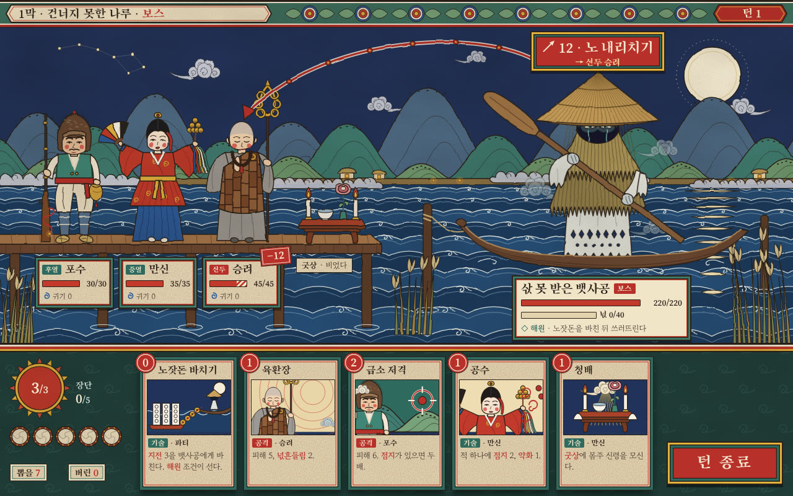

# s1 · 민화·무신도 평면 채색

- 원본: `index.html` (SVG를 스크립트로 그린다. 외부 그림 없음)
- 다시 렌더: `node docs/design/style-study/s1-minhwa/render.mjs` → `shot-1280x800.png` · `shot-1280x800.jpg`
- 글꼴(Google Fonts): Song Myung(제목·이름·숫자) · Gowun Batang(본문)

## 화풍 갈래
조선 후기 민화와 무신도의 채색 문법. 윤곽은 가는 먹선 하나로 두르고, 안은 그림자 없이 불투명한 색면으로 메운다.
- 인물은 정면에 선 위계적인 자세다. 머리가 크고 볼에 붉은 점을 찍는다.
- 오방색은 옷과 무구에 쓴다. 바탕은 쪽빛 밤과 장지색 종이로 누른다.
- 배경도 모두 문양으로 그린다. 구름은 영지운 덩이, 산은 겹 봉우리에 태점, 강은 말린 물마루가 줄지어 선 물결이다. 달빛 반사는 마름모 띠로 처리했다.
- UI 틀은 단청을 따랐다. 머리띠의 주화 문양, 현판처럼 짠 이름판, 번(幡) 모양의 의도 배지, 비단으로 표구한 카드다. 비용은 붉은 인장 모양이다.

## 참고 게임 (이름만)
Pentiment(필사본·판화 화풍을 화면 문법으로), Okami(전통 회화 양식을 게임 전체에 — 일본 양식이라 형식만 참고), Inkulinati(장식 테두리와 평면 인물), The Banner Saga(평면 색면 배경).

## 이 시안이 보여 주는 것
- 같은 정보를 평면 채색으로 그렸을 때의 **가독성**. 색면이 깨끗해 이름판·체력·의도가 아주 잘 읽힌다.
- 영웅 셋을 **색과 무구로 바로 구분**할 수 있다.
  - 포수: 털모자, 청록 조끼, 세운 화승총과 불씨, 화약 주머니
  - 만신: 홍철릭, 쪽빛 치마, 오방 부채, 일곱 방울과 오색 천
  - 승려: 민머리, 잿빛 장삼, 조각보 가사, 염주, 여섯 고리 육환장
- 원귀는 넋전처럼 오린 아랫자락에 그늘진 얼굴과 눈물 자국을 그렸다. 무섭기보다 처연하게.
- 단청·현판·인장으로 짠 UI가 무대와 한 화풍으로 묶인다.

## 못 보여 주는 것
- 움직임, 피격과 해원 연출, VFX. 정지 화면 한 장뿐이다.
- 코드로 그린 근사치라서 실제 민화 화원의 붓맛(선의 굵기 변화, 안료가 뭉친 결)은 흉내만 냈다. 경로가 단순해 "평면 벡터 일러스트"처럼 보이는 곳이 남는다.
- 1920×1080, 다른 장면(마을·지도·해원 순간)에서 이 화풍이 어떻게 버티는지.

## 본 제작이라면 필요한 것
- 민화와 채색화를 다룰 수 있는 일러스트레이터가 필요하다. 장지 위 광물 안료의 색감과 바림을 디지털 브러시 세트로 정리해야 한다.
- 문양 라이브러리를 만든다(단청 머리초·구름·물결·산). UI와 배경이 같은 부품을 쓰게 한다.
- 컷아웃(Spine) 리그. 정면 위계 자세라서 부품 수가 적고, 꼭두처럼 딱딱한 움직임이 오히려 어울린다.
- 밤 장면 색 대본. 오방색이 UI 색(공격 적·기술 청)과 부딪히지 않게 채도 상한을 둔다.
- **감수**: 무신도는 신체(神體)다. 영웅·신령이 실제 무신도 도상으로 읽히지 않는지 아트 단계에서 무속 연구자에게 확인받는다.

## 솔직한 평가 — 이 게임에 맞는가
**가독성과 문화 정체성은 가장 좋고, 공포와 애도는 가장 약하다.**
- 민화의 해학적이고 축제 같은 기운이 밝은 색과 붉은 볼 점을 타고 그대로 올라온다. "건너지 못한 넋을 보낸다"는 처연함보다 잔칫날 그림처럼 읽힐 위험이 크다.
- 보스는 처연하게 그렸지만 화면 전체가 즐겁다.
- 그래서 전투 화풍으로는 단독 채택을 권하지 않는다.
- 대신 본진(마을)·해학 장면(검문 놀이·탈꾼·대감 가호)·카드 테두리·UI 장식에는 아주 잘 맞는다. 다른 시안(예: s2 그림자극)의 무대와 섞는 혼합안이 현실적이다.
- 제작비는 셋 중 가장 낮다. 평면 색면과 컷아웃이라서다.
