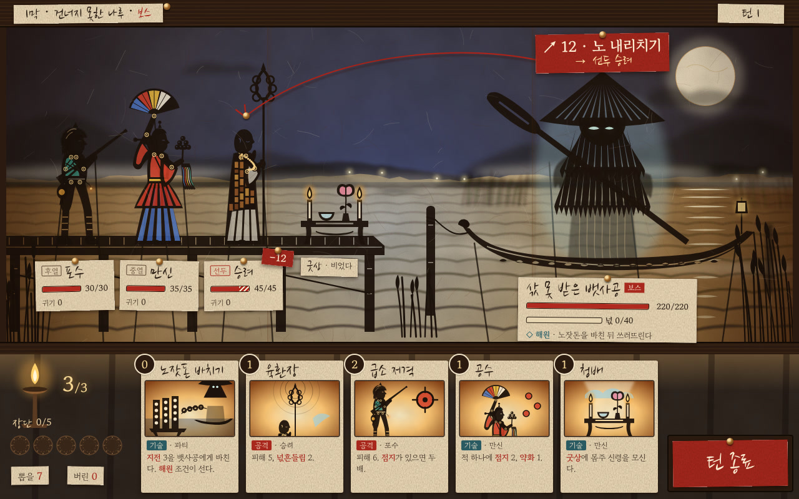

# s2 · 그림자극 (만석중놀이)

- 원본: `index.html` (SVG를 스크립트로 그린다. 외부 그림 없음)
- 다시 렌더: `node docs/design/style-study/s2-shadow/render.mjs` → `shot-1280x800.png` · `shot-1280x800.jpg`
- 글꼴(Google Fonts): Nanum Brush Script(종이쪽 손글씨·이름) · Gowun Batang(숫자·본문)

## 화풍 갈래
등잔불로 뒤에서 비춘 한지 막 위의 그림자극. 만석중놀이 같은 우리 그림자 연희의 형식이다.
- 인물은 옆모습 실루엣이다. 어깨·팔꿈치·엉덩이에 관절 실매듭이 빛나고, 아래에서 받친 조종 막대가 보인다.
- 색은 오려 낸 구멍에 댄 **색 한지**에서만 나온다: 만신의 홍철릭·쪽빛 치마·오방 부채, 포수의 청 조끼, 가사의 조각보, 원귀의 푸른 눈.
- 깊이는 흐림으로 낸다. 막에서 멀수록(등잔에 가까울수록) 그림자가 흐려진다. 먼 산, 먼 갈대, 안개, 막대 순으로 흐리다.
- 원귀는 얇은 종이(넋전)로 만든 반투명 그림자다. 삿갓·도롱이·노만 불투명한 물건이다.
- 밤은 쪽물 들인 한지를 위에 덧대서 만들었다. 달은 그 한지를 둥글게 오려 낸 자리다. 달빛 반사는 물결 그림자 사이로 빛이 새는 틈이다.
- 읽어야 할 정보(이름판·체력·의도·카드)는 막 **앞에 압정으로 꽂은 종이쪽**이다. 그래서 언제나 선명하다. 의도 선은 붉은 실을 종이쪽에서 승려 머리 위 압정까지 걸어 표현했다.

## 참고 게임 (이름만)
Projection: First Light(그림자극 인형을 쓴 퍼즐 플랫포머), Limbo · Inside(실루엣만으로 읽히는 형태), Tengami(종이 재료감).

## 이 시안이 보여 주는 것
- 애도·의례의 분위기. 등잔 하나가 비추는 막이 곧 굿판이고, 무대가 종이라는 사실이 "넋을 보낸다"는 서사와 이어진다.
- **넋전 = 반투명 그림자**라는 재료 문법. 해원은 종이가 밝아지며 막에서 떨어지는 것으로, 처치는 그림자가 구겨져 짙어지는 것으로 연출할 수 있다.
- 실루엣만으로도 표지가 선다.
  - 포수: 털모자 가장자리, 화승총과 불씨, 주머니
  - 만신: 부채 위 오방 한지, 방울 송이와 오색 천
  - 승려: 민머리, 조각보 가사, 여섯 고리 육환장
  - 보스: 삿갓 방사 틈, 도롱이 술, 노
- 관절과 막대가 보이니 **컷아웃 애니메이션의 딱딱함이 결점이 아니라 형식**이 된다.
- UI를 "꽂은 종이쪽"으로 하면 그림자 화풍 안에서도 가독성을 지킬 수 있다.

## 못 보여 주는 것
- 등잔 깜박임, 인형이 막에 붙었다 떨어질 때의 흐림 변화, 막대 움직임. 이 화풍의 매력 절반은 **움직임과 빛**에 있다.
- 오래 볼 때의 피로. 화면이 호박색 단색조라 30시간 런 동안 단조로울 수 있다.
- 상태 이상·버프 아이콘이 많아질 때의 밀도.

## 본 제작이라면 필요한 것
- 인형 설계도(부품·관절 위치·막대 부착점)와 Spine 컷아웃 리그. 막대도 리그의 일부로 움직인다.
- 실제 한지를 뒤에서 비춰 스캔한 텍스처. 섬유, 지합 얼룩, 이음매를 담는다.
- 2D 조명 셰이더가 필요하다.
  - 인형과 막 사이 거리를 파라미터로 받아 흐림·크기를 바꾼다.
  - 색 한지의 투과광을 표현한다.
  - 등잔이 흔들린다.
- VFX도 같은 문법으로 만든다: 오린 구멍으로 새는 빛, 색 한지를 겹치기, 그림자 겹침. 일반 파티클을 쓰면 화풍이 깨진다.
- 색 구분을 색 한지에만 의존하므로 색각 이상 검사가 필요하다.
- **감수**: 만석중놀이는 사월초파일 불교 연희에서 온 놀이다. 무속 굿판의 전투 무대로 형식을 빌려도 되는지, 불교 장엄과 굿청을 섞지 말라는 원칙(표현 조사 §4.5)과 부딪히지 않는지 확인해야 한다. "그림자 연희 일반"으로 추상화하는 길도 있다.

## 솔직한 평가 — 이 게임에 맞는가
**분위기와 재료 문법은 셋 중 가장 잘 맞는다.** 애도·민속 공포·해원(종이가 풀려 떠남)이 화풍의 성질만으로 나온다. 꼭두·넋전이라는 기존 표현 방향(목인·한지)과도 직접 이어진다.
- 약점은 둘이다.
  - ① 인물 개성이 실루엣과 색 한지 몇 조각에 갇힌다. 표정·연기로 애착을 만들기 어렵다. 초상·대화 장면은 다른 표현이 필요할 수 있다.
  - ② 화면 전체가 한 색조다.
- 그래도 이 시안을 전투 무대의 1순위로 권한다. 해원 순간을 가장 아름답게 만들 수 있는 화풍이다.
- 제작비는 중간이다. 그림 자체는 단순하고, 셰이더·조명 작업이 비용을 차지한다.
