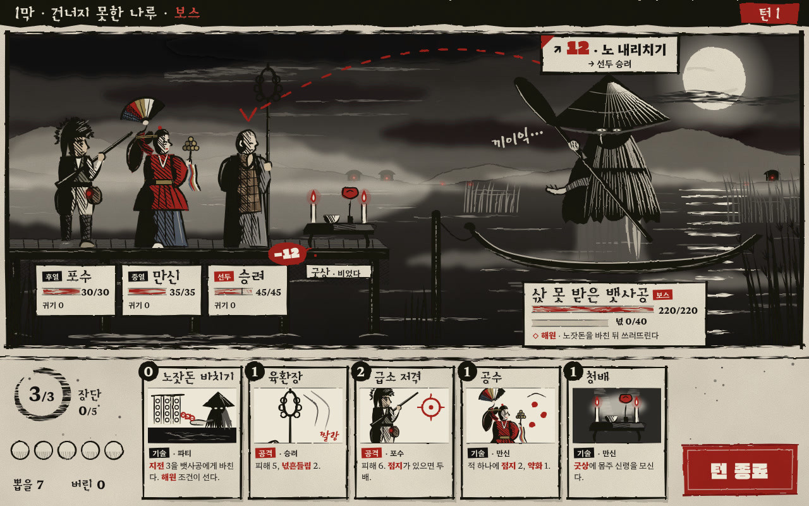

# s3 · 굵은 먹선 그래픽 노블

- 원본: `index.html` (SVG를 스크립트로 그린다. 외부 그림 없음)
  - 붓 획: 중심선에 굵기 곡선을 줘 채운 도형으로 그린다. 들어갈 때는 뭉툭하고(기필) 나갈 때는 가늘다(수필).
  - 빗금: 영역을 잘라 손으로 그은 선처럼 흔들었다.
  - 먹 번짐: feTurbulence 변위와 물자국 테로 냈다.
- 다시 렌더: `node docs/design/style-study/s3-ink-novel/render.mjs` → `shot-1280x800.png` · `shot-1280x800.jpg`
- 글꼴(Google Fonts): Black And White Picture(이름·제목) · Gasoek One(큰 숫자·턴 종료) · East Sea Dokdo(소리 글자) · Hahmlet(본문·숫자)

## 화풍 갈래
한국 수묵 붓선을 바탕으로 한 흑백 그래픽 노블.
- 달빛은 오른쪽 위에서 온다. 인물의 그늘 쪽은 먹으로 메우고, 그 경계에 빗금과 겹빗금을 친다.
- 검은 면(털모자·삿갓·도롱이·노)은 달빛 받은 짚 결을 흰 획으로 긁어 낸다.
- 하늘은 번진 먹구름, 물은 마른 붓 반사로 그렸다. 달은 비워 둔 종이다.
- 색은 뺐다. 회색 바림과 바랜 갈색·쪽빛만 남겼다.
- **짙은 붉은 먹만이 강조색**이다. 의도 선, 의도 수치, 피해 −12, 체력, 만신의 홍철릭, 불씨, 촛불, 지화, 턴 종료 낙관에 쓴다.
- 칸 테두리와 캡션 상자, 소리 글자("끼이익…")가 그래픽 노블 형식을 맡는다.
- 에너지는 원상(먹 동그라미)이고, 턴 종료는 붉은 낙관이다.

## 참고 게임 (이름만)
MadWorld(흑·백·적 3색 대비), The Mooseman(민속 신화를 단색으로), Black Book(민속 공포 카드 RPG — 분위기 비교), Okami(붓선 양식 — 일본 수묵이라 형식만).
- **Darkest Dungeon은 따르지 않았다.** 서양 목판화식 칼선, 고딕 질감, 극단적 캐리커처 비례 대신 다음을 썼다:
  - 먹의 번짐과 마른 붓
  - 기필·수필이 있는 붓 획
  - 원상과 낙관
  - 우리 복식의 3/4 인물

## 이 시안이 보여 주는 것
- 셋 중 가장 강한 **민속 공포**.
- 붉은색을 게임 의미(위협·피해·체력)에만 쓰면 강조색이 곧 **가독성 장치**가 된다. 의도 선과 −12가 화면에서 가장 먼저 눈에 들어온다.
- 원귀를 악마가 아니라 **처연하게** 그리는 방법을 보여 준다.
  - 앙상한 손목으로 노를 치켜들었다.
  - 다른 손은 빈 손바닥을 내밀어 삯을 청한다.
  - 삿갓 그늘 속에는 두 눈과 한 줄 눈물 자국만 남겼고, 아랫자락은 안개로 풀린다.
  - 고어는 쓰지 않았다.
- 영웅 표지가 흑백에서도 살아 있다.
  - 포수: 털모자, 화승총 불씨, 주머니
  - 만신: 붉은 철릭, 쪽빛 치마, 가라앉힌 오방 부채, 방울
  - 승려: 민머리, 조각보 가사, 염주, 여섯 고리 육환장

## 못 보여 주는 것
- 진짜 먹과 붓의 질감. 코드 획은 일정하고 깨끗해서 실제 붓의 갈필·삼투를 다 담지 못한다.
- 움직임. 먹선 애니메이션(선 떨림, 프레임마다 다시 그리기)은 이 화풍의 가장 큰 비용이자 매력인데, 정지 화면으로는 판단할 수 없다.
- 작은 화면이나 축소된 카드에서 빗금이 무아레를 일으키는지.

## 본 제작이라면 필요한 것
- 실제 먹으로 그린 획·번짐·튐 스캔 라이브러리, 그리고 그것을 쓰는 브러시와 셰이더(종이 결, 번짐 테).
- 선 굵기 규칙(무대·카드·초상별 최소 굵기)과 빗금 규칙. 1280 해상도에서 최소 간격을 정해 무아레를 막는다.
- 명도 설계. 검은 면이 많아 UI 상자·이름판이 묻히기 쉽다. 이 시안에서도 일행 뒤에 달빛 안개를 깔아 인물과 배경을 떼어 냈다.
- 붉은색 사용 규칙. 의미가 없는 곳(장식)에 쓰지 않는다.
- 한글 손글씨와 소리 글자를 레터러에게 맡긴다. 기성 글꼴로는 한계가 있다.
- 애니메이션은 컷아웃에 선 떨림 셰이더를 쓰거나, 핵심 동작만 프레임 애니메이션으로 만든다.

## 솔직한 평가 — 이 게임에 맞는가
**분위기와 개성은 강하고, 위험도 가장 크다.**
- 장점
  - 먹은 그 자체로 한국 시각 문화의 재료다.
  - 붉은 강조색은 덱빌더 가독성에 그대로 쓸 수 있다.
  - 원귀를 처연하게 그리는 데 표현력이 넉넉하다.
- 위험 ① "어두운 수묵 사무라이" 같은 일본·범동아시아 이미지로 미끄러지기 쉽다. 굿청의 종이꽃·오방기·넋전 같은 무속 고유 소재를 화면에 꾸준히 넣어야 정체성이 선다.
- 위험 ② 화면이 무거워 30시간 동안 피로하다. 해원 같은 "풀림" 순간에 색과 빛이 돌아오는 대비 설계가 필요하다(예: 해원 때만 오방색이 번져 나온다).
- 위험 ③ 손그림 먹선은 인력이 많이 든다. 셋 중 제작비가 가장 높다.
- 권하는 쓰임: 보스전과 이야기 컷신의 강조 화풍, 또는 s2 그림자극과 함께 쓰는 혼합안(전투는 그림자 막, 컷신·카드 그림은 먹선).
