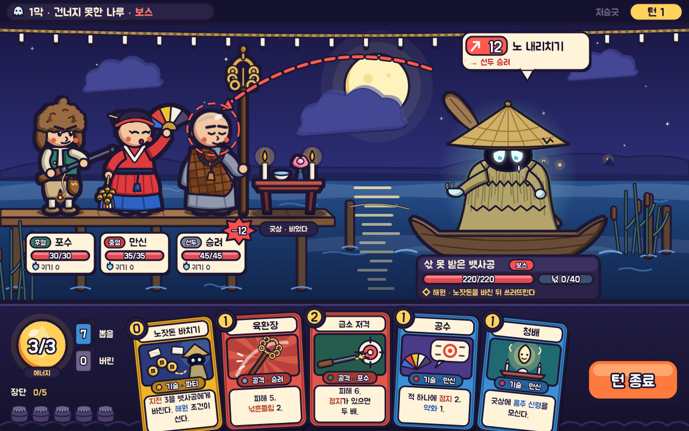

# s4 · 카툰 셀

다시 그리기: `node docs/design/style-study/s4-cartoon/render.mjs` → `shot-1280x800.png`·`.jpg`

## 화풍 갈래
- 현대 인디 로그라이크의 **카툰 셀**: 고르고 굵은 먹선(바깥 실루엣 약 5px, 안쪽 선 3.5px) + **그림자 한 단**(셀) + 단순한 큰 모양.
- 3등신 안팎. 머리가 크고 몸·팔다리는 짧다. 눈은 점, 볼에는 무신도에서 빌린 붉은 점.
- 색: 채도는 높게 두되 밤빛(남보라)으로 누른다. 하늘·물은 부드러운 그라데이션, 인물·소품은 평면 두 색.
- 글꼴: Jua(둥근 굵은 고딕), 숫자는 Do Hyeon. 둘 다 Google Fonts.

## 참고 게임 (이름만)
Cult of the Lamb · Wildfrost · Spiritfarer · Dicey Dungeons · Castle Crashers · Slay the Spire 2.
(어느 것의 캐릭터·UI도 본뜨지 않았다. Spiritfarer는 "죽음·뱃사공"이 겹치므로 본 제작에서는 오히려 거리를 둬야 한다.)

## 이 시안이 보여 주는 것
- 같은 장면을 **멀리서도 읽히는 실루엣**으로: 털모자·화승총(포수), 홍철릭·푸른 치마·오방색 부채·방울(만신), 민머리·조각보 가사·염주·육환장(승려)이 한눈에 갈린다.
- 원귀가 **무섭기보다 슬프고 귀엽다**: 처진 눈빛·눈물 한 방울·삯을 청하는 빈 손바닥. 혐오·고어 없이도 "풀어 보낼 넋"이 전해진다.
- 의도(빨간 점선 + 승려 머리 과녁), 이름판, 손패까지 **같은 먹선 문법**으로 묶어 UI와 그림이 한 몸처럼 보인다.
- 카드 그림이 작아도 모양이 단순해서 읽힌다(엽전·지전, 여섯 고리, 과녁, 오방 부채, 굿상).
- 금줄은 흰 한지 술로 그렸다(일본식 지그재그 종이를 피함).

## 못 보여 주는 것
- 움직임: 카툰은 **스쿼시·스트레치와 과장된 타이밍**이 반이다. 정지 화면으로는 그 맛을 못 보인다.
- 손그림 선의 굵기 변화·떨림. 이 시안은 코드로 그린 균일한 선이라 실제 카툰보다 딱딱하다.
- 공포 쪽 끝: 보스전 연출(어두워짐·물결 왜곡·넋의 울음)이 들어갔을 때 귀여움이 어디까지 버티는지.

## 본 제작이라면
- 캐릭터 시트(정면·3/4·옆), 표정 시트(특히 원귀: 슬픔·분노·풀림), 선 굵기 규칙 문서.
- 컷아웃(뼈대) 애니메이션 — Spine 같은 도구. 꼭두(목인) 조형 언어와 잘 맞아 "인형처럼 딱딱한 움직임"을 특징으로 삼을 수 있다.
- 영웅 8명 × 대기·공격·피격·쓰러짐, 원귀마다 해원(구김이 펴짐)·처치(주저앉음) 두 갈래.
- 배경은 겹 평면(민화식) 3~4장, 시간대별 색 보정표.
- 비용 감: 셋 중 **가장 싸고 빠르다**. 아트 1~2명이 일정한 품질을 유지하기 쉽다.

## 솔직한 평가 — 이 게임에 맞는가
- **장점**: 가독성 최고, 제작비·속도 유리, 스팀 인디 로그라이크 시장의 문법과 맞다. 꼭두가 원래 "장난스럽고 익살맞은" 장례 조형이라 귀여움 자체가 고증에서 벗어나지 않는다.
- **위험**: 애도·해원·민속 공포의 **무게가 가벼워질 수 있다**. 무당을 우스꽝스럽게 그리는 캐리커처로 읽히면 재현 윤리(무당·재가집을 조롱하지 않는다)에 걸린다 — 표정은 진지하게, 과장은 몸 비례에서만.
- **차별성**: 보통. 카툰 로그라이크가 많아서 "한국 무속"이 화면에서 먼저 보이려면 금줄·지화·오방색·한지 질감 같은 모티프를 더 앞에 세워야 한다.
- 결론: **"슬프고 귀여운" 쪽으로 가는 안전한 선택지.** 공포보다 위로가 앞서는 게임으로 정한다면 1순위 후보.
