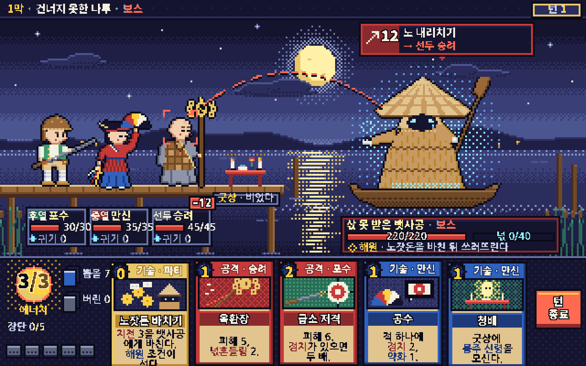

# s5 · 픽셀 아트

다시 그리기: `node docs/design/style-study/s5-pixel/render.mjs` → `shot-1280x800.png`·`.jpg`

## 화풍 갈래
- **진짜 저해상도**: 그림은 320×200 캔버스에 그리고 최근접 ×4로 1280×800에 올렸다(흐림 없음).
- 팔레트 **32색** 고정(밤 남색 8단 · 한지·달빛 · 짚·나무 · 피부 · 홍·청·녹 · 원귀 청록). 모든 점은 이 32색 중 하나다.
- 디더링은 **골라서만**: 달무리, 하늘 띠 경계, 안개 띠, 물빛, 원귀의 서늘한 빛, 카드 그림 바탕. 인물에는 디더 없이 깨끗한 덩어리.
- 영웅 키 40~48px(원본 화소). 빛은 달 쪽에서 오고 반대쪽 가장자리에 그늘 한 단, 바깥은 1px 검은 테두리.
- UI도 같은 화소 격자: 틀·막대·북·비용 구슬·턴 종료 단추는 원본 해상도에서 찍었다.

## 글자 — 픽셀 한글 글꼴에 대해
- 픽셀 한글 글꼴 **갈무리(Galmuri)는 Google Fonts에 없다**(요청 시 400). 그래서 Google Fonts의 **나눔고딕 Bold 11px**(본문)와 **Noto Sans KR 700/900**(이름·숫자)을 **640×400 격자(×2)에 문턱값으로 찍어** 계단 글자로 만들었다. 글자 한 점 = 화면 2×2px.
- 즉 **글자 격자가 그림 격자보다 두 배 곱다**(혼합 해상도). 320×200 그대로에서는 한글 본문이 들어가지 않는다 — 카드 한 장 폭이 44화소라 11px 한글이 4글자도 안 들어간다.
- 문턱값을 글꼴마다 따로 잡았다(11px 본문은 낮게 잡아야 "점지"의 ㅈ 삐침이 살아난다).

## 참고 게임 (이름만)
Blasphemous · The Rewinder · Eastward · Loop Hero · Peglin · Into the Breach.

## 이 시안이 보여 주는 것
- 밤 강나루를 **32색과 디더 몇 군데만으로** 세울 수 있다: 달무리·달빛 반사·안개 띠가 분위기를 거의 다 만든다.
- 40px 안팎에서도 영웅이 갈린다: 털모자+총(포수), 붉은 옷+푸른 치마+오방 부채(만신), 민머리+격자 가사+고리 지팡이(승려).
- 원귀는 삿갓·짚 도롱이 세 단·청록 눈빛·흘러내린 흰 머리·빈 손으로 읽힌다. 귀엽고도 서늘하다.
- 정보는 다 들어간다: 의도 배지·점선·과녁, 이름판(칸·이름·체력·귀기·−12), 보스판(체력·넋·해원 조건), 에너지·장단 북·뽑을/버린·턴 종료·손패 5장.

## 못 보여 주는 것
- 손으로 찍은 픽셀의 맛: 이 시안의 인물은 **도형으로 찍고 그늘·외곽선을 자동으로 얹은 것**이다. 화가가 직접 찍으면 얼굴·손·옷 주름의 덩어리가 훨씬 정돈된다(선택적 안티에일리어싱, 서브픽셀 표정).
- 프레임 애니메이션: 픽셀 아트의 생명은 움직임이다(물결 순환, 촛불, 넋빛 깜빡임, 공격 프레임).
- 글자가 많은 카드 게임에서 **저해상도 글자 피로도**. 한 화면은 버티지만 수십 판을 읽을 때는 다르다.

## 본 제작이라면
- **원본 해상도를 올린다**: 480×270(×4=1920×1080) 또는 640×360(×3). 한글 카드 본문을 그림 격자 그대로 쓰려면 이 정도가 필요하다.
- **한글 비트맵 글꼴을 게임에 넣는다**: 갈무리(SIL OFL) 같은 글꼴을 직접 포함하거나 11·12px 전용 글꼴을 만든다. 웹 글꼴 문턱값 방식은 시안용 임시방편이다.
- 팔레트 문서(32~48색, 막별 보정), 영웅 8명 × 대기 4~6프레임·공격 6~8프레임·피격·쓰러짐, 원귀 해원/처치 연출 프레임.
- 비용 감: 한 장면당 그림은 싸지만 **애니메이션 프레임 수가 곧 비용**이다. 숙련된 픽셀 화가 1명 이상 필수.

## 솔직한 평가 — 이 게임에 맞는가
- **장점**: 민속 공포와 궁합이 좋다(어둠·디더·제한된 색이 무서움을 상상에 맡긴다). 인디 시장 친화적이고, 무구·복식을 "기호"로 압축해야 해서 오히려 고증 부담이 줄어든다(실물 도상을 복제할 해상도가 아니다).
- **약점**: 이 게임은 **카드 글이 많고 한국어다**. 글 가독성이 픽셀 화풍의 가장 큰 짐이다. 또 40px에서는 염주·육환장 여섯 고리 같은 세부가 "점 몇 개"가 된다 — 무구가 게임의 정체성인 만큼 아쉽다.
- **차별성**: 높음. "한국 무속 + 픽셀"은 드물다.
- 결론: **분위기는 가장 잘 맞지만 글 때문에 해상도를 올려야 한다.** 480×270 이상 + 한글 비트맵 글꼴을 전제로 하면 강한 후보.
