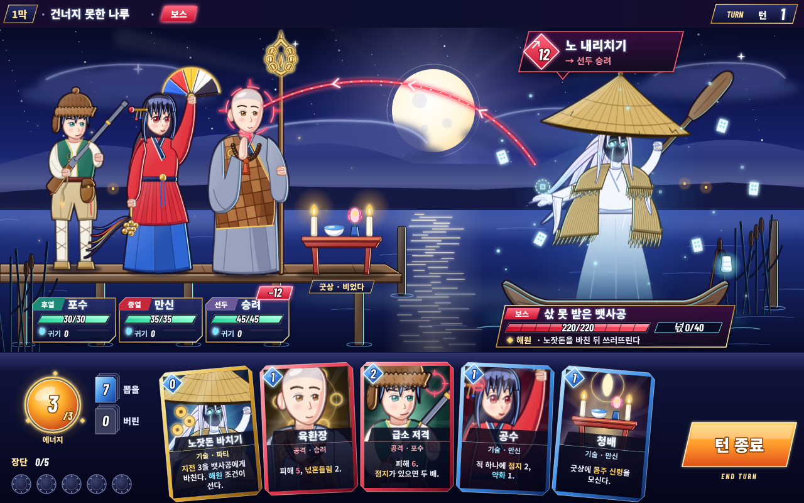

# s6 · 애니메·서브컬처 2D

다시 그리기: `node docs/design/style-study/s6-anime/render.mjs` → `shot-1280x800.png`·`.jpg`
(개발용: `index.html?view=x,y,w,h` 로 한 곳을 크게 볼 수 있다.)

## 화풍 갈래
- 한국·동아시아 **수집형(가챠)·서브컬처** 문법: 이상화된 5.5~6등신, 큰 눈(홍채 그라데이션·하이라이트 두 점·굵은 윗눈꺼풀), 맑은 색 선화(재질마다 그 색의 어두운 선).
- 칠: **셀 두 단 + 부드러운 그라데이션 + 림라이트**. 주광은 왼쪽 앞, 림은 오른쪽(달과 원귀의 푸른빛). 원귀는 반대로 달 쪽 림.
- 빛 효과: 달빛 살·달무리·반짝이는 물길, 원귀 둘레 청록 넋빛과 떠도는 지전, 굿상 촛불의 따뜻한 빛, 붉은 겨냥 빛줄기와 과녁.
- UI: 비스듬한 판, 금테, 광택 막대(마디 표시), 보석 비용, 희귀도 색 테두리 카드, 빛나는 턴 종료 단추. 글꼴은 Noto Sans KR(500/700/900) + 숫자 Barlow Condensed 기울임.

## 참고 게임 (이름만)
Epic Seven · Limbus Company · Chaos Zero Nightmare · Arknights · Blue Archive.
(Chaos Zero Nightmare는 우리 문서가 **배치는 따르되 화풍은 반면교사**로 꼽은 게임이다. 이 시안이 그 방향에 가장 가깝다는 점을 염두에 두고 볼 것.)

## 이 시안이 보여 주는 것
- 같은 장면이 이 문법으로 가면 **어떤 온도와 밀도**가 되는지: 색이 훨씬 밝고, 빛 효과가 많고, UI가 "게임 상품"처럼 반짝인다.
- 영웅을 **매력적이고 영웅답게** 그리면서 복식 표지를 지킨 예: 승려는 민머리·장삼·조각보 가사·염주·육환장 그대로(꾸밈 없이), 만신은 홍철릭·푸른 치마·오방 부채·오색 천 방울, 포수는 털모자·조끼·행전·화승총·화약 주머니. 노출·팬 서비스 없음.
- 원귀를 **비극적으로 아름답게**: 흩날리는 흰 머리, 그늘 속에서 빛나는 처진 눈과 빛 눈물, 삯을 청하는 빈 손 위의 텅 빈 엽전 자리, 안개로 풀리는 소복 자락.
- 카드 그림이 **캐릭터 얼굴**이 되는 구조(같은 캐릭터 그림을 크게 잘라 씀) — 수집형 카드 UI의 핵심.

## 못 보여 주는 것 (솔직하게)
- **진짜 일러스트와의 거리**가 크다. 이 시안은 SVG 경로·그라데이션·하이라이트로 만든 "벡터 애니풍"이다. 실제 이 장르는:
  - 얼굴 하나에 수십 겹의 칠(볼 홍조·입술·눈 반사광·속눈썹 낱개), 머리카락 결과 빛 띠의 정교한 붓질,
  - 정확한 해부(손가락·관절·옷 주름의 무게),
  - Live2D·Spine 같은 **변형 애니메이션**(숨쉬기·머리카락 흔들림·옷자락), 필살기 컷신
  으로 승부한다. 이 시안의 손은 단순화된 주먹, 얼굴은 평면에 가깝고, 움직임은 전혀 없다.
- 그러니 이 그림으로 판단할 것은 **색·빛·UI 언어·밀도·분위기의 방향**이지, 캐릭터 일러스트의 품질이 아니다.

## 본 제작이라면
- 영웅마다 **스탠딩 일러스트**(고해상도, 2~3 표정) + **전투용 Live2D/Spine 모델** + 카드 일러스트 다수(카드마다 별도 그림이 이 장르의 기대치).
- 이펙트 전담(파티클·셰이더): 의도 빛줄기, 넋빛, 해원 연출(빛으로 풀려 오르는 넋), 필살기.
- UI 전담: 금테·광택·희귀도 체계, 다국어 글꼴 규칙.
- 비용 감: 셋 중 **가장 비싸다**. 캐릭터 한 명당 일러스트+리깅+이펙트가 카툰·픽셀의 몇 배다. 외주 일러스트레이터 여럿과 감수 일정이 필요하다.

## 솔직한 평가 — 이 게임에 맞는가
- **장점**: 한국·아시아 시장에서 **눈길을 끄는 힘**과 캐릭터 애착(수집·팬덤)이 가장 크다. 영웅 8명의 개성을 팔기 쉽다.
- **위험 1 — 어조**: 반짝이는 UI·이상화된 미형·화려한 빛은 **애도·해원·민속 공포**와 쉽게 어긋난다. 원귀를 "예쁜 보스"로 소비하게 만들 수 있다.
- **위험 2 — 재현 윤리**: 무당·승려를 아이돌처럼 미화하면 실제 신앙 공동체에 대한 존중 문제가 생기고, "신비한 동양" 이국화로 흐르기 쉽다. 신령을 가상 이름·굿상 설치물로만 두고 실물 도상을 본뜨지 않는다는 원칙(표현 조사 §4.1·§5)도 미형 캐릭터화와 부딪히기 쉽다.
- **위험 3 — 비용·규모**: 덱빌더 로그라이크(가챠가 아닌 단품)라면 이 화풍의 기대 품질을 맞출 예산이 문제다.
- **차별성**: 낮다. 같은 문법의 게임이 많고, 우리 문서가 반면교사로 둔 방향과 겹친다.
- 결론: **시장성은 가장 크지만 이 게임의 정체성과는 가장 멀다.** 쓴다면 UI 광택·이펙트 밀도를 크게 낮추고, 원귀·신령은 사람 미형이 아닌 한지·넋전 재료로 두는 "절충"이 필요하다.
