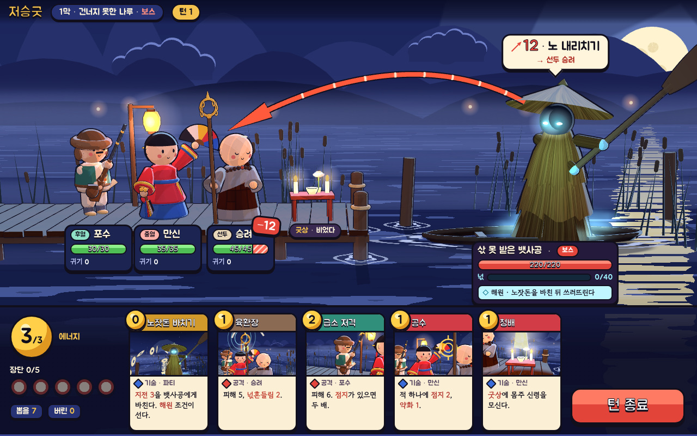

# s7 — 3D 툰 셰이딩



- **화풍 갈래**: 셀(툰) 셰이딩 3D. 둥글고 뭉툭한 2.5~3등신 인형, `MeshToonMaterial` 3단 그라디언트, 뒤집은 껍질(inverted hull) 먹선, 달빛 쪽에서만 켜지는 단단한 림, 무신도식 볼연지. 배경은 계단식 달무리 · 겹친 원 구름 · 줄무늬 잔물결의 양식화된 밤 강.
- **참고 게임(이름만)**: 젤다의 전설 바람의 지휘봉, 니노쿠니, 하이파이 러시, 드래곤 퀘스트 XI, A Short Hike.
- **원본**: `src/main.ts`(장면) · `src/style.css`(겹 UI) · `src/index.html`, 공통 `../_kit-3d/`(정보 · 빌드 · 촬영). `index.html` 은 묶은 한 장(오프라인에서 열림, 글꼴 Jua · Gowun Dodum 부분집합 내장).

## 보여 주는 것
- 같은 구도(왼쪽 파티 · 가운데 굿상 · 오른쪽 배 위 원귀)를 살짝 내려다보는 3D 카메라로. 의도 선은 **3D 관**(먹선 있는 붉은 호 + 화살촉)으로 뱃사공 → 승려 머리.
- 복식 표지가 덩어리로 읽힌다: 포수(털 테 모자 · 청록 조끼 · 세운 화승총 · 불씨 · 화약 주머니), 만신(홍철릭 · 푸른 치마 · 오방색 부채 · 방울과 오색 끈), 승려(민머리 하이라이트 · 잿빛 장삼 · 조각보 가사 · 큰 염주 · 고리 여섯 육환장), 뱃사공(삿갓 · 세 단 도롱이 · 그늘진 얼굴에 푸른 눈 · 뒤로 치켜든 노 · 발치의 넋 안개).
- 따뜻한 등불 · 촛불(산 사람 쪽)과 찬 달 · 원귀 빛(넋 쪽)의 색 대비. 물은 셰이더로 그린 줄무늬 · 달빛 기둥 · 말뚝 둘레 물거품.
- **카드 그림도 같은 세계를 다른 카메라로 찍은 것**(카드 전용 소품만 켠다: 지전 · 휘두른 자국 · 총불 · 점지 과녁 · 신령 빛). 3D 툰이면 카드 314장 삽화를 "무대 컷 + 덧그림"으로 뽑는 길이 열린다.

## 못 보여 주는 것
- 애니메이션(리그 · 표정 · 피격 · 해원 연출). 정지 한 장이다.
- 손으로 다듬은 모델 · 텍스처의 품질. 모두 원시 도형(구 · 돌림체 · 압출)이라 손 · 얼굴 · 옷 주름이 단순하다.
- 먹선 품질의 한계: 뒤집은 껍질은 납작한 면(부채)과 날카로운 모서리에서 끊긴다(부채는 뒤판으로 흉내 냈다). 본 제작은 깊이 · 노멀 기반 후처리 외곽선을 섞는다.

## 렌더 비용(이 저장소에서 잰 값)
- 헤드리스 크로뮴 **CPU 렌더(SwiftShader)**, 1280×800 · MSAA, 본 장면 한 프레임 가운데값 **약 300 ms**(1픽셀 readPixels 로 끝까지 기다린 값) · 그리기 호출 697 · 삼각형 15.5만 · 장면 만들기 2.1초.
- 비용의 대부분은 먹선(모든 메시를 두 번 그림)과 달빛 그림자 한 장. 실제 GPU 에서는 문제없는 규모다(내장 그래픽 60fps 예상 — 예상일 뿐, 확인 안 함).

## 본 제작이라면 필요한 것
- 인물 9명 + 원귀 · 보스 수십을 **로우폴리 모델 + 스켈레톤 리그 + 손 애니메이션**으로(Blender → glTF). 툰 램프 텍스처 · 림 · 외곽선 셰이더를 한 벌로 맞춘다.
- 무대(나루 · 길목 · 마을)를 3D 세트로. 카메라 연출(공격 시 밀기 · 해원 시 올려다보기).
- **엔진(D9)**: 웹 유지가 가능하다 — three.js(또는 Babylon.js)로 같은 결과가 나오고, 규칙 엔진(TypeScript) · Preact UI 를 그대로 쓴다. 다만 2D 안 A 의 "Spine 컷아웃" 파이프라인이 "3D 모델 · 리그 · 리타깃" 파이프라인으로 바뀌어 아트 비용이 커진다(표현 설계 §2 의 안 B 비용 1.8~2.2배에 가깝다). Godot 로 가도 규칙 엔진 이식이 필요하다.

## 솔직한 적합도 — 중하
- **가독성은 가장 좋은 축**: 덩어리 · 색 · 먹선이 분명해 의도 · 대상 · 예상 피해가 한눈에 읽힌다.
- **분위기는 맞지 않는다**: 뭉툭한 툰 인형은 "아늑하고 귀여운" 쪽으로 기운다. 애도 · 해원 · 민속 공포를 담기에 너무 밝고 장난감 같다. 팔레트를 더 어둡게 눌러도 비율 자체가 톤을 정한다.
- 고른다면 비율을 키우고(5~6등신) 외곽선을 가늘게 해 "어두운 동화" 쪽으로 옮겨야 하는데, 그러면 2D 안 A 보다 나은 점(입체 · 카메라)에 비해 비용이 너무 크다.

## 다시 렌더
```
npm install
node docs/design/style-study/_kit-3d/build.mjs s7-toon3d   # src → index.html (Google Fonts 부분집합을 받아 넣는다 — 이때만 네트워크)
node docs/design/style-study/_kit-3d/shot.mjs s7-toon3d    # index.html → shot PNG/JPG (전역 playwright, 바깥 요청은 막고 찍는다)
```
