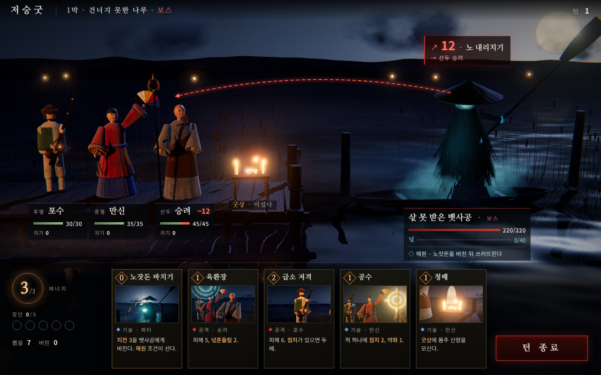

# s8 — 3D 사실풍(UE식 PBR) · 조명 · 분위기 · 카메라 시험



- **화풍 갈래**: 사실풍 3D 공포. 물리 기반 재질(`MeshPhysicalMaterial`: 천의 sheen · 옻칠 · 사기 clearcoat · 놋쇠 금속), 절차적 환경맵(밤하늘 · 달 · 먼 불빛 장면을 PMREM 으로), 그림자 · 지수 안개 · 빛 받는 안개 판, **반사하는 물**(`Water`), 후처리(블룸 → ACES 톤 매핑 → 비네트 · 필름 그레인 · 약한 색수차). 나무 · 짚 · 천 · 털 · 조각보는 모두 **잡음으로 만든 색 · 노멀 · 거칠기 맵**.
- **참고 게임(이름만)**: Clair Obscur: Expedition 33(언리얼 5 턴제 · 파티 대 적 구도), 사일런트 힐 2(2024), Hellblade: Senua's Sacrifice, The Medium, 다키스트 던전 II.
- **원본**: `src/main.ts` · `src/style.css` · `src/index.html`, 공통 `../_kit-3d/`. `index.html` 은 묶은 한 장(오프라인, 글꼴 Nanum Myeongjo · Noto Sans KR 부분집합 내장).

> **먼저 분명히**: 이 시안의 인물은 **그레이박스**다. 진짜 언리얼 품질은 스캔 · 조각한 모델, 머리카락 · 옷 시뮬레이션, Lumen(실시간 전역 조명) · Nanite(고밀도 지오메트리) · 볼류메트릭 안개 · TAA 가 있어야 나온다. three.js 로는 그 근처의 **빛 · 분위기 · 카메라**만 보여 줄 수 있고, 이 시안도 그것만 판정 대상이다.

## 보여 주는 것
- **빛의 이야기**: 화면 밖 왼쪽 앞 횃불(주광, 그림자) · 파티 앞 등불 · 굿상 촛불(점광 그림자)이 산 사람 쪽을 따뜻하게, 뒤쪽 달빛(림 · 긴 그림자)과 원귀의 찬 청록 빛이 넋 쪽을 차게. 블룸이 촛불 · 먼 기슭 불빛 · 원귀 눈을 띄운다.
- 물 위 반사(달무리 · 안개 · 말뚝 · 배), 지평 쪽에 깔린 안개 띠, 수백 가닥 짚을 인스턴스로 꽂은 도롱이, 주름 잡힌 치마 · 철릭 자락(돌림체에 세로 주름).
- 복식 표지: 포수(털모자 · 녹색 조끼 · 거의 세운 화승총 · 불씨 · 화약 주머니 · 뿔 화약통), 만신(붉은 철릭 · 푸른 주름치마 · 오방색 부채와 대살 · 놋방울과 오색 끈 · 쪽머리 비녀), 승려(빛 받는 민머리 · 잿빛 장삼 · 바랜 조각보 가사 · 염주 · 놋 육환장), 뱃사공(삿갓 · 짚 도롱이 · 검은 얼굴의 두 눈빛 · 치켜든 노).
- HUD 는 사실풍 게임의 관례대로 얇은 선 · 반투명 검은 판 · 명조 제목으로 절제했고, 의도 선은 3D 좌표에서 투영한 2D 점선.
- 카드 그림도 같은 장면 · 같은 후처리를 다른 카메라로 찍었다.

## 못 보여 주는 것
- 사람다운 얼굴 · 손 · 옷감 · 머리카락, 피부 산란. 그레이박스 마네킹이다.
- 전역 조명(빛 튕김) · 진짜 부피 안개 · 빛줄기. 안개는 잡음 판을 겹친 흉내다.
- 움직임(옷 · 물결 · 안개 흐름 · 카메라 연출) — 사실풍에서 가장 큰 설득력이 여기서 나온다.
- 어둠 속 가독성의 진짜 문제: 첫 시도는 파티가 실루엣이 되어 복식이 안 읽혔다. 화면 밖 횃불을 "연출용 주광"으로 더해야 했다 — 사실풍은 정보를 빛으로 다시 세워야 한다.

## 렌더 비용(이 저장소에서 잰 값)
- 헤드리스 크로뮴 **CPU 렌더(SwiftShader)**, 1280×800, 본 장면 한 프레임 가운데값 **약 2.9초**(s7 툰의 약 10배) · 그리기 호출 1,749 · 삼각형 78만. 물 반사가 장면을 한 번 더 그리고, 그림자 패스가 14번(점광 큐브 그림자 둘 + 방향 · 스폿), 블룸이 여러 번 흐린다.
- 장면 만들기 약 19초 — 대부분 자바스크립트로 잡음 텍스처를 굽는 시간(본 제작이면 미리 구운 텍스처).
- 실제 GPU 에서는 돌지만, 웹(WebGL)에서 이 이상(전역 조명 · 고해상 그림자 · 볼류메트릭)은 어렵다.

## 본 제작이라면 필요한 것
- 인물 · 원귀마다 고해상 조각 → 리토폴로지 → PBR 텍스처 → 리그 · 페이셜 · 모캡/키 애니메이션 · 옷 시뮬레이션. 무구 · 복식은 고증 자문과 실물 촬영(스캔).
- 무대마다 라이팅 아티스트 · VFX(안개 · 넋 · 해원 연출) · 사운드 공간화.
- **엔진(D9)**: 사실상 **언리얼 엔진**(또는 Unity HDRP)이 필요하다 → 규칙 엔진(TypeScript)을 C++/C# 로 옮기거나, 언리얼 안에서 TypeScript 를 돌리는 다리(예: Puerts)를 써야 한다 — 어느 쪽이든 "규칙 · 시뮬 · UI 가 한 코드"(D4)라는 지금의 큰 장점을 잃는다. 표현 설계 §2 의 안 B 비용(1.8~2.2배 + 엔진 이전)보다도 위다. 카드 314장 삽화는 3D 렌더로 대신하기 어려워(그레이박스 티가 난다) 따로 그려야 한다.

## 솔직한 적합도 — 낮음
- **분위기 하나는 셋 중 가장 강하다**: 촛불 · 달 · 안개 · 물 반사만으로 "건너지 못한 나루"의 공포와 쓸쓸함이 선다.
- 그러나 ① 비용 · 인원 · 엔진 이전이 프로젝트 규모를 넘는다. ② 사실풍은 원귀를 "괴물"로 밀기 쉽다 — 명세의 "원귀는 악마가 아니라 풀어 보낼 넋, 혐오 · 고어 금지"와 긴장 관계다. ③ 실제 무속 의례를 사실적으로 재현할수록 고증 · 민감도 부담이 커진다. ④ 어두운 화면은 정보 가독성을 빛 연출로 계속 메워야 한다.
- 쓸 곳이 있다면 **트레일러 · 키 아트 · 해원 컷신의 무드 기준**으로. 본 게임 화풍으로는 권하지 않는다.

## 다시 렌더
```
npm install
node docs/design/style-study/_kit-3d/build.mjs s8-real3d
node docs/design/style-study/_kit-3d/shot.mjs s8-real3d   # CPU 렌더라 30~50초 걸린다
```
