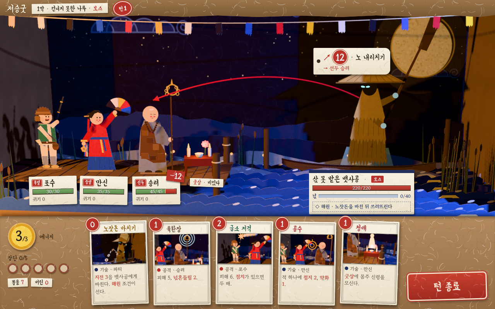

# s9 — 종이 공예 디오라마(2.5D)



- **화풍 갈래**: 손으로 만든 굿판 미니어처. **진짜 3D 상자 무대**(판지 바닥 · 벽) 안에 두께 있는 오린 종이 인형 · 소품을 받침에 세우고, **따뜻한 등(왼쪽 앞)과 찬 달빛(오른쪽 앞) 두 빛이 진짜 그림자**를 벽 · 판에 드리운다. 물은 윗단을 물결로 오린 종이 띠를 여러 줄 세운 것(앞줄이 뒷줄에 그림자), 배경은 쪽물 들인 한지에 목판으로 찍은 달 · 구름 · 별, 안개는 습자지, 무대 틀에는 오색 종이 술 줄. 살짝 비스듬한 카메라 + 얕은 피사계 심도(보케)로 "작은 모형을 찍은 사진" 느낌.
- **참고 게임(이름만)**: 페이퍼 마리오 오리가미 킹, Tearaway, 요시 크래프트 월드, Tengami, Inscryption(손으로 만든 소품의 질감).
- **원본**: `src/main.ts` · `src/style.css` · `src/index.html`, 공통 `../_kit-3d/`. `index.html` 은 묶은 한 장(오프라인, 글꼴 Yeon Sung · Gowun Batang 부분집합 내장).

## 보여 주는 것
- 2D 기준안(s0)과 다른 점: 평면 그림이 아니라 **깊이가 있는 상자 속 무대**다. 인형 · 갈대 · 술의 그림자가 판지 벽 · 한지 배경 · 나루 바닥에 실제로 떨어지고, 종이 조각 사이에도 작은 그림자가 생긴다. 조각마다 **두께와 밝은 단면(종이 속살)**, 섬유 결 범프, 판의 살짝 휜 곡면.
- 인물은 **종이 조각을 겹겹이 붙인 꼭두**: 포수(털 테가 오돌토돌한 모자 · 녹색 조끼 · 세운 화승총과 놋띠 · 불씨 · 화약 주머니 · 뿔 화약통), 만신(홍철릭 · 주름 그은 푸른 치마 · 오방색 부채 · 방울 송이와 오색 끈 · 쪽 · 비녀 · 댕기), 승려(민머리 · 잿빛 장삼 · 덧댄 조각들로 만든 **진짜 조각보** 가사 · 염주 · 고리 여섯 육환장), 뱃사공(세 단 짚 오림 도롱이 · 살을 그은 삿갓 · 검은 얼굴의 빛나는 눈 · 치켜든 노 · 습자지 넋 안개), 굿상(종이 초 · 사발 · **지화** — 무속의 지화 · 넋전 · 지전은 원래 종이 공예라 이 화풍에서는 소품이 "그 자체"가 된다).
- 의도 선은 **진짜 붉은 실**(그림자를 드리운다) + 종이 화살촉, 의도 배지는 실에 매단 한지 꼬리표. 이름판 · 카드 · 손패 띠도 한지 꼬리표 · 붉은 도장 · 판지 쟁반으로 맞췄다. 카드 그림은 같은 디오라마를 접사 카메라(보케)로 찍었다.

## 못 보여 주는 것
- 움직임: 종이 인형극식 관절(조각 회전) · 휘청이는 판 · 펄럭이는 습자지 · 그림자극 연출. 이 화풍의 매력 대부분이 여기 있다.
- 손으로 그린 얼굴 · 무늬의 품질. 지금은 도형 조각만으로 오려 단순하다.
- 실제 종이 재질의 투과광(등 뒤에서 비치는 한지) — 흉내만 냈다.

## 렌더 비용(이 저장소에서 잰 값)
- 헤드리스 크로뮴 **CPU 렌더(SwiftShader)**, 1280×800, 본 장면 한 프레임 가운데값 **약 1.2초**(s7 의 약 4배, s8 의 약 0.4배) · 그리기 호출 5,178 · 삼각형 30만 · 장면 만들기 약 4초.
- 비용은 조각 수에서 나온다: 종이 조각 하나가 메시 하나(앞면 · 단면 두 재질)이고, 스폿 그림자 두 장이 모든 조각을 다시 그린다. 본 제작이면 인물 하나를 한 메시(텍스처 아틀라스)로 합치고 정지 소품 그림자는 굽는다 — 호출 수가 수십 분의 일로 준다.

## 본 제작이라면 필요한 것
- 인물마다 **2D 부품 일러스트**(종이 결 · 단면 색 포함) → 부품을 얇은 판으로 세워 관절 애니메이션. 이것은 안 A 의 "부품 일러스트 + Spine 컷아웃"과 **같은 파이프라인**이다 — Spine 런타임은 three.js 에도 있다(spine-threejs). 같은 부품을 2D 무대 · 3D 상자 무대 양쪽에 쓸 수 있다.
- 무대 세트(상자 · 배경 한지 인쇄 · 물결 띠 · 소품)는 지역마다 한 벌. 등 · 달 두 빛의 조명 설계, 얕은 심도 · 보케 후처리.
- **엔진(D9)**: **웹 유지가 자연스럽다** — three.js(무대) + Preact(UI) + 규칙 엔진(TypeScript) 한 코드. 필요한 기술은 얇은 판 · 그림자 · 후처리뿐이라 엔진 이전 이유가 없다. PixiJS 무대를 three.js 무대로 바꾸는 것이 가장 큰 변경이다. 성능 위험은 "조각 수 × 그림자 패스"이고, 합치기 · 굽기로 다룰 수 있다(실제 GPU 확인은 아직).

## 솔직한 적합도 — 높음(셋 중 가장 높다)
- **주제와 재료가 겹친다**: 굿판의 지화 · 넋전 · 지전 · 기메가 모두 종이다. 굿판 미니어처는 "판을 벌인다"는 의례의 감각과 맞고, 표현 설계 §2 안 B 의 "굿판 그 자체"를 3D 대작 없이 얻는다.
- **가독성이 높다**: 인물이 평면 조각이라 겹침이 적고 정보판이 평면에 놓인다. 원근이 있어도 정면에서 크게 벗어나지 않는다.
- **위험**: 페이퍼 마리오처럼 "아기자기한 공작"으로 읽히면 애도 · 공포가 약해진다. 그림자극(그림자가 넋처럼 벽에 크게 드리우는 연출) · 어두운 쪽빛 · 습자지 원귀로 서늘함을 지켜야 한다. 지금 시안은 아직 따뜻한 쪽에 가깝다.
- 다음으로 해 볼 것: 인형 하나를 실제 부품 일러스트로 바꿔 보고, 해원 연출(넋 조각이 접혀 날아오르는 종이 새 · 그림자 커지기)을 움직여 본다.

## 다시 렌더
```
npm install
node docs/design/style-study/_kit-3d/build.mjs s9-papercraft
node docs/design/style-study/_kit-3d/shot.mjs s9-papercraft
```
